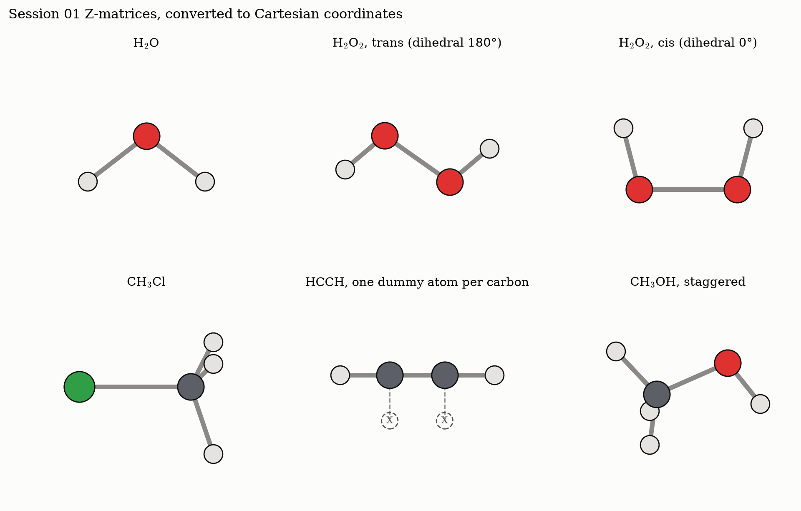
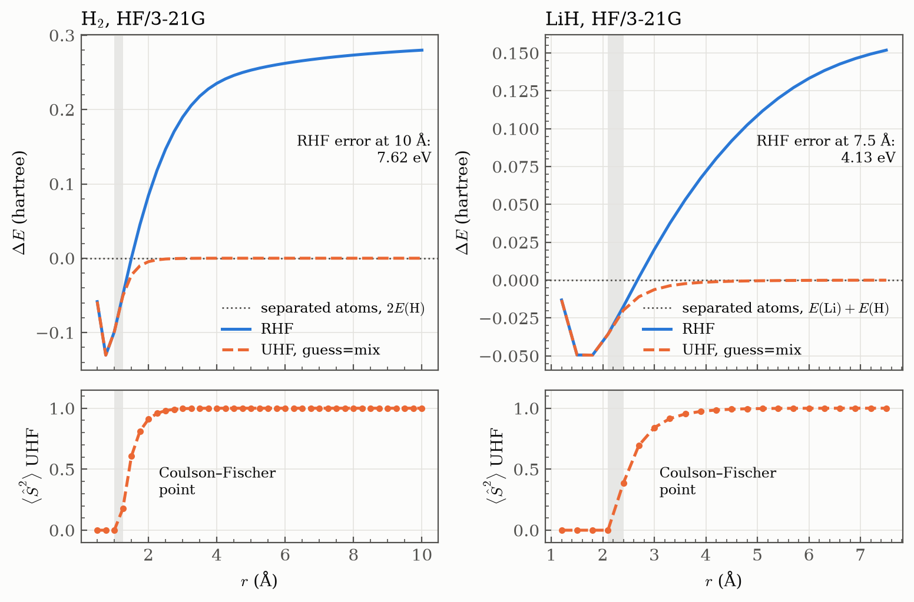

# Computational Chemistry

Coursework portfolio for a university course in computational chemistry. Each session is a short, self-contained study: the chemical questions, the calculations used to answer them, the scripts that automate them, and what the results say, with a written report when the session has one.

The aim is to show the whole workflow, not only the final numbers: how each calculation is set up, how the output is processed, and how the results are read against theory and experiment.

## Sessions

| # | Topic | Methods | Highlights |
|---|-------|---------|------------|
| 01 | [**Linux and Z-matrices**](sessions/01-linux-and-z-matrices/) | HF/3-21G · Gaussian 09 | Building molecules as Z-matrices (conformers, dummy atoms for linear molecules) and the first single-point calculations |
| 02 | [**Hartree–Fock in practice**](sessions/02-hartree-fock/) | HF, RHF/UHF · STO-3G → 6-31G(d,p) · Gaussian 09 | Basis-set convergence, bond-length scans, and the dissociation problem of RHF (H₂, LiH), with a [full report](sessions/02-hartree-fock/report/report.pdf) |
| 03 | [**Geometry optimisation and frequencies**](sessions/03-geometry-optimization/) | HF, B3LYP · STO-3G → 6-311G* · Gaussian 09 | Optimised geometries and dipoles of CH₄, H₂O, HF and NH₃ against experiment, cross-checked with Session 02; normal modes of water and ammonia, read from the displacement vectors; HF vs B3LYP geometries *(in progress)* |

<table>
<tr>
<td align="center" width="33%"><a href="sessions/01-linux-and-z-matrices/"></a><br><sub><b>01</b> · Z-matrices, drawn</sub></td>
<td align="center" width="33%"><a href="sessions/02-hartree-fock/"></a><br><sub><b>02</b> · RHF vs UHF dissociation</sub></td>
<td align="center" width="33%"><a href="sessions/03-geometry-optimization/"></a><br><sub><b>03</b> · Normal modes of NH₃</sub></td>
</tr>
</table>

More sessions will be added as the course goes on.

## Repository layout

```
.
├── README.md                      # This page
├── docs/
│   └── bash-for-gaussian.md       # Bash patterns used in every session, linked to the exact script lines
└── sessions/
    ├── 01-linux-and-z-matrices/   # Z-matrices and first calculations (no report)
    ├── 02-hartree-fock/
    │   ├── README.md              # Session overview: figures, key results, conclusions
    │   ├── report/
    │   │   ├── report.pdf         # Written report (Ex. 6)
    │   │   └── preview.png        # Thumbnail shown in the README
    │   ├── figures/               # PNG figures, built by plot_figures.py
    │   ├── plot_figures.py        # Rebuilds every figure from the data files
    │   ├── run.sh                 # Runs all Gaussian inputs in a folder, skipping finished jobs
    │   ├── ex2-basis-sets/        # One folder per exercise:
    │   ├── ex3-bond-scans/        #   README.md    task, approach, results
    │   ├── ex4-rhf-dissociation/  #   *.com        Gaussian inputs
    │   ├── ex5-uhf-initial-guess/ #   *.sh         Bash scripts, commented line by line
    │   └── ex6-rhf-vs-uhf/        #   *.txt, *.dat extracted data
    └── 03-geometry-optimization/  # Same layout, no report (yet)
        ├── README.md
        ├── figures/
        ├── plot_figures.py
        ├── run.sh
        ├── ex1-optimized-geometries/
        ├── ex2-vibrational-frequencies/
        ├── ex3-ammonia-frequencies/
        └── ex4-hf-vs-b3lyp/
```

Every session follows the same layout. A `report/` folder appears only when the session has a written report.

**Where to start:** a session README ([02](sessions/02-hartree-fock/), [03](sessions/03-geometry-optimization/)) for the results, an exercise README for the reasoning behind each step, and the [Bash guide](docs/bash-for-gaussian.md) for how the scripts work.

**What is tracked:** inputs, scripts, extracted data, figures, reports and their READMEs. Raw Gaussian outputs (`.log`, `.chk`) are left out, since everything the analysis needs is in the extracted data, and every figure can be rebuilt from the repository alone. [`.gitattributes`](.gitattributes) keeps Unix line endings on scripts and inputs, so they run on Linux even after passing through Windows.

## Tools

- **Electronic structure:** Gaussian 09
- **Automation:** Bash on Linux: job launching, input generation with `sed`, output parsing with `grep`/`awk`. See the **[Bash for Gaussian guide](docs/bash-for-gaussian.md)**
- **Figures:** Python (NumPy, Matplotlib); PGFPlots/TikZ in the reports
- **Reports:** LaTeX

## Author

Martín Llorens Giménez

---

© 2026 Martín Llorens Giménez. All rights reserved.
