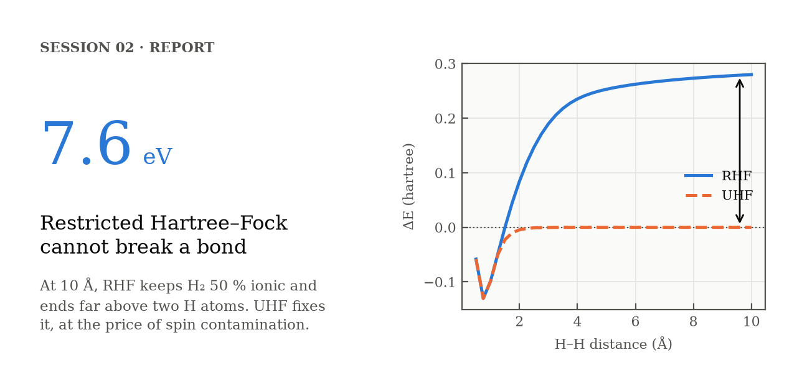
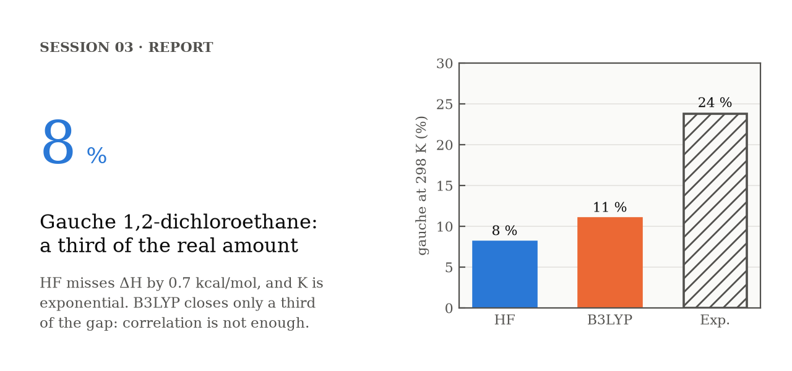
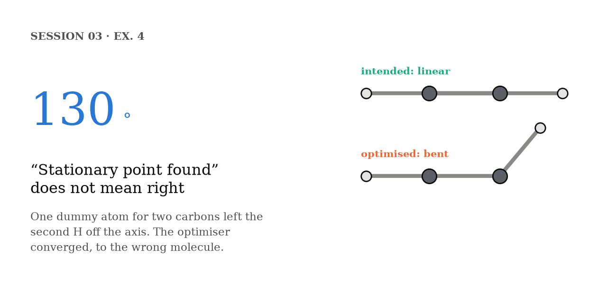
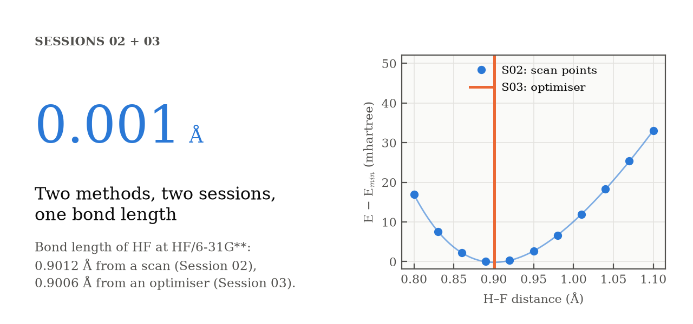

# Computational Chemistry

Coursework portfolio for a university course in computational chemistry. Each session is a short, self-contained study: the chemical questions, the calculations used to answer them, the scripts that automate them, and what the results say, with a written report when the session has one.

The aim is to show the whole workflow, not only the final numbers: how each calculation is set up, how the output is processed, and how the results are read against theory and experiment.

## Featured findings

<table>
<tr>
<td width="50%"><a href="sessions/02-hartree-fock/"></a></td>
<td width="50%"><a href="sessions/03-geometries-and-conformers/report/"></a></td>
</tr>
</table>
<table>
<tr>
<td width="50%"><a href="sessions/03-geometries-and-conformers/ex4-hf-vs-b3lyp/#acetylene-came-out-bent"></a></td>
<td width="50%"><a href="sessions/03-geometries-and-conformers/ex1-optimized-geometries/#cross-checks-with-session-02"></a></td>
</tr>
</table>

Each card links to the full story. They are drawn from the session data by [`docs/make_cards.py`](docs/make_cards.py).

## Sessions

| # | Topic | Methods | Highlights |
|---|-------|---------|------------|
| 01 | [**Linux and Z-matrices**](sessions/01-linux-and-z-matrices/) | HF/3-21G · Gaussian 09 | Describing a molecule the way Gaussian reads it: shared variables that build in symmetry, cis and trans from a single dihedral, and the dummy atoms a linear molecule cannot do without. First single points of water and methanol |
| 02 | [**Hartree–Fock in practice**](sessions/02-hartree-fock/) | HF, RHF/UHF · STO-3G → 6-31G(d,p) · Gaussian 09 | How far the basis set moves energies and bond lengths. Why restricted HF cannot break H₂, ending 7.6 eV above two H atoms, and how UHF fixes it at the price of spin contamination. [Full report](sessions/02-hartree-fock/report/report.pdf) |
| 03 | [**Geometries, frequencies and conformers**](sessions/03-geometries-and-conformers/) | HF, B3LYP · STO-3G → 6-311G* · Gaussian 09 | Optimised geometries against experiment, matching the Session 02 scans to 0.001 Å. Normal modes read from the displacement vectors. What B3LYP fixes over HF. Then three conformational problems: the gauche population of 1,2-dichloroethane ([case study and report](sessions/03-geometries-and-conformers/report/)), the anomeric effect in fluoromethanol, and glycine, where imposed symmetry hid two saddle points |

More sessions will be added as the course goes on.

## Repository layout

```
.
├── README.md                      # This page
├── LICENSE                        # MIT, for the code
├── LICENSE-CC-BY-4.0              # CC BY 4.0, for text, figures and data
├── docs/
│   ├── bash-for-gaussian.md       # Bash patterns used in every session, linked to the exact script lines
│   ├── make_cards.py              # Builds the featured-findings cards from the session data
│   └── cards/
└── sessions/
    ├── 01-linux-and-z-matrices/   # Z-matrices and first calculations (no report)
    ├── 02-hartree-fock/
    │   ├── README.md              # Session overview: figures, key results, conclusions
    │   ├── report/
    │   │   ├── report.pdf         # Written report (Ex. 6)
    │   │   └── preview.png        # Thumbnail shown in the README
    │   ├── figures/               # PNG figures, built by plot_figures.py
    │   ├── plot_figures.py        # Rebuilds every figure from the data files
    │   ├── run.sh                 # Runs all Gaussian inputs in a folder, skipping finished jobs
    │   ├── ex2-basis-sets/        # One folder per exercise:
    │   ├── ex3-bond-scans/        #   README.md    task, approach, results
    │   ├── ex4-rhf-dissociation/  #   *.com        Gaussian inputs
    │   ├── ex5-uhf-initial-guess/ #   *.sh         Bash scripts, commented line by line
    │   └── ex6-rhf-vs-uhf/        #   *.txt, *.dat extracted data
    └── 03-geometries-and-conformers/ # Same layout
        ├── README.md
        ├── report/                # Report (Ex. 5 + 6) and the case study behind it
        ├── figures/
        ├── plot_figures.py
        ├── run.sh
        ├── ex1-optimized-geometries/
        ├── ex2-vibrational-frequencies/
        ├── ex3-ammonia-frequencies/
        ├── ex4-hf-vs-b3lyp/
        ├── ex5-dichloroethane-scan/
        ├── ex6-conformer-thermochemistry/
        ├── ex7-fluoromethanol-rotation/
        └── ex8-glycine-conformers/
```

Every session follows the same layout. A `report/` folder appears only when the session has a written report.

**Where to start:** a session README ([02](sessions/02-hartree-fock/), [03](sessions/03-geometries-and-conformers/)) for the results, an exercise README for the reasoning behind each step, and the [Bash guide](docs/bash-for-gaussian.md) for how the scripts work.

**What is tracked:** inputs, scripts, extracted data, figures, reports and their READMEs. Raw Gaussian outputs (`.log`, `.chk`) are left out, since everything the analysis needs is in the extracted data, and every figure can be rebuilt from the repository alone. [`.gitattributes`](.gitattributes) keeps Unix line endings on scripts and inputs, so they run on Linux even after passing through Windows.

## Tools

- **Electronic structure:** Gaussian 09
- **Automation:** Bash on Linux: job launching, input generation with `sed`, output parsing with `grep`/`awk`. See the **[Bash for Gaussian guide](docs/bash-for-gaussian.md)**
- **Figures:** Python (NumPy, Matplotlib); PGFPlots/TikZ in the reports
- **Reports:** LaTeX

## Author

Martín Llorens Giménez

## License

© 2026 Martín Llorens Giménez.

- **Code** (`*.sh`, `*.py`, and the Gaussian inputs `*.com` and `*.zmat`): [MIT](LICENSE).
- **Everything else** (READMEs, figures, reports and their LaTeX sources, and the data files `*.txt` and `*.dat`): [CC BY 4.0](LICENSE-CC-BY-4.0). You may reuse and adapt it, including commercially, as long as you credit the author and link to this repository.
