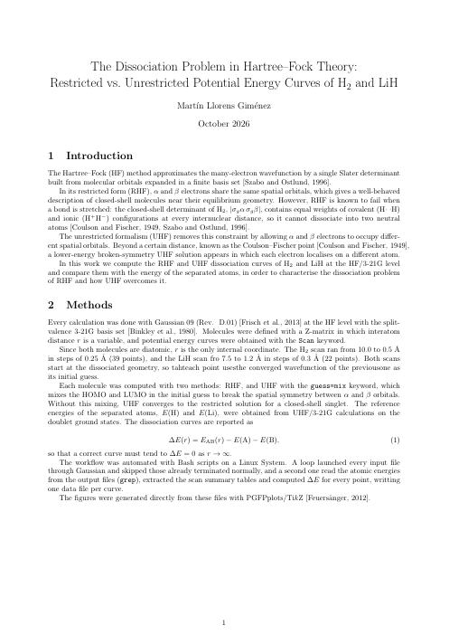
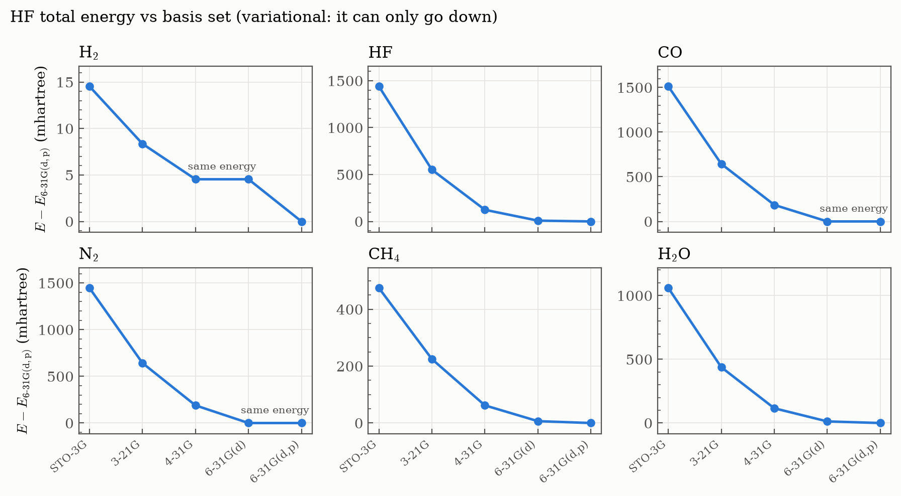
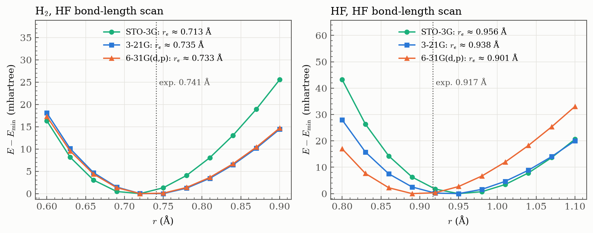
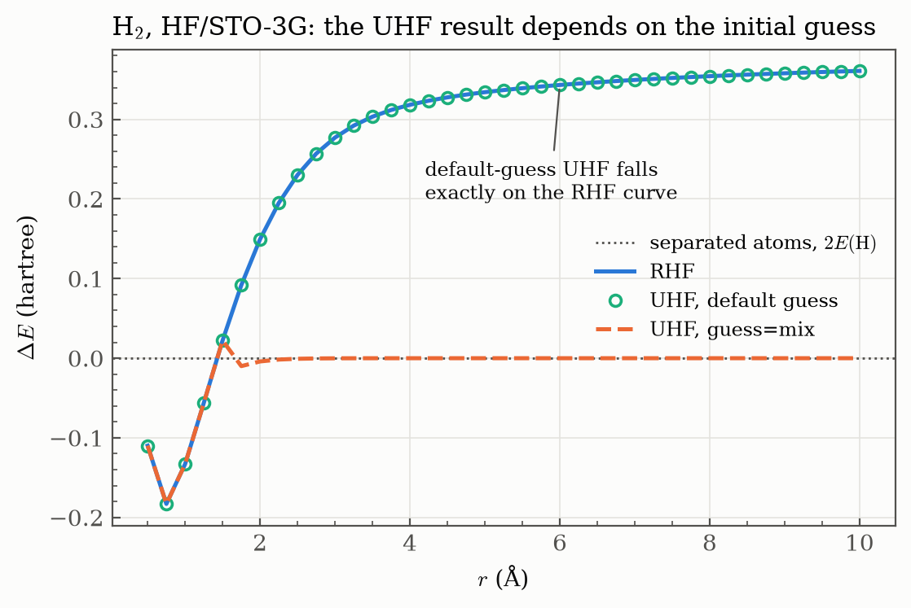

# Session 02 — Hartree–Fock in Practice

Basis sets, potential energy scans and the dissociation problem of restricted Hartree–Fock, worked through with Gaussian 09 and a set of Bash scripts that run the jobs and extract the results.

The session builds up in five exercises. The last one is written up as a full report.


<table>
<tr>
<td width="190"><a href="report/report.pdf"></a></td>
<td>

### 📄 Report: *The Dissociation Problem in Hartree–Fock Theory*
**Restricted vs. unrestricted potential energy curves of H₂ and LiH**

RHF cannot break a bond: its closed-shell determinant keeps a constant 50 % ionic weight, so H₂ ends up 7.6 eV above two H atoms. UHF with a symmetry-broken guess dissociates correctly beyond the Coulson–Fischer point, at the price of spin contamination.

**[Read the report (PDF, 3 pages) →](report/report.pdf)**

</td>
</tr>
</table>

## Contents

| Exercise | Question | Level of theory |
|---|---|---|
| [Ex. 2 — Basis sets](#ex-2--how-the-basis-set-changes-the-answer) | How do energy, dipole and charges change with the basis? | HF, STO-3G → 6-31G(d,p) |
| [Ex. 3 — Bond scans](#ex-3--equilibrium-bond-lengths) | How good are HF bond lengths? | HF, 3 basis sets |
| [Ex. 4 — RHF dissociation](#ex-4-and-5--rhf-dissociation-and-the-uhf-initial-guess) | What happens to RHF when a bond is stretched? | RHF/STO-3G |
| [Ex. 5 — UHF initial guess](#ex-4-and-5--rhf-dissociation-and-the-uhf-initial-guess) | Does UHF fix it on its own? | UHF/STO-3G ± `guess=mix` |
| [Ex. 6 — RHF vs UHF](#ex-6--rhf-vs-uhf-for-h-and-lih-report) | Full comparison for H₂ and LiH (**report**) | RHF, UHF/3-21G |

---

## Ex. 2 — How the basis set changes the answer

Single-point HF energies of six small molecules (H₂, HF, CO, N₂, CH₄, H₂O) at fixed experimental-like geometries, with five basis sets. Only the STO-3G inputs are stored: [`generate.sh`](ex2-basis-sets/generate.sh) builds the rest with `sed` and runs them.



| Total energy (hartree) | STO-3G | 3-21G | 4-31G | 6-31G(d) | 6-31G(d,p) |
|---|---|---|---|---|---|
| H₂  | −1.11676 | −1.12294 | −1.12676 | −1.12676 | −1.13129 |
| HF  | −98.57110 | −99.45988 | −99.88728 | −100.00281 | −100.01122 |
| CO  | −111.22456 | −112.09330 | −112.55236 | −112.73734 | −112.73734 |
| N₂  | −107.49598 | −108.30024 | −108.75364 | −108.94262 | −108.94262 |
| CH₄ | −39.72670 | −39.97674 | −40.13955 | −40.19506 | −40.20159 |
| H₂O | −74.96332 | −75.58550 | −75.90734 | −76.01040 | −76.02299 |

**What the numbers say**

- **The energy only goes down**, as the variational principle requires. The big step is leaving the minimal STO-3G basis: 0.6–0.9 hartree for HF, CO, N₂ and H₂O.
- **Some energies are identical, and that is correct.** In H₂, 4-31G and 6-31G(d) give the same energy: both use the same split-valence 31G functions on hydrogen, and the `(d)` only adds polarisation to heavy atoms. In CO and N₂, 6-31G(d) and 6-31G(d,p) agree because the `p` only adds polarisation to hydrogen, and there is none.
- **Mulliken charges are not a physical observable.** The charge on oxygen in H₂O moves from −0.36 (STO-3G) to −0.87 (6-31G(d)) and back to −0.67 (6-31G(d,p)). The dipole moment, which is observable, is far more stable once polarisation functions are in: 2.23 → 2.19 D.

Files: [inputs](ex2-basis-sets/) · [`generate.sh`](ex2-basis-sets/generate.sh) · [`extract.sh`](ex2-basis-sets/extract.sh) · [results](ex2-basis-sets/results.txt) (energy, HOMO, dipole, Mulliken charges)

## Ex. 3 — Equilibrium bond lengths

Rigid scans of the H–H and H–F distance (`Scan` keyword, 0.03 Å steps) with three basis sets. r<sub>e</sub> is taken from a parabola through the three points around each minimum.



| r<sub>e</sub> (Å) | STO-3G | 3-21G | 6-31G(d,p) | Exp. |
|---|---|---|---|---|
| H₂ | 0.713 | 0.735 | 0.733 | 0.741 |
| HF | 0.956 | 0.938 | 0.901 | 0.917 |

With a decent basis, HF bond lengths land within ~0.02 Å of experiment. For HF the polarised basis overshoots to a bond that is *too short*: the usual Hartree–Fock trend near the basis-set limit, which electron correlation corrects by lengthening the bond.

Files: [inputs](ex3-bond-scans/) · [`generate.sh`](ex3-bond-scans/generate.sh) · [`extract.sh`](ex3-bond-scans/extract.sh) · [results](ex3-bond-scans/results.txt)

## Ex. 4 and 5 — RHF dissociation and the UHF initial guess

H₂ is stretched from 10 Å down to 0.5 Å, and every point is referenced to two isolated H atoms, ΔE = E(H₂) − 2E(H).



- **RHF (ex. 4)** ends 0.361 hartree (**9.8 eV**) above two H atoms at 10 Å, almost twice the bond energy at this level (5.0 eV).
- **UHF with the default guess (ex. 5)** reproduces RHF *point by point*, with ⟨Ŝ²⟩ = 0 everywhere. For a closed-shell singlet the default guess has α and β orbitals identical, and the SCF has no reason to break that symmetry.
- **UHF with `guess=mix`** mixes HOMO and LUMO in the guess, which lets the solution break symmetry. Beyond the Coulson–Fischer point (between 1.5 and 1.75 Å at this level) it drops to the correct limit, ΔE → 0.

Files: [ex. 4](ex4-rhf-dissociation/) ([results](ex4-rhf-dissociation/results.txt)) · [ex. 5](ex5-uhf-initial-guess/) ([no mix](ex5-uhf-initial-guess/h2_uhf.dat), [mix](ex5-uhf-initial-guess/h2_uhfmix.dat), including ⟨Ŝ²⟩)

## Ex. 6 — RHF vs UHF for H₂ and LiH (report)

The same comparison at HF/3-21G for H₂ and LiH, written up in the [report](report/report.pdf). The figure at the top of this page shows the curves and, below them, the ⟨Ŝ²⟩ of the UHF solution: exactly 0 until the Coulson–Fischer point, then a quick rise to 1, an equal singlet–triplet mixture.

| | r<sub>e</sub> HF (Å) | r<sub>e</sub> exp. (Å) | D<sub>e</sub> HF (eV) | D<sub>e</sub> exp. (eV) | r<sub>CF</sub> (Å) | RHF error at r<sub>max</sub> (eV) |
|---|---|---|---|---|---|---|
| H₂  | 0.735 | 0.741 | 3.55 | 4.75 | ≈ 1.2 | 7.62 |
| LiH | 1.64  | 1.596 | 1.42 | 2.52 | ≈ 2.2 | 4.13 |

Experimental values: Huber & Herzberg (1979).

**Conclusions**

- Near equilibrium RHF and UHF coincide. Bond lengths are good, but D<sub>e</sub> is underestimated (−25 % for H₂, −44 % for LiH) because HF lacks electron correlation.
- RHF cannot dissociate the bond. At the largest distance its error is larger than the bond energy itself.
- UHF with `guess=mix` splits from RHF at the Coulson–Fischer point and goes smoothly to the correct limit, at the cost of spin contamination (⟨Ŝ²⟩ → 1).
- A balanced description of the whole curve needs more than one determinant, e.g. configuration interaction.

*A small detail in the data:* at large r the UHF curve of H₂ levels off at −2.7 × 10⁻⁶ hartree rather than exactly 0. Gaussian's scan summary prints energies to 5 decimals, while the atomic reference comes from the full-precision `SCF Done` line, so this floor is just rounding.

Files: [inputs](ex6-rhf-vs-uhf/) · [`extract.sh`](ex6-rhf-vs-uhf/extract.sh) · data: [H₂ RHF](ex6-rhf-vs-uhf/h2_rhf.dat), [H₂ UHF](ex6-rhf-vs-uhf/h2_uhfmix.dat), [LiH RHF](ex6-rhf-vs-uhf/lih_rhf.dat), [LiH UHF](ex6-rhf-vs-uhf/lih_uhfmix.dat)

---

## Reproducing everything

On a machine with Gaussian 09 (`g09` in the `PATH`):

```bash
cd ex2-basis-sets && ./generate.sh && ./extract.sh > results.txt && cd ..
cd ex3-bond-scans && ./generate.sh && ./extract.sh > results.txt && cd ..
cd ex4-rhf-dissociation && ../run.sh && ./extract.sh > results.txt && cd ..
cd ex5-uhf-initial-guess && ../run.sh && ./extract.sh && cd ..
cd ex6-rhf-vs-uhf && ../run.sh && ./extract.sh && cd ..
python plot_figures.py   # numpy + matplotlib
```

[`run.sh`](run.sh) launches every input in a folder and skips the jobs that already finished normally, so it can be re-run safely after an interruption.

Gaussian output files (`.log`, `.chk`) are not stored. Everything the analysis needs is in the extracted data files.
