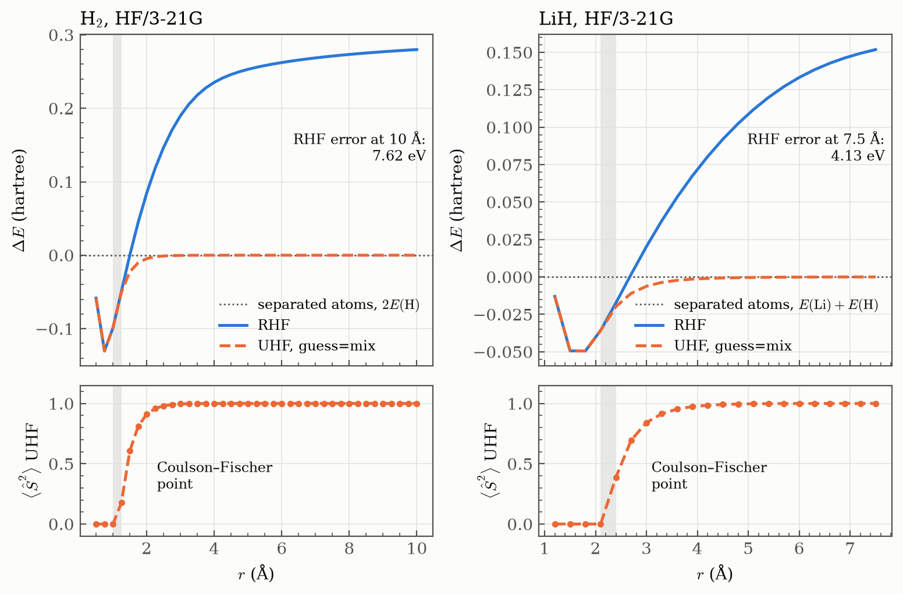

# Ex. 6 — RHF vs UHF for H₂ and LiH

[← Session 02](../) · [Bash guide](../../../docs/bash-for-gaussian.md) · **[Report (PDF)](../report/report.pdf)**

## Task

Compute the RHF and UHF (`guess=mix`) dissociation curves of H₂ and LiH at HF/3-21G, reference them to the separated atoms, and write up the results as a short report.

## Approach

**What Ex. 4 and 5 already established.** RHF cannot dissociate H₂, and UHF can only if the initial guess breaks the symmetry. This exercise checks whether the picture holds with a better basis (3-21G instead of STO-3G) and for a heteronuclear bond.

**Why LiH.** Like H₂, it is a two-electron bond, but between two different atoms, and much longer and weaker. It has two consequences:

- The reference becomes E(Li) + E(H). Both atoms are doublets, computed with UHF.
- The scan range moves out: `r1 7.5 21 -0.3` covers 7.5 → 1.2 Å in 22 points, around an equilibrium distance of about 1.6 Å.

**Six jobs, one launcher.** Four scans (2 molecules × 2 methods) and two atoms go into one folder, and [`run.sh`](../run.sh) launches them all, skipping any that already finished.

**One data file per curve.** [`extract.sh`](extract.sh) writes four files (`h2_rhf.dat`, `h2_uhfmix.dat`, `lih_rhf.dat`, `lih_uhfmix.dat`) that can be plotted directly. The report's figures were drawn from them with PGFPlots. In this repository, ⟨Ŝ²⟩ was added to the UHF files, and the figures were redrawn with [`plot_figures.py`](../plot_figures.py).

## Results and reading

The full discussion is in the **[report](../report/report.pdf)**, and the summary table and conclusions are in the [session README](../).

- Near equilibrium RHF and UHF are the same calculation. HF/3-21G gives re within 0.05 Å, but underestimates De by 25 % (H₂) and 44 % (LiH), because Hartree–Fock has no electron correlation.
- RHF ends 7.6 eV (H₂) and 4.1 eV (LiH) above the separated atoms, errors larger than the bonds themselves.
- UHF leaves RHF at the Coulson–Fischer point, ≈ 1.2 Å for H₂ and ≈ 2.2 Å for LiH, and reaches the correct limit. Below the curves, ⟨Ŝ²⟩ shows the cost: it rises from 0 to 1 right where the curves split.
- Here the UHF curves split from RHF smoothly. In Ex. 5, at STO-3G, the split was an abrupt jump, most likely the SCF falling back into the restricted solution. A smooth onset of ⟨Ŝ²⟩ is a good sign that the scan followed one solution all the way.

## Known slips in the submitted report

The [report](../report/report.pdf) is kept as it was submitted. Checking it against the data for this repository turned up:

- **The LiH equilibrium values cannot be traced to the data.** The report gives re = 1.64 Å and De = 1.42 eV. The scan stored here goes in steps of 0.3 Å: its lowest point is at 1.8 Å, 1.35 eV below the separated atoms, and a parabola through the three lowest points gives 1.65 Å and 1.39 eV. The conclusions do not change: De is still about 45 % below experiment.
- **The H₂ values come from two scans.** re = 0.735 Å is the 3-21G result of the finer scan of [Ex. 3](../ex3-bond-scans/) (0.03 Å steps), and De = 3.55 eV is the lowest point of the 0.25 Å scan of this exercise. A parabola through the three lowest points of that coarse scan would give 0.80 Å, which shows why the finer scan is the right source.
- **The experimental re of LiH is 1.5949 Å** (NIST Diatomic Spectral Database, as listed by [CCCBDB](https://cccbdb.nist.gov/expgeom2x.asp?casno=7580678&charge=0)), so 1.595 Å, not the 1.596 Å of Table 1.
- **Two typos in the Methods:** "writting" for *writing*, and "Linux System" with a capital S.

## Scripts

[`extract.sh`](extract.sh), commented line by line, does for H₂ and LiH what Ex. 4 and 5 did for H₂ alone. The two repeated operations, reading a scan relative to a reference and reading ⟨Ŝ²⟩, are written once as Bash functions (`scan` and `s2`), and the loop only picks the right reference energy for each molecule. The first version repeated the extraction for each molecule, with the number of points fixed by hand (39 and 22). Now adding a third molecule only takes another reference energy. Pattern: [functions: write it once](../../../docs/bash-for-gaussian.md#7-functions-write-it-once).

## Files

| File | What it is |
|---|---|
| `h2_rhf_321g.com`, `h2_uhfmix_321g.com` | H₂ scans, 10 → 0.5 Å |
| `lih_rhf_321g.com`, `lih_uhfmix_321g.com` | LiH scans, 7.5 → 1.2 Å |
| `h_321g.com`, `li_321g.com` | Atomic references (UHF doublets) |
| [`extract.sh`](extract.sh) | Writes the four `.dat` files |
| `*.dat` | r, ΔE (and ⟨Ŝ²⟩ for UHF), one file per curve |
