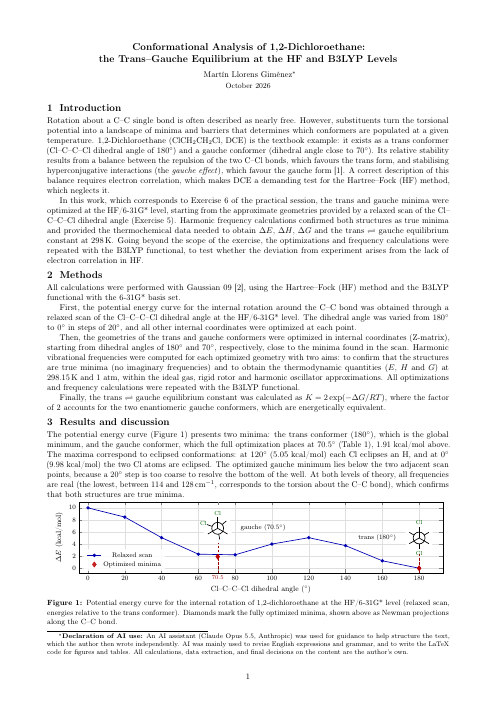
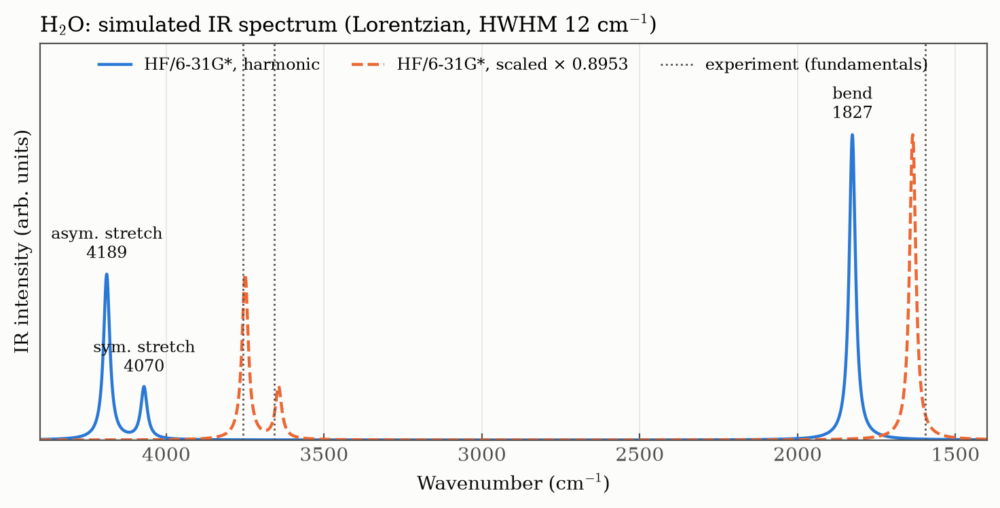
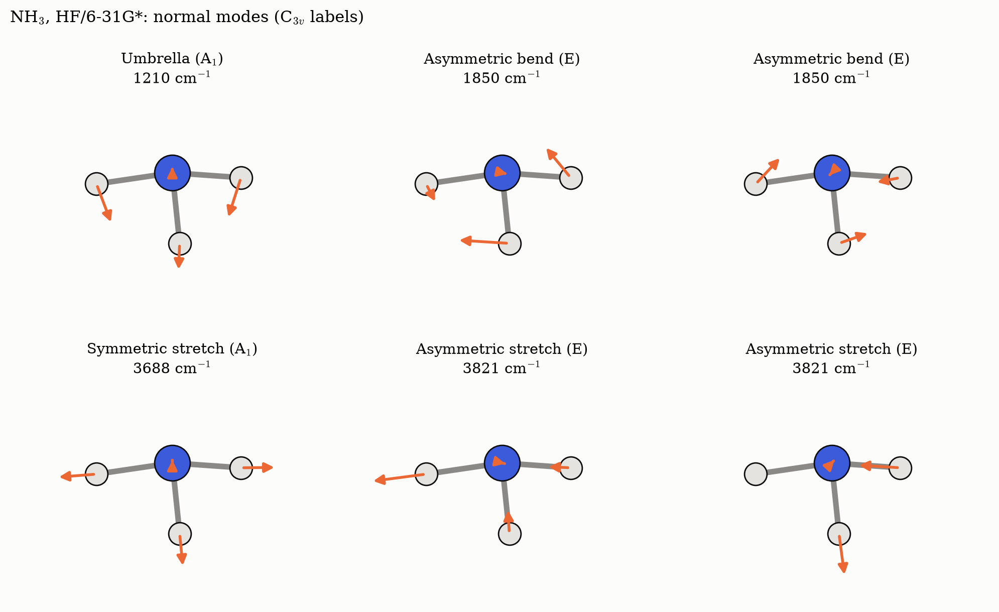
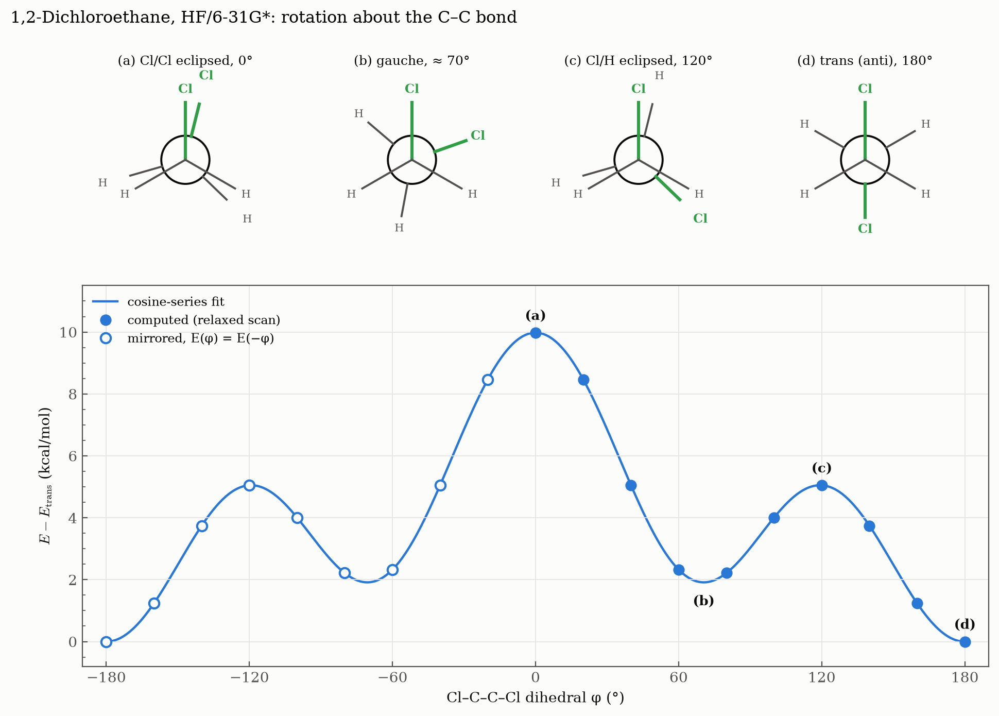
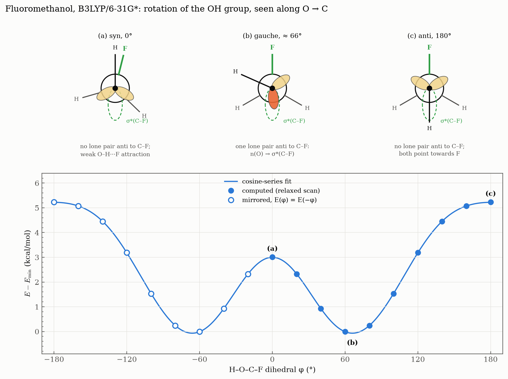
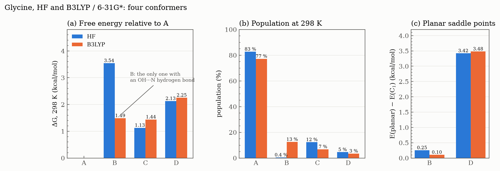

# Session 03 — Geometries, Frequencies and Conformers

From fixed geometries to optimised ones, and from one structure to several. The first half lets the optimiser find the structure of a molecule, measures how far it lands from experiment with each basis set and with B3LYP, and probes the curvature of the minimum through its vibrational frequencies. The second half turns to conformers: rotations about single bonds, the thermochemistry that decides how each conformer is populated, and the interactions that override steric intuition (the gauche effect, the anomeric effect, an intramolecular hydrogen bond).


<table>
<tr>
<td width="190"><a href="report/"></a></td>
<td>

### Case study and report: *the trans–gauche equilibrium of 1,2-dichloroethane*

Exercises 5 and 6, plus a B3LYP extension, told as one study: a relaxed scan finds the conformers, optimisations and frequencies give ΔH, ΔG and K, and the gap to experiment becomes a hypothesis, tested with B3LYP and checked against the literature. Correlation turns out to be necessary but not sufficient.

**[Case study: how the work was done](report/)** · **[Report (PDF, 2 pages)](report/report.pdf)**

</td>
</tr>
</table>

## Contents

Each exercise folder has its own README with the task and the reasoning behind each step, and its scripts are commented line by line. The Bash patterns are explained in the **[Bash for Gaussian guide](../../docs/bash-for-gaussian.md)**.

| Exercise | Question | Level of theory |
|---|---|---|
| [Ex. 1 — Optimised geometries](ex1-optimized-geometries/) | How close do HF geometries and dipoles get to experiment, and how does the basis set change them? | HF, STO-3G → 6-31G** |
| [Ex. 2 — Vibrational frequencies](ex2-vibrational-frequencies/) | What are the normal modes of water, and how good are harmonic HF frequencies? | HF/6-31G* |
| [Ex. 3 — Ammonia frequencies](ex3-ammonia-frequencies/) | Can the symmetry and the character of each mode be read from the displacement vectors alone? | HF/6-31G* |
| [Ex. 4 — HF vs B3LYP](ex4-hf-vs-b3lyp/) | How much does electron correlation (through B3LYP) improve optimised geometries? | HF, B3LYP / 6-31G*, 6-311G* |
| [Ex. 5 — Dichloroethane conformers](ex5-dichloroethane-scan/) | How does the energy change as one CH₂Cl group rotates about the C–C bond? | HF/6-31G*, relaxed scan |
| [Ex. 6 — Conformer thermochemistry](ex6-conformer-thermochemistry/) | What are ΔE, ΔH, ΔG and K between gauche and trans? | HF/6-31G*, opt + freq |
| [Ex. 7 — Fluoromethanol rotation](ex7-fluoromethanol-rotation/) | Why is the OH hydrogen most stable *gauche* to fluorine, and least stable *anti*? | B3LYP/6-31G*, relaxed scan |
| [Ex. 8 — Glycine conformers](ex8-glycine-conformers/) | Which of four glycine conformers are true minima, and how are they populated at 298 K? | HF, B3LYP / 6-31G*, opt + freq |
| [Case study and report](report/) | Ex. 5 and 6 as one study, with a B3LYP extension | HF, B3LYP / 6-31G* |

---

## Ex. 1 — Optimised geometries and the basis set

CH₄, H₂O, HF and NH₃ are optimised with four basis sets, 16 optimisations in all. Each one starts from a Z-matrix whose shared variables keep the molecular symmetry, and some start deliberately far from the answer, such as water at 90°.

| 6-31G** | r (Å) | Exp. | Angle (°) | Exp. | μ (D) | Exp. |
|---|---|---|---|---|---|---|
| CH₄ | 1.0835 | 1.087 | 109.47 | 109.47 | 0 | 0 |
| H₂O | 0.9431 | 0.958 | 105.96 | 104.5 | 2.15 | 1.86 |
| HF  | 0.9006 | 0.917 | – | – | 1.94 | 1.83 |
| NH₃ | 1.0008 | 1.012 | 107.61 | 106.7 | 1.84 | 1.47 |

- **HF bonds are too short** with the larger basis sets, by up to 0.016 Å, the systematic trend of Hartree–Fock without electron correlation.
- **3-21G flattens NH₃** to 112.4°, 5.7° too wide. Adding d functions (6-31G*) fixes it, and polarisation on hydrogen (6-31G**) barely changes the geometry.
- **Dipoles are too large** with the larger basis sets, by 0.1–0.45 D: the HF charge distribution is too ionic.
- **Consistent with Session 02:** the optimised HF bond lengths match the scans of [S02 Ex. 3](../02-hartree-fock/ex3-bond-scans/) to 0.001 Å, and every optimised energy is below the fixed-geometry energy of [S02 Ex. 2](../02-hartree-fock/ex2-basis-sets/) with the same basis set.

Full table, NH₃ symmetry check and conclusions: [Ex. 1 README](ex1-optimized-geometries/).

---

## Ex. 2 — Vibrational frequencies of water

Water is optimised and its harmonic frequencies computed in a single job (`opt freq`) at HF/6-31G*. The optimised geometry is identical to Ex. 1, and three real frequencies confirm it is a true minimum.



| Mode | Symmetry | Harmonic | Scaled × 0.8953 | Exp. | IR (km/mol) |
|---|---|---|---|---|---|
| Bend | A₁ | 1827 | 1635 | 1595 | 107 |
| Symmetric stretch | A₁ | 4070 | 3644 | 3657 | 18 |
| Antisymmetric stretch | B₂ | 4189 | 3750 | 3756 | 58 |

- **Harmonic HF frequencies are 11–15 % too high:** the harmonic approximation ignores anharmonicity, and HF bonds are too stiff.
- **A single scale factor** (0.8953 for HF/6-31G(d)) brings both stretches within 15 cm⁻¹ of experiment; the bend stays 40 cm⁻¹ high.
- **IR intensity follows the change in dipole, not the stiffness:** the soft bend is the strongest band.

Normal-mode diagrams, GaussView views and conclusions: [Ex. 2 README](ex2-vibrational-frequencies/).

---

## Ex. 3 — Vibrational frequencies of ammonia

The same `opt freq` job for NH₃. This time the six normal modes are worked out from the output alone: the displacement vectors give the C₃ axis, the position of each H and, through their projection on the N–H bonds, whether each mode is a bend or a stretch.



| Mode | C₃ᵥ | Harmonic (cm⁻¹) | Exp. (cm⁻¹) | IR (km/mol) | Raman (Å⁴/amu) |
|---|---|---|---|---|---|
| Umbrella | A₁ | 1210 | 950 | 218 | 8.8 |
| Asymmetric bend | E | 1850 | 1627 | 21 | 10.6 |
| Symmetric stretch | A₁ | 3688 | 3337 | 0.3 | 116 |
| Asymmetric stretch | E | 3821 | 3444 | 0.5 | 59 |

- **Bends and stretches separate cleanly:** the share of each mode's H motion along the N–H bonds is 0.00 for the three bends and 0.99–1.00 for the three stretches.
- **The umbrella has the largest error, 27 %**, against 11–14 % for the other modes: inversion makes its potential a strongly anharmonic double well.
- **IR and Raman are complementary:** the umbrella dominates the IR spectrum, while the stretches are almost IR-silent but dominate the Raman one.
- **Gaussian found Cs, not C₃ᵥ:** the Z-matrix leaves the symmetry free, and a 10⁻⁴ Å asymmetry was enough to lose the C₃ axis. It splits the E pairs by 0.05 cm⁻¹ and gives the wrong rotational symmetry number in the thermochemistry.

Full analysis, GaussView views and conclusions: [Ex. 3 README](ex3-ammonia-frequencies/).

---

## Ex. 4 — HF vs B3LYP geometries

H₂O₂ (6-31G*), HCN (6-311G*) and HCCH (6-31G*) are optimised with Hartree–Fock and with the B3LYP functional, from identical inputs that differ only in the method.


- **HF shortens bonds between heavy atoms**, most where there are lone pairs or multiple bonds: O–O by 0.055 Å, C≡N by 0.029 Å.
- **B3LYP brings both within 0.007 Å of experiment**, and the H–O–O angle from +2.1° to −0.3°.
- **The H–O–O–H dihedral defeats both methods** (+2.3° and +4.8°): the torsional surface is very flat, so a small error in the energy moves the minimum a long way.
- **Acetylene came out bent.** The Z-matrix defines the second H relative to a dummy atom that sits on the first carbon, so the C–C–H angle stayed at about 130°. The diagnosis, the corrected Z-matrix and the lesson are in the exercise README; the corrected run is pending.

Full table and conclusions: [Ex. 4 README](ex4-hf-vs-b3lyp/).

---

## Ex. 5 — Conformers of 1,2-dichloroethane

A relaxed scan of the Cl–C–C–Cl dihedral from 180° to −20°: at each angle every other coordinate is optimised. The Z-matrix places each H relative to the Cl of its own carbon, so a single variable rotates a whole CH₂Cl group.



- **Trans is the global minimum, gauche a local one** near 70°, about 2 kcal/mol higher.
- **Two kinds of barrier:** 5.1 kcal/mol with Cl eclipsing H (120°), 10.0 kcal/mol with the two Cl atoms eclipsed (0°).
- **The molecule makes room as the Cl atoms approach:** the C–C bond stretches from 1.516 to 1.547 Å and the C–C–Cl angle opens from 109° to 117°.
- **Half a turn is enough:** E(φ) = E(−φ), and the extra point at −20° matches +20° to 0.0002 kcal/mol.

Z-matrix design, full table and conclusions: [Ex. 5 README](ex5-dichloroethane-scan/).

---

## Ex. 6 — Thermochemistry of the gauche and trans conformers

Both conformers of Ex. 5 optimised freely and followed by a frequency calculation, which confirms them as minima and gives their thermochemistry at 298 K.


| Gauche − trans | ΔE | ΔH (298 K) | ΔG (298 K) | K = 2 exp(−ΔG/RT) | Gauche at 298 K |
|---|---|---|---|---|---|
| HF/6-31G* | 1.91 kcal/mol | 1.79 kcal/mol | 1.85 kcal/mol | 0.088 | 8 % |

- **The scan was right:** the free optimisation lands on φ = 70.5° and ΔE = 1.912 kcal/mol, as the cosine-series fit of Ex. 5 predicted.
- **Two gauche conformers:** g⁺ and g⁻ are mirror images with the same energy, hence the factor 2 in K.
- **Against experiment** (ΔH = 1.1 ± 0.1 kcal/mol), HF is 0.7 kcal/mol too high; the [case study](report/) tests why with B3LYP.

Full tables, entropy decomposition, caveats and conclusions: [Ex. 6 README](ex6-conformer-thermochemistry/).

---

## Ex. 7 — Internal rotation of fluoromethanol

A relaxed scan of the H–O–C–F dihedral at B3LYP/6-31G*: the hydroxyl hydrogen turns about the C–O bond. Steric intuition, which explains 1,2-dichloroethane, gets this one backwards.



- **The minimum is *gauche*, the maximum *anti*:** about 60° (66° from a fit), with barriers of 3.0 kcal/mol at 0° and 5.2 kcal/mol at 180°.
- **The anomeric effect:** at *gauche*, one oxygen lone pair is antiperiplanar to the C–F bond and donates into σ\*(C–F). At *anti*, no lone pair is in that position, and both sit on the fluorine side.
- **Lone pairs act like substituents.** Drawing the Newman projection with them is what makes the curve readable.

Interpretation, the two wrong explanations that came first, and conclusions: [Ex. 7 README](ex7-fluoromethanol-rotation/).

---

## Ex. 8 — Conformers of glycine

Four conformers of neutral glycine, built from one Z-matrix that differs only in three dihedrals, optimised with HF and B3LYP and checked with frequencies.



- **Imposed symmetry hid two saddle points.** Planar B and D each have one imaginary frequency. The mode of D is a rotation of the NH₂ group; releasing the symmetry and nudging the geometry out of the plane gives true C1 minima that are still B and D.
- **Not all saddle points are equal:** planar B lies only 0.1–0.25 kcal/mol above its minimum, so B is effectively planar; planar D lies 3.4 kcal/mol above, so it is not a conformer at all.
- **The hydrogen bond needs correlation.** B, the only conformer with an OH···N hydrogen bond, is 3.0 kcal/mol above A with HF and almost absent, but only 0.7 kcal/mol above with B3LYP, where it is the second most populated (13 %).
- **A dominates** with both methods (77–83 %), and the factor 2 for the mirror-image C1 conformers nearly doubles the share of B.

Saddle points, the imaginary mode, the chain of errors before the first good run, and conclusions: [Ex. 8 README](ex8-glycine-conformers/).

---

## Reproducing everything

On a machine with Gaussian 09 (`g09` in the `PATH`):

```bash
cd ex1-optimized-geometries && ./generate.sh && ./extract.sh > results.txt && cd ..
cd ex2-vibrational-frequencies && ../run.sh && cd ..   # frequencies read by hand into frequencies.txt
cd ex3-ammonia-frequencies && ../run.sh && cd ..       # modes read by hand into frequencies.txt, normal_modes.txt
cd ex4-hf-vs-b3lyp && ./generate.sh && ./extract.sh > results.txt && cd ..
cd ex5-dichloroethane-scan && ../run.sh && cd ..        # scan points read from the output into scan.txt
cd ex6-conformer-thermochemistry && ../run.sh && ./extract.sh && cd ..
cd ex7-fluoromethanol-rotation && ../run.sh && ./extract.sh && cd ..
cd ex8-glycine-conformers && ../run.sh && ./extract.sh && cd ..
python plot_figures.py   # numpy + matplotlib
```

[`run.sh`](run.sh) is the same launcher as in Session 02: it runs every input in a folder and skips the jobs that already finished normally.

Gaussian output files (`.log`, `.chk`) are not stored. Everything the analysis needs is in the extracted data files.
