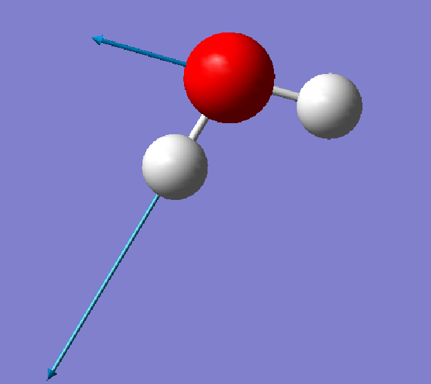

# Ex. 2 — Vibrational frequencies of water

[← Session 03](../) · [Bash guide](../../../docs/bash-for-gaussian.md)

## Task

Optimise water at HF/6-31G* and compute its harmonic vibrational frequencies. Identify the three normal modes, their symmetry and their IR activity, and compare the frequencies with experiment.

## Approach

**Optimise and compute frequencies in one job.** The route line `#hf/6-31G* opt=z-matrix freq` chains both steps: Gaussian first optimises the geometry, then starts a second job (a second `Normal termination` in the output) that computes the frequencies at the optimised geometry, with the same method and basis set. That matters, because harmonic frequencies only make sense at a stationary point of the *same* potential energy surface. Computed anywhere else, the gradient is not zero and the result is meaningless.

**Start from Ex. 1.** The input is the water template of [Ex. 1](../ex1-optimized-geometries/), with the same Z-matrix and the same deliberately poor start at 90°. The optimised geometry is identical to that of Ex. 1 with 6-31G*, down to the last printed digit: r = 0.9473 Å, ∠HOH = 105.4963°, E = −76.0107465152 hartree.

**Check that it is a minimum.** A minimum has only real (positive) frequencies, and a transition state has exactly one imaginary one. Water gives three positive frequencies. Gaussian also prints the six "low frequencies" of the translations and rotations, which should be zero: here they are between −2 and 14 cm⁻¹, small enough to confirm that the geometry is well converged.

## Results

| Mode | Symmetry | ν harmonic (cm⁻¹) | ν scaled × 0.8953 | ν exp. (cm⁻¹) | IR intensity (km/mol) | Force constant (mDyne/Å) |
|---|---|---|---|---|---|---|
| Bend | A₁ | 1827 | 1635 | 1595 | 107 | 2.13 |
| Symmetric stretch | A₁ | 4070 | 3644 | 3657 | 18 | 10.21 |
| Antisymmetric stretch | B₂ | 4189 | 3750 | 3756 | 58 | 11.19 |

Experimental fundamentals: NIST CCCBDB. Scale factor for HF/6-31G(d): Scott & Radom (1996). Zero-point energy: 0.022977 hartree (14.4 kcal/mol).

<p align="center">
  
</p>

<table>
<tr>
<td align="center"><br><sub>Bend, 1827 cm⁻¹</sub></td>
<td align="center"><br><sub>Symmetric stretch, 4070 cm⁻¹</sub></td>
<td align="center"><br><sub>Antisymmetric stretch, 4189 cm⁻¹</sub></td>
</tr>
</table>
<p align="center"><sub>Displacement vectors as shown by GaussView.</sub></p>

The diagram matches the displacement vectors printed in the output: in the bend, both H atoms move in and down, closing the angle; in the symmetric stretch, both move out along their bonds; in the antisymmetric stretch, one H moves towards the O while the other moves away, and the O shifts sideways to keep the centre of mass fixed.


## Conclusions

**True minimum.** All three vibrational frequencies (3N − 6 = 3) are real and positive, so the HF/6-31G* geometry is a minimum on the potential energy surface and not a saddle point.

**Mode assignment.**

- 1827 cm⁻¹ (A₁): H–O–H bending
- 4070 cm⁻¹ (A₁): symmetric O–H stretching
- 4189 cm⁻¹ (B₂): asymmetric O–H stretching

The bending mode has a force constant about five times smaller than the stretching modes (2.1 vs. 10–11 mDyne/Å), which is why its frequency is much lower. The asymmetric stretch lies slightly above the symmetric one.

**Symmetry and spectroscopy.** The two A₁ modes preserve the C₂ᵥ symmetry, while the B₂ mode breaks it. The bend dominates the IR spectrum (107 km/mol) and the symmetric stretch dominates the Raman spectrum (75.5 Å⁴/amu), which illustrates how the two techniques complement each other. Moreover, only the totally symmetric (A₁) modes give polarised Raman bands (depolarisation ratio below 0.75).

**Comparison with experiment.** HF overestimates all three frequencies, by 11–15 % with respect to the experimental gas-phase values (1595, 3657 and 3756 cm⁻¹). There are two causes: the lack of electron correlation, which gives bonds that are too short and too stiff, and the harmonic approximation, whereas experimental frequencies include anharmonicity. Applying the usual scale factor for HF/6-31G* (0.8953) brings the results into good agreement with experiment.

## Data

There is no script for this exercise. With a single molecule and three modes, the numbers were read by hand from the normal-mode table at the end of the output:

```
                     A1                     A1                     B2
 Frequencies --   1826.6059              4070.3974              4188.6160
 Red. masses --      1.0823                 1.0455                 1.0828
 Frc consts  --      2.1276                10.2061                11.1933
 IR Inten    --    107.2633                18.2076                58.0946
 Raman Activ --      5.7242                75.5376                39.0902
```

and copied into [`frequencies.txt`](frequencies.txt), which [`plot_figures.py`](../plot_figures.py) uses for the simulated spectrum.

## Files

| File | What it is |
|---|---|
| [`h2o_freq.com`](h2o_freq.com) | Optimisation + frequencies of water, HF/6-31G* |
| [`frequencies.txt`](frequencies.txt) | Symmetry, frequency, IR intensity and force constant of each mode, read by hand from the output |
