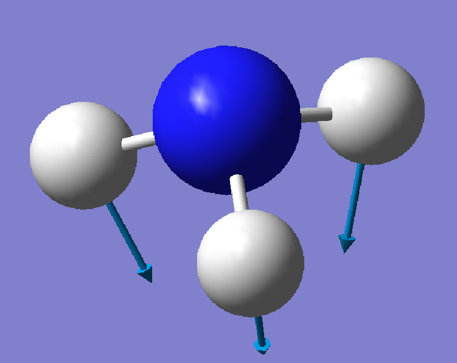
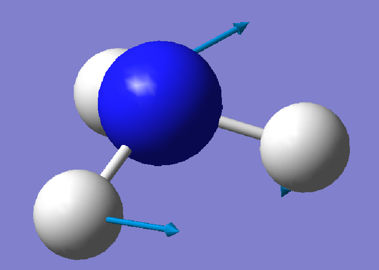
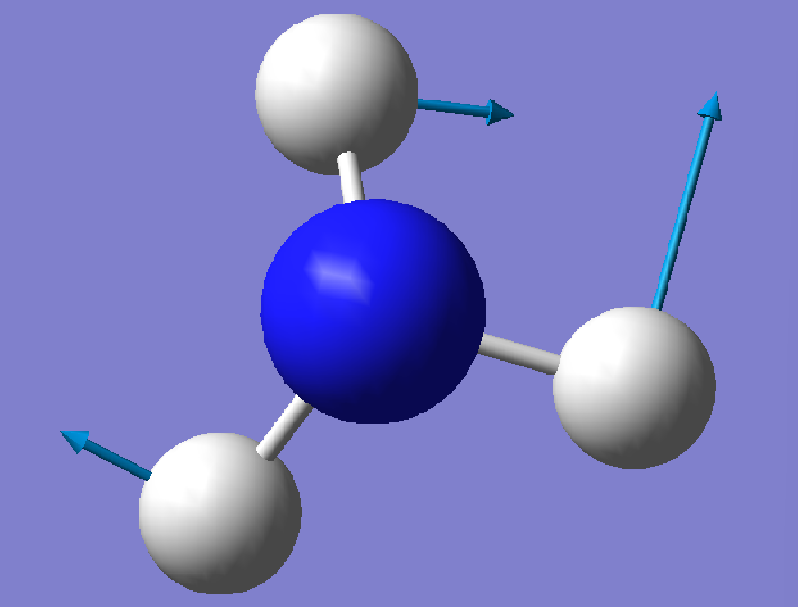
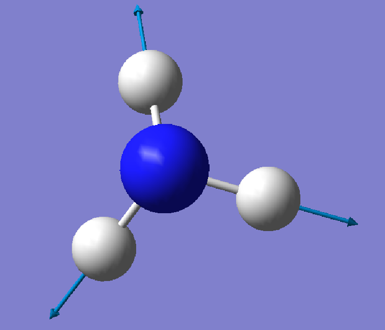
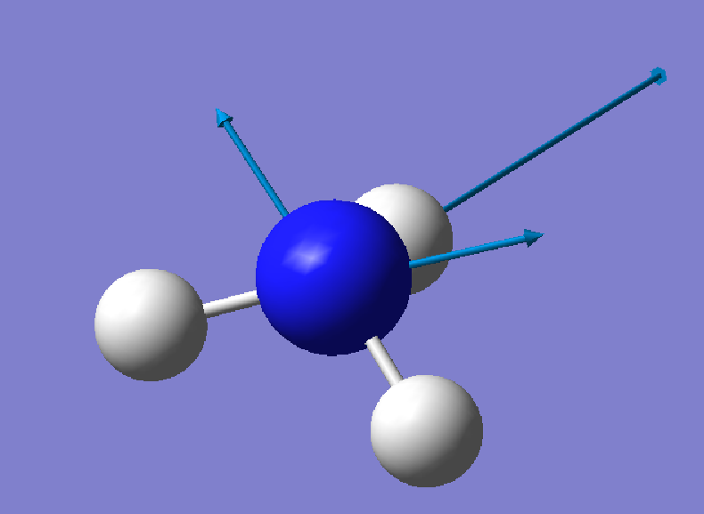
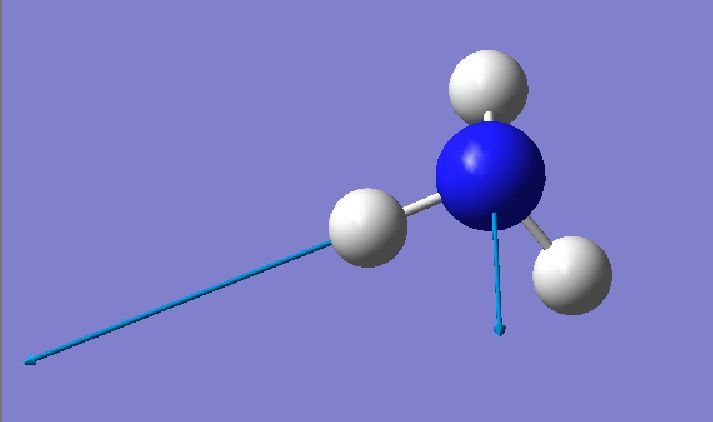

# Ex. 3 — Vibrational frequencies of ammonia

[← Session 03](../) · [Bash guide](../../../docs/bash-for-gaussian.md)

## Task

Optimise ammonia at HF/6-31G* and compute its harmonic frequencies. Using only the output (geometry and displacement vectors), work out the orientation of the molecule, classify each normal mode as a bend or a stretch, symmetric or asymmetric, and compare the frequencies with experiment.

## Approach

**Same recipe as Ex. 2.** One job, `#hf/6-31G* opt=z-matrix freq`, starting from the NH₃ template of [Ex. 1](../ex1-optimized-geometries/). The optimised geometry is identical to Ex. 1 with 6-31G*: r = 1.0026 Å, ∠HNH = 107.17°, E = −56.1843563090 hartree.

**Read the modes from the numbers, not the pictures.** Gaussian prints, for every mode, a displacement vector for each atom in the *standard orientation*. Combined with the atomic positions, those vectors are enough to find the symmetry axis, locate each H and tell bends from stretches, without opening a viewer. GaussView was used afterwards, to check.

**One output, read by hand.** As in Ex. 2, the frequencies, intensities and displacement vectors were copied directly from the output into [`frequencies.txt`](frequencies.txt) and [`normal_modes.txt`](normal_modes.txt). The mode diagram below is drawn from those vectors by [`plot_figures.py`](../plot_figures.py).

## Results

| Mode | C₃ᵥ | ν harmonic (cm⁻¹) | ν exp. (cm⁻¹) | Error | IR (km/mol) | Raman (Å⁴/amu) | Depol. ratio | Stretch fraction |
|---|---|---|---|---|---|---|---|---|
| 1 Umbrella | A₁ | 1210 | 950 | +27 % | **218** | 8.8 | 0.14 | 0.00 |
| 2, 3 Asymmetric bend | E | 1850 | 1627 | +14 % | 21 | 10.6 | 0.75 | 0.00 |
| 4 Symmetric stretch | A₁ | 3688 | 3337 | +11 % | 0.3 | **116** | 0.08 | 1.00 |
| 5, 6 Asymmetric stretch | E | 3821 | 3444 | +11 % | 0.5 | 59 | 0.75 | 0.99 |

Experimental fundamentals: NIST CCCBDB (the umbrella value is the centre of the inversion doublet, 932/968 cm⁻¹). Zero-point energy: 0.036997 hartree (23.2 kcal/mol).

**Stretch fraction** turns the bend-or-stretch criterion of conclusion 4 into a number: of all the motion of the H atoms relative to N, the fraction that lies along their N–H bonds. It is 0 for a pure bend and 1 for a pure stretch, and the six modes split cleanly into three of each. `python plot_figures.py` prints it for every mode.

<table>
<tr>
<td align="center"> 1 · Umbrella, 1210 cm⁻¹</td>
<td align="center"> 2 · Asymmetric bend, 1850 cm⁻¹</td>
<td align="center"> 3 · Asymmetric bend, 1850 cm⁻¹</td>
</tr>
<tr>
<td align="center"> 4 · Symmetric stretch, 3688 cm⁻¹</td>
<td align="center"> 5 · Asymmetric stretch, 3821 cm⁻¹</td>
<td align="center"> 6 · Asymmetric stretch, 3821 cm⁻¹</td>
</tr>
</table>

Displacement vectors as shown by GaussView.

### Gaussian saw Cs, not C₃ᵥ

The output labels the modes A′ and A″ and reports point group **Cs**, not C₃ᵥ. The Z-matrix does not impose C₃ᵥ: the dihedral `z3` that places the third H is optimised freely, and the optimiser stopped within its tolerance of the symmetric structure, with H2 at y = −0.259392 Å and H3, H4 at y = −0.259297 Å. A difference of 10⁻⁴ Å is enough for Gaussian to keep only the mirror plane. Some consequences can be seen in the output:

- **Labels.** A′ and A″ are the Cs labels. The C₃ᵥ labels in the table come from the mode shapes and the degeneracies.
- **Degeneracy splitting.** The E pairs differ by 0.05 and 0.03 cm⁻¹, an artefact of the broken symmetry rather than physics.
- **Thermochemistry.** Gaussian calls NH₃ an *asymmetric top* with rotational symmetry number 1 instead of 3. The rotational entropy is then too large by R ln 3, and the Gibbs energy too low by RT ln 3 = 0.65 kcal/mol at 298 K.
- **Rotations.** The "low frequencies" of the rotations are 35–38 cm⁻¹, against at most 14 cm⁻¹ for water in Ex. 2. Like the 10⁻⁴ Å asymmetry, this points to a geometry converged slightly less tightly.

None of this changes the frequencies or the mode assignment. Building the Z-matrix so that C₃ᵥ is exact, or tightening the optimisation (`opt=tight`), would be the way to remove it.

## Conclusions

1. **It is a minimum.** All six frequencies (3N − 6 = 6) are real and positive, so the structure is a minimum on the potential energy surface.

2. **The C₃ axis is y.** In mode 1, the three H atoms have the same y displacement (−0.53) and N moves only along y. Only a motion along the symmetry axis can be the same for all three H atoms, so y is the C₃ axis. In addition, H2 always has z = 0 while H3 and H4 have opposite z values: the symmetry plane is z = 0, and it contains N and H2.

3. **Where each H is.** In mode 4, each H moves in a single direction. If the mode is a stretch (checked in point 5), the displacement is parallel to the bond, so it points along each N–H bond. This agrees with the expected geometry: the three H atoms sit below the N, 120° apart around the axis.

4. **Bend or stretch: the criterion.** With the position of each H, take the scalar product of its displacement with the direction of its N–H bond. If it is close to zero, the H moves perpendicular to the bond: the bond length does not change, only the angles do, so the mode is a bend. If it is large, the H moves along the bond and its length changes: a stretch.

5. **Symmetric or asymmetric.**
   - Mode 1: the three H atoms have the same y displacement. They move down together while N moves up, so the pyramid opens and closes: the umbrella mode.
   - Mode 4: the three H atoms move away from N at the same time: the symmetric stretch.
   - Mode 5: H2 has a large displacement away from the rest of the molecule, while H3 and H4 move slightly in the opposite direction: an asymmetric stretch.

6. **Degeneracy.** Modes 2 and 3 (1849.66 and 1849.72 cm⁻¹) and modes 5 and 6 (3821.08 and 3821.11 cm⁻¹) have identical reduced masses and force constants. In C₃ᵥ, an E mode is a pair of independent vibrations with the same energy, and the specific displacements printed for each one are an arbitrary choice among infinitely many combinations. That is why modes 2 and 3 do not look alike at first sight.

7. **Error against experiment.** Compared with the gas-phase experimental values, the computed frequencies are 11–14 % too high, and the umbrella mode 27 %. The umbrella is a special case: NH₃ can invert (the pyramid turns inside out), so its potential along this coordinate is a double well and strongly anharmonic, which is where the harmonic approximation fails most. On top of that comes the usual Hartree–Fock overestimation.

## Files

| File | What it is |
|---|---|
| [`nh3_freq.com`](nh3_freq.com) | Optimisation + frequencies of ammonia, HF/6-31G* |
| [`frequencies.txt`](frequencies.txt) | Frequency, IR and Raman intensities, depolarisation ratio and force constant of each mode, copied from the output |
| [`normal_modes.txt`](normal_modes.txt) | Atomic positions and displacement vectors of the six modes, copied from the output |
