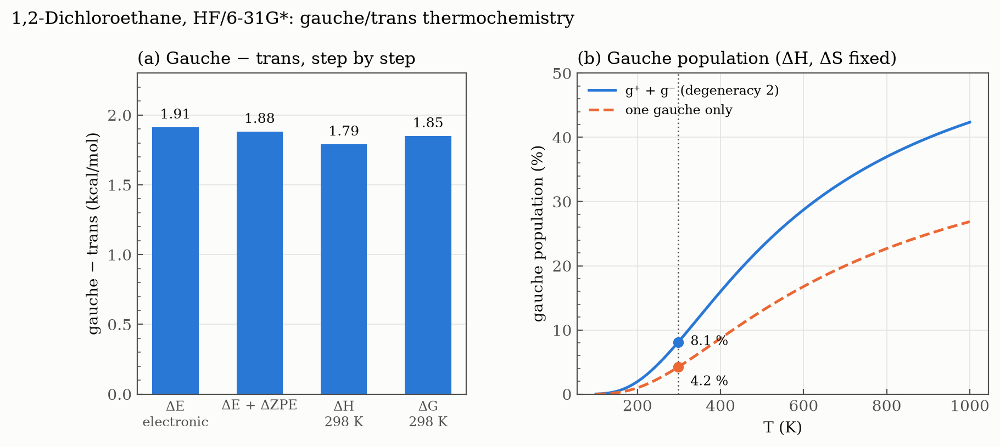

# Ex. 6 — Thermochemistry of the gauche and trans conformers

[← Session 03](../) · [Bash guide](../../../docs/bash-for-gaussian.md) · **[Case study and report](../report/)**

This is the exercise handed in as the [Session 03 report](../report/), together with the scan of [Ex. 5](../ex5-dichloroethane-scan/) and a B3LYP extension.

## Task

Optimise the trans and gauche conformers of 1,2-dichloroethane at HF/6-31G* and compute their frequencies. From the thermochemistry, obtain ΔE, ΔH and ΔG between gauche and trans, and the equilibrium constant K at 298 K from ΔG.

## Approach

**Start from the scan.** Both inputs reuse the Z-matrix of [Ex. 5](../ex5-dichloroethane-scan/), where each H is referenced to the Cl of its own carbon. Only the starting dihedral changes: 180° for trans and 70° for gauche, where the scan placed the gauche minimum. This time `z3` is not scanned but optimised freely, together with everything else. The two inputs were generated from the scan input with `sed "s/^z3 .*/z3 180./"` (and `70.` for gauche), a pattern that replaces the whole line whatever the old value looked like.

**One job per conformer: `opt freq`.** The frequencies do two things. They confirm that each structure is a true minimum: all 18 frequencies are real, the lowest being the C–C torsion (127.5 cm⁻¹ for trans, 122.2 cm⁻¹ for gauche). And they feed the thermochemistry block that Gaussian prints at the end, at 298.15 K and 1 atm, with E, H and G already summed: "Sum of electronic and thermal Enthalpies" and "… Free Energies".

**Extraction.** [`extract.sh`](extract.sh) reads the optimised dihedral, E, H and G of both conformers into [`thermo.txt`](thermo.txt).

**The B3LYP extension.** For the report, both conformers were repeated with B3LYP/6-31G*. The inputs are the HF ones with only the method changed in the route line, and the same `extract.sh` reads all four outputs. Both B3LYP structures are also true minima (lowest frequencies 117.8 and 114.1 cm⁻¹), with gauche at 69.6°. The analysis is in the [report](../report/).

## Results (what the exercise asks for)

| | Trans | Gauche | Gauche − trans |
|---|---|---|---|
| Optimised Cl–C–C–Cl dihedral | 180.0° | 70.5° | |
| E (hartree) | −997.030936 | −997.027890 | **ΔE = 1.91 kcal/mol** (8.00 kJ/mol) |
| H, 298 K (hartree) | −996.962335 | −996.959483 | **ΔH = 1.79 kcal/mol** (7.49 kJ/mol) |
| G, 298 K (hartree) | −996.996809 | −996.993863 | **ΔG = 1.85 kcal/mol** (7.74 kJ/mol) |

From ΔG, for the equilibrium trans ⇌ gauche:

  K = 2 exp(−ΔG / RT) = 2 exp(−1.849 / (1.987 × 10⁻³ × 298.15)) = **0.088** → **8 % gauche** at 298 K

**Why the factor 2.** Rotating by +70° or −70° gives two gauche conformers, g⁺ and g⁻: mirror images with exactly the same energy. The G printed by Gaussian describes only one of them, and exp(−ΔG/RT) = 0.044 is the constant for trans ⇌ one gauche. The equilibrium with *all* gauche molecules counts both.

Gauche lies 1.8–1.9 kcal/mol above trans whatever the energy considered.

**Cross-check with Ex. 5.** The trans energy is identical, to the last printed digit, to the 180° point of the scan. The free optimisation of gauche lands at φ = 70.51° and ΔE = 1.912 kcal/mol. The cosine-series fit of the scan had predicted 70.5° and 1.91 kcal/mol from points 20° apart.

## Beyond the exercise

*Not required by the task: further quantities that come out of the same two outputs ([`thermo_extra.txt`](thermo_extra.txt)).*

**From ΔE to ΔG, step by step** (panel a). Each correction is small:

| Step | Gauche − trans |
|---|---|
| ΔE, electronic | 1.912 kcal/mol |
| + ΔZPE (−0.031) | ΔE₀ = 1.880 kcal/mol |
| + thermal energy at 298 K | ΔU = 1.790 kcal/mol |
| + Δ(pV) | ΔH = 1.790 kcal/mol |
| − TΔS | ΔG = 1.849 kcal/mol |

- **ΔU = ΔH exactly.** For an isomerisation in the ideal gas, the number of molecules does not change, so Δ(pV) = Δn RT = 0.
- **ΔS = −0.20 cal/(mol K): gauche is slightly more ordered.** By contributions: translational 0 (same mass); rotational +0.41, because trans is almost a rod, with one very small moment of inertia (61 against 176 amu·bohr² for gauche), so the product of its three moments is smaller; vibrational −0.61, because the second and third softest modes of gauche are stiffer (280 and 443 cm⁻¹ against 236 and 324 cm⁻¹). TΔS is only −0.06 kcal/mol at 298 K, which is why ΔG and ΔH are so close.

**The factor 2 as an entropy** (panel b). Counting both gauche conformers is equivalent to giving the gauche family an extra entropy R ln 2 = 1.38 cal/(mol K), which lowers its effective free energy by RT ln 2 = 0.41 kcal/mol: 8.1 % gauche at 298 K instead of 4.2 %. Panel b follows the population with temperature, keeping ΔH and ΔS at their 298 K values: gauche reaches about 29 % at 600 K and 42 % at 1000 K, always below the 2/3 limit of three equally likely conformers.

**Caveats.**

- **Symmetry.** Gaussian finds point group C1 for both conformers, instead of C₂ₕ (trans) and C₂ (gauche), because the Z-matrix does not impose it, as already seen for NH₃ in [Ex. 3](../ex3-ammonia-frequencies/). Both should have rotational symmetry number 2 and both get 1, so each absolute entropy is too large by R ln 2, but the error cancels in ΔS and ΔG.
- **The torsion as a harmonic oscillator.** The thermochemistry treats every mode as harmonic, including the C–C torsion at about 125 cm⁻¹, which is really a hindered rotation over the barriers of Ex. 5. A hindered-rotor treatment would change the vibrational entropy somewhat.
- **The method.** Everything here is HF/6-31G*: the electronic ΔE dominates every quantity, and it carries the usual lack of electron correlation. The [report](../report/) takes this further: against the experimental ΔH of 1.1 ± 0.1 kcal/mol, HF is 0.7 kcal/mol too high, and repeating both conformers with B3LYP corrects only about a third of the gap.

## Conclusions

The conclusions of this exercise are those of the [report](../report/#conclusions):

1. Trans and gauche are both true minima. At HF/6-31G*, trans is more stable by ΔG = 1.85 kcal/mol: K = 0.088 and 8 % gauche at 298 K.
2. ΔE, ΔH and ΔG are practically equal: the equilibrium is governed by the electronic energy, not by entropic or thermal effects.
3. HF overestimates the stability of trans by about 0.7 kcal/mol and underestimates the gauche population by a factor of about 3. B3LYP corrects only a third of the error: correlation is necessary but not sufficient, and dispersion is still missing.
4. All results are for the gas phase. Gauche has a dipole of about 3 D and trans none, so a polar solvent would shift the equilibrium towards gauche.

## Files

| File | What it is |
|---|---|
| [`dce_trans.com`](dce_trans.com), [`dce_gauche.com`](dce_gauche.com) | `opt freq` of each conformer, HF/6-31G*, from the Z-matrix of Ex. 5 |
| [`dce_trans_b3lyp.com`](dce_trans_b3lyp.com), [`dce_gauche_b3lyp.com`](dce_gauche_b3lyp.com) | The same at B3LYP/6-31G* (extension for the report) |
| [`extract.sh`](extract.sh) | Writes dihedral, E, H and G of the four calculations to `thermo.txt` |
| [`thermo.txt`](thermo.txt) | Output of `extract.sh` |
| [`thermo_extra.txt`](thermo_extra.txt) | ZPE, E + ZPE, entropy contributions and heat capacity, copied from the outputs |

The derived quantities and the figure are computed by [`plot_figures.py`](../plot_figures.py).
