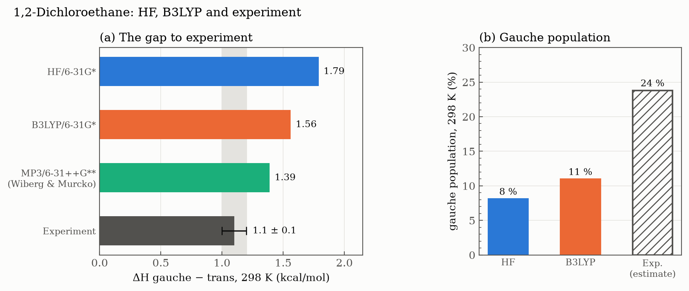

# Case study — the trans–gauche equilibrium of 1,2-dichloroethane

[← Session 03](../) · [Ex. 5 — scan](../ex5-dichloroethane-scan/) · [Ex. 6 — thermochemistry](../ex6-conformer-thermochemistry/)

<table>
<tr>
<td width="190"><a href="report.pdf"></a></td>
<td>

### Report: *Conformational Analysis of 1,2-Dichloroethane*
**The trans–gauche equilibrium at the HF and B3LYP levels**

Two exercises and one extension, told as a single study: a relaxed scan finds the conformers, optimisations and frequencies turn them into ΔH, ΔG and an equilibrium constant, and the disagreement with experiment becomes a hypothesis, tested with B3LYP and checked against the literature.

**[Read the report (PDF, 2 pages)](report.pdf)**

</td>
</tr>
</table>

## The question

Rotation about a C–C single bond is often described as nearly free, but substituents turn it into a landscape of minima and barriers. 1,2-Dichloroethane is the textbook case: a trans conformer (Cl–C–C–Cl at 180°) and a gauche one (near 70°), whose balance comes from the repulsion between the two C–Cl bonds, which favours trans, and hyperconjugation (the *gauche effect*), which favours gauche. Describing that balance needs electron correlation, which makes the molecule a demanding test for Hartree–Fock. How many molecules are gauche at room temperature, and how close does each method get?

## The path, step by step

Each step prepared the next one, and the report follows the same order:


## Results



| Gauche − trans, 298 K | ΔE (kcal/mol) | ΔH (kcal/mol) | ΔG (kcal/mol) | K | Gauche (%) |
|---|---|---|---|---|---|
| HF/6-31G* | 1.91 | 1.79 | 1.85 | 0.088 | 8 |
| B3LYP/6-31G* | 1.70 | 1.56 | 1.65 | 0.12 | 11 |
| Experiment | – | 1.1 ± 0.1 | – | ≈ 0.31* | ≈ 24* |

K = 2 exp(−ΔG/RT), where the factor 2 counts the two mirror-image gauche conformers. \*Estimated from the experimental ΔH, assuming ΔG ≈ ΔH. Experimental value and MP3 reference: Wiberg & Murcko (1987). Data: [`report_data.txt`](report_data.txt).

## How the work was done

### 1. A scan to know where to look ([Ex. 5](../ex5-dichloroethane-scan/))

An optimiser goes down to the minimum *closest* to where it starts. Starting anywhere could end in the wrong well, so a relaxed scan of the Cl–C–C–Cl dihedral, from 180° in steps of 20°, came first: it draws the whole surface and shows where trans and gauche are.

- **Dihedrals named `z`, not `d`.** Gaussian reads numbers in Fortran format, where `D` marks an exponent (`1.0D3`), and a variable name starting with `d` can confuse the parser.
- **Energies from a trigger, not from the summary table.** The scan summary prints energies with only five decimals and runs the columns together. A one-line `awk` program keeps the last `SCF Done` energy and prints it each time a point converges (`Stationary point found`).
- **Validated before anything was built on it.** The energies matched the reference table of the practical session to the fifth decimal, and the point at −20° matched +20°, as symmetry requires. Later, an external check: the HF/6-31G* energies of the four key points coincide exactly with those published by Wiberg and Murcko (−997.03094, −997.02789, −997.02288 and −997.01503 hartree, that is 0.00, 1.91, 5.05 and 9.98 kcal/mol).

### 2. Refining the minima ([Ex. 6](../ex6-conformer-thermochemistry/))

The scan is coarse, one point every 20°, so the bottom of the gauche well falls between two points and is never computed. Trans and gauche were therefore optimised without constraints, starting from 180° and 70°, with `opt=z-matrix freq`. The optimised gauche (70.5°, 1.91 kcal/mol) lies *below* its neighbouring scan points.

The frequencies were needed for two reasons: to confirm that both structures are true minima (all frequencies real, the lowest, about 120 cm⁻¹, being the C–C torsion), and to obtain H and G, which Gaussian only gives after a frequency calculation (ideal gas, rigid rotor, harmonic oscillator, 298.15 K and 1 atm). They are computed at the same level as the optimisation, because they only make sense at the minimum of the method's own surface, where the gradient is zero.

The inputs were generated from the scan input with `sed`, using a pattern that does not depend on how the value was written (`s/^z3 .*/z3 180./` works for `180.` and `180.0` alike). The extraction script reads dihedral, E, H and G from each output and is reusable for later exercises.

### 3. The detail that raises the level: two gauche conformers

There are *two* gauche conformers, at +70° and −70°: mirror images with the same energy, while the G printed by Gaussian describes only one. Counting both doubles K, from 0.044 to **0.088**, that is 8 % gauche at 298 K. Taking it into account is the difference between applying a formula and understanding where the number comes from.

### 4. From description to hypothesis test

**The problem.** Against experiment (1.1 ± 0.1 kcal/mol), HF overestimates the enthalpy difference by about 0.7 kcal/mol and predicts a gauche population of a third of the real one. The experimental value comes mostly from the temperature dependence of gas-phase measurements, so it is compared with ΔH, not ΔE.

**The hypothesis.** HF fails because it has no electron correlation, and the gauche effect, a hyperconjugative stabilisation, is exactly the kind of interaction that needs it.

**The test.** Trans and gauche repeated at B3LYP/6-31G*: the same inputs, with the method changed by `sed`. Cheap, and it turns a descriptive report into a tested hypothesis.

**The result, and why it is good even if it is not clean.** B3LYP moves in the expected direction but corrects only about a third of the error, from 0.69 to 0.46 kcal/mol above experiment. The conclusion becomes sharper: correlation is **necessary but not sufficient**.

**Reading the source changed the explanation.** A first draft blamed the 6-31G* basis set, which has no diffuse functions. The paper by Wiberg and Murcko showed otherwise: at the MP3 level, adding diffuse functions only moves the difference from 1.60 to 1.54 kcal/mol, and even with explicit correlation (MP3, MP4) it stays around 1.5 kcal/mol; their best value, an enthalpy at 298 K with MP3/6-31++G**, is 1.39 kcal/mol. The remaining error lies in the treatment of correlation: B3LYP is approximate and does not describe dispersion, which would favour the more compact gauche conformer. The initial hypothesis about the basis set did not survive the comparison with the literature.

**Supporting data.**

- **Dipole moments.** Trans: 0.00 D with both methods, as its centre of inversion requires. Gauche: 3.14 D (HF) and 2.93 D (B3LYP), consistent with HF overestimating dipoles. This points to the solvent: a polar medium would stabilise gauche.
- **Gauche dihedral.** 70.5° (HF) and 69.6° (B3LYP), both within the electron-diffraction value of 72.4 ± 3.1°.
- **Exponential sensitivity.** Since K depends on exp(−ΔG/RT), an error of about 0.75 kcal/mol in ΔG changes K by a factor of about 3.5. That is why computational chemistry chases *chemical accuracy*, about 1 kcal/mol.

### 5. Choosing what to hand in

The deliverable asked for a single exercise in at most two pages. Exercise 6 was chosen because it tells the complete story (optimisation, frequencies, thermochemistry and a K comparable with experiment), with Exercise 5 as the step before it, as the exercise itself proposes. The introduction says which exercise is handed in, and that the B3LYP part goes beyond it.

### 6. Building the report

- **Structure.** Introduction (problem and question), Methods (reproducible), Results and discussion (curve, thermochemistry, hypothesis), Conclusion (four points, the last one a perspective).
- **Writing.** Content drafted in Spanish and translated into English by the author. Corrections were grouped by pattern (false friends, prepositions, *it's*/*its*, agreement) to learn the pattern rather than the single fix. The use of AI is declared in the report itself.
- **Figure 1** (LaTeX, vector). The curve is drawn with `pgfplots` from `.dat` files, so the data live in one place. The Newman projections are drawn in TikZ above each minimum; the trick is to mark the position with a `\coordinate` inside the axes and draw outside them, so the `pgfplots` scaling does not distort the drawings.
- **Tables** with `booktabs` (no grid) and `siunitx` columns aligned on the decimal point. Significant figures chosen deliberately: six decimals for absolute energies, two for differences, two significant figures for K.
- **Two pages, by formatting alone.** Compact title and sections (`titling`, `titlesec`), tight lists (`enumitem`), a small bibliography with the Gaussian citation shortened to *et al.*, and the figure at 4.6 cm, the largest height at which everything fits.

## Inside the LaTeX source

The full source of the report is in [`source/`](source/): [`report.tex`](source/report.tex), [`bibliografia.bib`](source/bibliografia.bib) and the two data files of the figure. The comments in the `.tex` are in Spanish, as they were written.

### Newman projections in polar coordinates

The first attempt at the Newman projections was drawn point by point. The working version is a TikZ `pic` that takes a single argument, the angle of the back Cl, and builds everything else in **polar coordinates**, `(angle:radius)`:

```latex
\tikzset{
  pics/newman/.style={code={
    \fill[white] (0,0) circle (0.62);                                     % background: hides the grid
    \draw[thick] (0,0) circle (0.25);                                     % back carbon
    \foreach \a in {0,120,240} \draw[thick] (#1+\a:0.25) -- (#1+\a:0.48); % back bonds
    \foreach \a in {90,210,330} \draw[thick] (0,0) -- (\a:0.48);          % front bonds
    \node[font=\scriptsize, text=green!40!black, inner sep=0pt] at (#1:0.64) {Cl};
    \node[font=\scriptsize, text=green!40!black, inner sep=0pt] at (90:0.64) {Cl};
  }}
}
```

- The **front** bonds always start at the centre and point to 90°, 210° and 330°. The front Cl is the one at 90°, straight up.
- The **back** bonds start on the circle (radius 0.25) and point to `#1`, `#1 + 120` and `#1 + 240`: the back carbon is the same tripod, rotated.
- With the front Cl at 90°, a Cl–C–C–Cl dihedral φ puts the back Cl at **90° + φ**. That is the whole recipe: gauche (φ = 70.5°) is `newman=160.5`, and trans (φ = 180°) is `newman=270`.

A Newman projection *is* a polar diagram: everything is an angle around the C–C axis. Once the drawing is written in the coordinates the molecule already uses, the dihedral angle becomes the only input.

### Drawing outside the axes without losing the position

`pgfplots` rescales everything inside an `axis`, so a projection drawn there comes out squashed. The positions are marked with `\coordinate` inside the axis, in data units, and the projections are drawn *after* `\end{axis}`, in real centimetres:

```latex
  \coordinate (pg) at (axis cs:70.5,6.6);      % inside the axis: data coordinates
  ...
\end{axis}
\pic at (pg) {newman=160.5};                    % outside: real centimetres, no distortion
```

The dashed connectors are drawn from the x axis (`\pgfkeysvalueof{/pgfplots/ymin}`) up to each projection, passing through the optimised minimum. The curve and the diamonds read [`scan_hf.dat`](source/scan_hf.dat) and [`minima_hf.dat`](source/minima_hf.dat) directly, so the numbers live in one place.

### Building it

```bash
pdflatex report && bibtex report && pdflatex report && pdflatex report
```

## Conclusions

1. 1,2-Dichloroethane has two stable conformers, trans and gauche, both confirmed as true minima by frequency calculations. At the HF/6-31G* level, trans is more stable, with ΔG = 1.85 kcal/mol, which gives K = 0.088 and a gauche population of 8 % at 298 K.
2. The three energy differences (ΔE, ΔH and ΔG) are practically equal, so the conformational equilibrium is governed by the electronic energy rather than by entropic or thermal effects.
3. HF overestimates the stability of the trans conformer by about 0.7 kcal/mol and, given the exponential dependence of K on ΔG, underestimates the gauche population by a factor of about 3. Including electron correlation with B3LYP improves the result but corrects only about a third of the error: correlation is necessary but not sufficient, and a quantitative description requires a more complete treatment of electron correlation, including dispersion.
4. All results refer to the gas phase. Since trans has no dipole moment (μ = 0 by symmetry) and gauche does (μ ≈ 3 D), a polar solvent is expected to stabilise gauche and shift the equilibrium. This could be studied with an implicit solvent model.

## Files and sources

| File | What it is |
|---|---|
| [`report.pdf`](report.pdf) | The report (2 pages) |
| [`report_data.txt`](report_data.txt) | Table 1 of the report: HF and B3LYP energies, dihedrals and dipoles |
| [`source/report.tex`](source/report.tex) | LaTeX source of the report |
| [`source/bibliografia.bib`](source/bibliografia.bib) | Bibliography |
| [`source/scan_hf.dat`](source/scan_hf.dat), [`source/minima_hf.dat`](source/minima_hf.dat) | Data of Figure 1: the scan points and the optimised minima |

All calculations behind the report, HF and B3LYP, with their inputs and extraction scripts, are in [Ex. 5](../ex5-dichloroethane-scan/) and [Ex. 6](../ex6-conformer-thermochemistry/). The figure on this page is drawn by [`plot_figures.py`](../plot_figures.py).

**Reference.** K. B. Wiberg and M. A. Murcko, *Rotational barriers. 1. 1,2-Dihaloethanes*, J. Phys. Chem. **1987**, 91, 3616–3620. [doi:10.1021/j100297a030](https://doi.org/10.1021/j100297a030)
