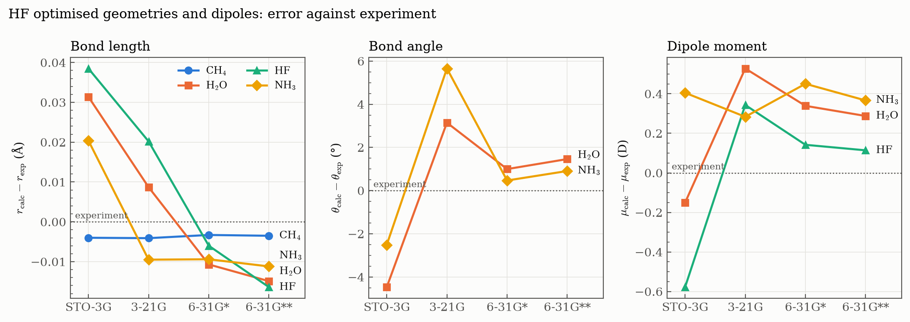

# Session 03 — Geometry Optimisation and Frequencies

From fixed geometries to optimised ones: letting Hartree–Fock find the structure of a molecule, seeing how far that structure is from experiment with each basis set, and then probing the curvature of the minimum through its vibrational frequencies.



## Contents

Each exercise folder has its own README with the task and the reasoning behind each step, and its scripts are commented line by line. The Bash patterns are explained in the **[Bash for Gaussian guide](../../docs/bash-for-gaussian.md)**.

| Exercise | Question | Level of theory |
|---|---|---|
| [Ex. 1 — Optimised geometries](ex1-optimized-geometries/) | How close do HF geometries and dipoles get to experiment, and how does the basis set change them? | HF, STO-3G → 6-31G** |
| [Ex. 2 — Vibrational frequencies](ex2-vibrational-frequencies/) | What are the normal modes of water, and how good are harmonic HF frequencies? | HF/6-31G* |

More exercises will be added as the session goes on.

---

## Ex. 1 — Optimised geometries and the basis set

CH₄, H₂O, HF and NH₃ are optimised with four basis sets, 16 optimisations in all. Each one starts from a Z-matrix whose shared variables keep the molecular symmetry, and some start deliberately far from the answer, such as water at 90°.

| 6-31G** | r (Å) | Exp. | Angle (°) | Exp. | μ (D) | Exp. |
|---|---|---|---|---|---|---|
| CH₄ | 1.0835 | 1.086 | 109.47 | 109.47 | 0 | 0 |
| H₂O | 0.9431 | 0.958 | 105.96 | 104.5 | 2.15 | 1.85 |
| HF  | 0.9006 | 0.917 | – | – | 1.94 | 1.83 |
| NH₃ | 1.0008 | 1.012 | 107.61 | 106.7 | 1.84 | 1.47 |

- **HF bonds are too short** with the larger basis sets, by up to 0.016 Å, the systematic trend of Hartree–Fock without electron correlation.
- **3-21G flattens NH₃** to 112.4°, 5.7° too wide. Adding d functions (6-31G*) fixes it, and polarisation on hydrogen (6-31G**) barely changes the geometry.
- **Dipoles are too large** with the larger basis sets, by 0.1–0.45 D: the HF charge distribution is too ionic.
- **Consistent with Session 02:** the optimised HF bond lengths match the scans of [S02 Ex. 3](../02-hartree-fock/ex3-bond-scans/) to 0.001 Å, and every optimised energy is below the fixed-geometry energy of [S02 Ex. 2](../02-hartree-fock/ex2-basis-sets/) with the same basis set.

Full table, NH₃ symmetry check and conclusions: [Ex. 1 README](ex1-optimized-geometries/).

---

## Ex. 2 — Vibrational frequencies of water

Water is optimised and its harmonic frequencies computed in a single job (`opt freq`) at HF/6-31G*. The optimised geometry is identical to Ex. 1, and three real frequencies confirm it is a true minimum.


| Mode | Symmetry | Harmonic | Scaled × 0.8953 | Exp. | IR (km/mol) |
|---|---|---|---|---|---|
| Bend | A₁ | 1827 | 1635 | 1595 | 107 |
| Symmetric stretch | A₁ | 4070 | 3644 | 3657 | 18 |
| Antisymmetric stretch | B₂ | 4189 | 3750 | 3756 | 58 |

- **Harmonic HF frequencies are 11–15 % too high:** the harmonic approximation ignores anharmonicity, and HF bonds are too stiff.
- **A single scale factor** (0.8953 for HF/6-31G(d)) brings both stretches within 15 cm⁻¹ of experiment; the bend stays 40 cm⁻¹ high.
- **IR intensity follows the change in dipole, not the stiffness:** the soft bend is the strongest band.

Normal-mode diagrams, GaussView views and discussion: [Ex. 2 README](ex2-vibrational-frequencies/).

---

## Reproducing everything

On a machine with Gaussian 09 (`g09` in the `PATH`):

```bash
cd ex1-optimized-geometries && ./generate.sh && ./extract.sh > results.txt && cd ..
cd ex2-vibrational-frequencies && ../run.sh && cd ..   # frequencies read by hand into frequencies.txt
python plot_figures.py   # numpy + matplotlib
```

[`run.sh`](run.sh) is the same launcher as in Session 02: it runs every input in a folder and skips the jobs that already finished normally.

Gaussian output files (`.log`, `.chk`) are not stored. Everything the analysis needs is in the extracted data files.
