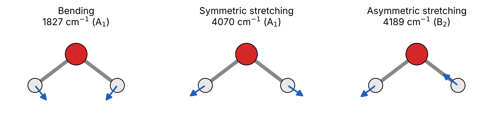
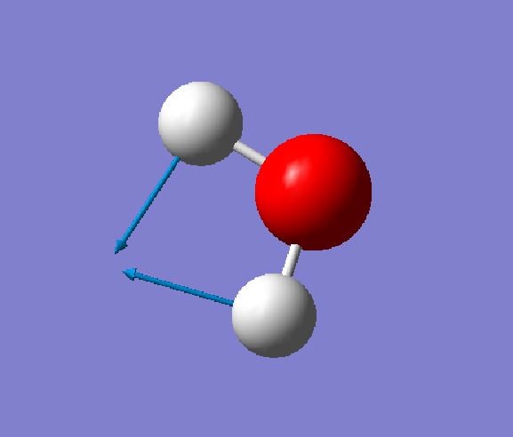
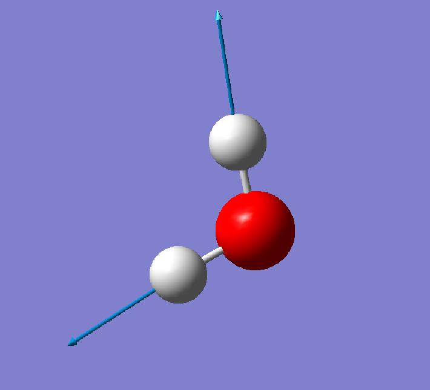

# Ex. 2 — Vibrational frequencies of water

[← Session 03](../) · [Bash guide](../../../docs/bash-for-gaussian.md)

## Task

Optimise water at HF/6-31G* and compute its harmonic vibrational frequencies. Identify the three normal modes, their symmetry and their IR activity, and compare the frequencies with experiment.

## Approach

**Optimise and compute frequencies in one job.** The route line `#hf/6-31G* opt=z-matrix freq` chains both steps: Gaussian first optimises the geometry, then starts a second job (a second `Normal termination` in the output) that computes the frequencies at the optimised geometry, with the same method and basis set. That matters, because harmonic frequencies only make sense at a stationary point of the *same* potential energy surface. Computed anywhere else, the gradient is not zero and the result is meaningless.

**Start from Ex. 1.** The input is the water template of [Ex. 1](../ex1-optimized-geometries/), with the same Z-matrix and the same deliberately poor start at 90°. The optimised geometry is identical to that of Ex. 1 with 6-31G*, down to the last printed digit: r = 0.9473 Å, ∠HOH = 105.4963°, E = −76.0107465152 hartree.

**Check that it is a minimum.** A minimum has only real (positive) frequencies, and a transition state has exactly one imaginary one. Water gives three positive frequencies. Gaussian also prints the six "low frequencies" of the translations and rotations, which should be zero: here they are between −2 and 14 cm⁻¹, small enough to confirm that the geometry is well converged.

## Results

| Mode | Symmetry | ν harmonic (cm⁻¹) | ν scaled × 0.8953 | ν exp. (cm⁻¹) | IR intensity (km/mol) | Force constant (mDyne/Å) |
|---|---|---|---|---|---|---|
| Bend | A₁ | 1827 | 1635 | 1595 | 107 | 2.13 |
| Symmetric stretch | A₁ | 4070 | 3644 | 3657 | 18 | 10.21 |
| Antisymmetric stretch | B₂ | 4189 | 3750 | 3756 | 58 | 11.19 |

Experimental fundamentals: NIST CCCBDB. Scale factor for HF/6-31G(d): Scott & Radom (1996). Zero-point energy: 0.022977 hartree (14.4 kcal/mol).

  

<table>
<tr>
<td align="center"> Bend, 1827 cm⁻¹</td>
<td align="center"> Symmetric stretch, 4070 cm⁻¹</td>
<td align="center"> Antisymmetric stretch, 4189 cm⁻¹</td>
</tr>
</table>

Displacement vectors as shown by GaussView.

The diagram matches the displacement vectors printed in the output: in the bend, both H atoms move in and down, closing the angle; in the symmetric stretch, both move out along their bonds; in the antisymmetric stretch, one H moves towards the O while the other moves away, and the O shifts sideways to keep the centre of mass fixed.

## Reading

- **Three modes, as expected.** A nonlinear molecule has 3N − 6 = 3 vibrations. Two are totally symmetric (A₁) and keep the C₂ᵥ symmetry; the antisymmetric stretch (B₂) breaks the equivalence of the two O–H bonds. All three change the dipole moment, so all three are IR active.
- **Harmonic HF frequencies are 11–15 % too high.** Two errors add up. The harmonic approximation treats the well as a parabola, while the real one is anharmonic and softer, so real fundamentals are lower. And Hartree–Fock, with bonds that are too short, also gives force constants that are too large: a stiffer spring vibrates faster.
- **One scale factor fixes most of it.** Multiplying by 0.8953, a factor fitted once for HF/6-31G(d) over many molecules, brings both stretches within 15 cm⁻¹ of experiment. The bend stays 40 cm⁻¹ too high: a single factor cannot correct every mode equally.
- **Stretching is stiffer than bending.** The O–H stretching force constants (10–11 mDyne/Å) are five times larger than the bending one (2.1 mDyne/Å). It takes far more energy to stretch a bond than to open an angle.
- **Intensity is not frequency.** The bend is the strongest band in the spectrum (107 km/mol) and the symmetric stretch the weakest (18 km/mol). IR intensity depends on how much the dipole moment changes during the vibration, not on how stiff the bond is.

## Scripts

[`extract.sh`](extract.sh), commented line by line, reads the normal-mode block of the output: symmetry labels, frequencies, IR intensities and force constants, plus the zero-point energy. Gaussian prints modes in columns of three, so the script turns each row into a list and pastes the lists side by side. It works for any molecule, whatever its number of modes. Patterns: [pulling one number out of a log](../../../docs/bash-for-gaussian.md#2-pulling-one-number-out-of-a-log), [gluing columns together](../../../docs/bash-for-gaussian.md#6-gluing-columns-together), [functions](../../../docs/bash-for-gaussian.md#7-functions-write-it-once).

## Files

| File | What it is |
|---|---|
| [`h2o_freq.com`](h2o_freq.com) | Optimisation + frequencies of water, HF/6-31G* |
| [`extract.sh`](extract.sh) | Writes mode, symmetry, frequency, IR intensity and force constant |
| [`frequencies.txt`](frequencies.txt) | Output of `extract.sh` |

Run with `../run.sh && ./extract.sh h2o_freq.log > frequencies.txt`.
