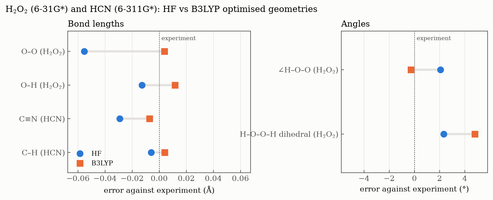

# Ex. 4 — HF vs B3LYP geometries

[← Session 03](../) · [Bash guide](../../../docs/bash-for-gaussian.md)

## Task

Optimise hydrogen peroxide (HOOH), acetylene (HCCH) and hydrogen cyanide (HCN) with Hartree–Fock and with the B3LYP density functional, and compare both sets of geometries with experiment. HOOH and HCCH use the 6-31G* basis set and HCN uses 6-311G*, as the exercise specifies.

## Approach

**Same input, different method.** Only the HF inputs are written by hand. [`generate.sh`](generate.sh) builds each B3LYP input by changing two words with `sed`: the method in the route line and the last word of the title. Molecule, basis set and starting geometry are therefore identical, and any difference in the results comes from the method alone.

**Dummy atoms for linear molecules.** A Z-matrix cannot define an atom with a 180° angle, because the dihedral that should place the next atom becomes undefined. The usual trick is a dummy atom `X`, placed 1 Å away from a carbon at 90° to the axis: each H is then defined at 90° from `X` with a dihedral of 180°, which puts it on the axis. That works for HCN, which needs only one. It went wrong for HCCH: see [below](#acetylene-came-out-bent).

**Why these three molecules.** They put HF to the test where it is known to be weak: an O–O single bond between two atoms with lone pairs (HOOH), two triple bonds (C≡C and C≡N), and a torsion on a very flat potential energy surface (the H–O–O–H dihedral).

## Results

| Parameter | HF | B3LYP | Exp. | HF error | B3LYP error |
|---|---|---|---|---|---|
| **H₂O₂** (6-31G*) | | | | | |
| r(O–O) (Å) | 1.3964 | 1.4556 | 1.452 | −0.055 | +0.004 |
| r(O–H) (Å) | 0.9492 | 0.9737 | 0.962 | −0.013 | +0.012 |
| ∠H–O–O (°) | 102.07 | 99.71 | 100.0 | +2.1 | −0.3 |
| H–O–O–H dihedral (°) | 116.04 | 118.50 | 113.7 | +2.3 | +4.8 |
| **HCN** (6-311G*) | | | | | |
| r(C≡N) (Å) | 1.1268 | 1.1489 | 1.156 | −0.029 | −0.007 |
| r(C–H) (Å) | 1.0581 | 1.0681 | 1.064 | −0.006 | +0.004 |

Experimental values: H₂O₂, semi-experimental equilibrium structure from Herberth, Giesen and Yamada, *J. Mol. Spectrosc.* **2019**, 362, 37 ([arXiv:2105.09186](https://arxiv.org/abs/2105.09186)); NIST CCCBDB lists only an older 1962 fit (1.475 Å, 0.950 Å, 94.8°, 119.8°). HCN: NIST CCCBDB. All six optimisations converged ("Stationary point found").



### Acetylene came out bent

Both HCCH optimisations converged, but to the wrong molecule. Gaussian reports point group Cs instead of D∞h, and the final coordinates give the angles

| | ∠H–C–C (first H) | ∠C–C–H (second H) |
|---|---|---|
| HF/6-31G* | 180.0° | **129.9°** |
| B3LYP/6-31G* | 180.0° | **129.4°** |

The cause is the line that places the second hydrogen:

```
C
C 1 rcc
X 1 1.0 2 90.0
H 1 rch 3 90.0 2 180.0
H 2 rch 3 90.0 1 180.0     <- 90° from X, but X sits on the FIRST carbon
```

For the first H, the 90° angle to `X` is measured at C1, where `X` stands perpendicular to the axis, so the H lands on the axis. For the second H, the same 90° is measured at C2, and seen from C2, `X` is not perpendicular to the axis. The H is placed off the axis, and since angles are constants in this Z-matrix and only `rcc` and `rch` are optimised, the molecule stays bent. The fix is one dummy atom per carbon:

```
C
C 1 rcc
X 1 1.0 2 90.0
X 2 1.0 1 90.0 3 0.0
H 1 rch 3 90.0 2 180.0
H 2 rch 4 90.0 1 180.0
```

This is exactly the Z-matrix already written in [Session 01](../../01-linux-and-z-matrices/z-matrices/hcch.zmat). Converting both Z-matrices to Cartesian coordinates confirms the diagnosis: the original one gives 129.8° for the second H, the same as Gaussian, and the corrected one gives 180.0° for both. The bent results (HF: r(C≡C) = 1.1965 Å, r(C–H) = 1.0624 Å; B3LYP: 1.2162 Å and 1.0730 Å) are kept in [`results.txt`](results.txt) for the record, but they are not the geometry of acetylene and are left out of the comparison. The inputs in this folder are the ones that were run. The calculation with the corrected Z-matrix is pending.

**Lesson:** "Stationary point found" means the optimiser found the minimum *of the coordinates it was allowed to change*. It says nothing about whether the constraints were right. Checking the point group in the output (Cs where D∞h was expected) is the quickest way to catch this kind of error.

## Conclusions

1. **HF systematically shortens bonds between heavy atoms.** The largest errors appear in bonds involving lone pairs or multiple bonds: the O–O bond of HOOH is 0.055 Å too short, and the C≡N bond of HCN 0.029 Å too short. As in [Ex. 1](../ex1-optimized-geometries/), this reflects the lack of electron correlation in the Hartree–Fock method.

2. **B3LYP largely corrects these errors.** With B3LYP, the O–O and C≡N distances fall within 0.007 Å of experiment, and the H–O–O angle improves from +2.1° (HF) to −0.3°. Including electron correlation, even approximately through the exchange–correlation functional, is essential to describe these bonds accurately.

3. **Acetylene.** The HCCH results are not compared here: the Z-matrix produced a bent molecule (see [above](#acetylene-came-out-bent)), so its bond lengths do not describe acetylene. This conclusion will be completed once the corrected calculation is run.

4. **The HOOH dihedral angle is the most sensitive parameter.** Both methods overestimate it. The torsional potential energy surface of H₂O₂ is very flat, so small changes in the computed energy shift the position of the minimum considerably. In addition, the experimental value is a vibrationally averaged quantity for a large-amplitude motion, not the bottom of the potential well.

**Overall.** B3LYP reproduces bond lengths and angles much better than HF with the same basis set, especially for bonds where correlation effects are important (O–O, C≡N). Torsional angles on flat potential energy surfaces remain challenging for both methods at this level.

## Scripts

Both scripts are commented line by line.

- [`generate.sh`](generate.sh) turns each HF input into its B3LYP version with two `sed` substitutions in a single call, then runs the six jobs with the session's [`run.sh`](../run.sh). Pattern: [generating inputs from a template](../../../docs/bash-for-gaussian.md#5-generating-inputs-from-a-template).
- [`extract.sh`](extract.sh) prints every optimised variable of every output. The three molecules use different variable names, so instead of asking for each one by name, it keeps every line of the *Optimized Parameters* table that holds a variable. Pattern: [pulling one number out of a log](../../../docs/bash-for-gaussian.md#2-pulling-one-number-out-of-a-log).

## Files

| File | What it is |
|---|---|
| [`hooh_hf.com`](hooh_hf.com), [`hcch_hf.com`](hcch_hf.com), [`hcn_hf.com`](hcn_hf.com) | Hand-written HF inputs, used as templates (HCCH as run, with the Z-matrix error) |
| [`generate.sh`](generate.sh) | Builds the B3LYP inputs and runs all six jobs |
| [`extract.sh`](extract.sh) | Prints the optimised variables of every output |
| [`results.txt`](results.txt) | Output of `extract.sh` |
