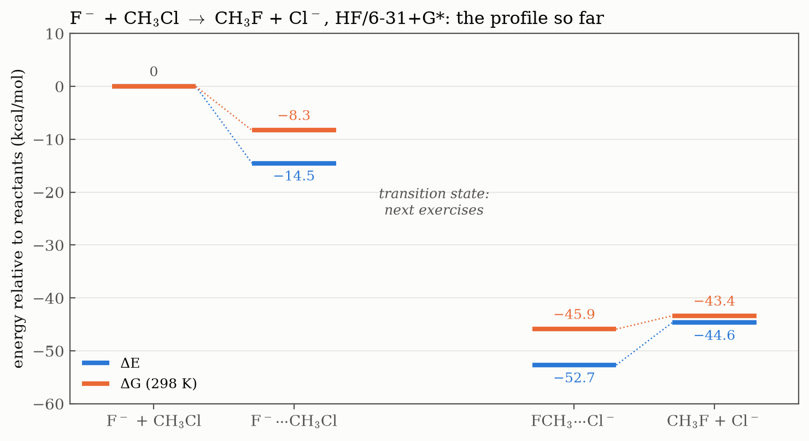

# Session 04 — An SN2 Reaction

From structures to reactions: the gas-phase substitution

F⁻ + CH₃Cl → CH₃F + Cl⁻

followed at the HF/6-31+G\* level. The first exercises characterise the stationary points on each side, and the next ones build the energy profile between them.



## Contents

Each exercise folder has its own README with the task and the reasoning behind each step, and its scripts are commented line by line. The Bash patterns are explained in the **[Bash for Gaussian guide](../../docs/bash-for-gaussian.md)**.

| Exercise | Question | Level of theory |
|---|---|---|
| [Ex. 1 — Reactants and products](ex1-reactants-and-products/) | What are E, H and G of the four species, and the energy of the overall reaction? | HF/6-31+G\*, opt + freq |
| [Ex. 2 — Ion-dipole complexes](ex2-ion-dipole-complexes/) | How strongly is each ion bound, and how much does it already weaken the C–X bond? | HF/6-31+G\*, opt + freq |

More exercises will be added as the session goes on.

---

## Ex. 1 — Reactants and products

The two ions and the two halomethanes, each with a frequency calculation so that H and G are available for every species, the single atoms included.

| | F⁻ | Cl⁻ | CH₃Cl | CH₃F |
|---|---|---|---|---|
| E (hartree) | −99.418586 | −459.539661 | −499.094158 | −139.044227 |
| G, 298 K (hartree) | −99.432745 | −459.554684 | −499.076105 | −139.023276 |
| r(C–X) (Å) | – | – | 1.786 | 1.371 |

- **Anions need diffuse functions,** the `+` in 6-31+G\*: the extra electron spreads far from the nucleus, beyond the reach of an ordinary basis set.
- **Atoms need `freq` too:** with no vibrations, their H and G come from translation alone (H − E = 5/2 RT = 1.48 kcal/mol), but the reaction energies need them.
- **The reaction is strongly downhill:** ΔE = −44.6 and ΔG = −43.4 kcal/mol.
- **A Z-matrix with the symmetry built in:** one variable per kind of bond and angle, and the atom on the C₃ axis second, so the three hydrogens are equivalent by construction.

Full table, the first Z-matrix and what was wrong with it, and how the extraction script evolved: [Ex. 1 README](ex1-reactants-and-products/).

---

## Ex. 2 — Ion-dipole complexes

Each ion held behind the C–X bond, on the C₃ axis, where the SN2 attack happens. A dummy atom keeps three collinear atoms out of the Z-matrix. Both complexes are true minima.

| | F⁻···CH₃Cl | FCH₃···Cl⁻ |
|---|---|---|
| Complexation ΔE (kcal/mol) | −14.51 | −8.04 |
| Complexation ΔG, 298 K (kcal/mol) | −8.29 | −2.52 |
| Ion to carbon (Å) | 2.586 | 3.423 |
| C–X bond, free → complex (Å) | 1.786 → 1.864 | 1.371 → 1.399 |
| C–X stretch, free → complex (cm⁻¹) | 779 → 560 | 1155 → 1057 |

- **The ion starts the reaction.** It donates into σ\*(C–X), and the bond weakens without breaking: C–Cl stretches by 0.078 Å and its frequency drops by 28 %.
- **Three measurements, one ratio.** The bond length, the frequency and the charge transferred all change about 3 times more in F⁻···CH₃Cl: F⁻ is the better donor, and C–Cl the better acceptor.
- **ΔG is not ΔE.** Two particles becoming one cost 5 to 6 kcal/mol of translational entropy, so FCH₃···Cl⁻ is barely bound in free energy.

Dummy atoms, the `rch 108.` that broke the first run, reading the frequencies, and conclusions: [Ex. 2 README](ex2-ion-dipole-complexes/).

---

## Reproducing everything

On a machine with Gaussian 09 (`g09` in the `PATH`):

```bash
cd ex1-reactants-and-products && ../run.sh && ./extract.sh && cd ..
cd ex2-ion-dipole-complexes && ../run.sh && ./extract.sh && cd ..
python plot_figures.py   # matplotlib
```

[`run.sh`](run.sh) is the same launcher as in the previous sessions: it runs every input in a folder and skips the jobs that already finished normally.

Gaussian output files (`.log`, `.chk`) are not stored. Everything the analysis needs is in the extracted data files.
