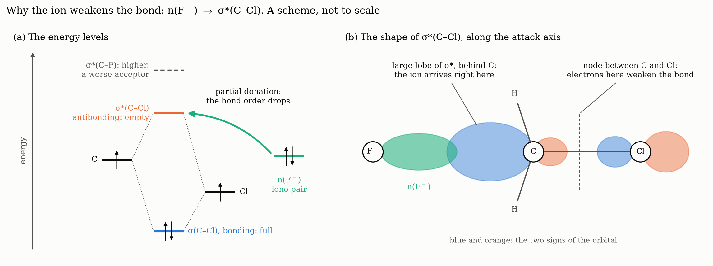
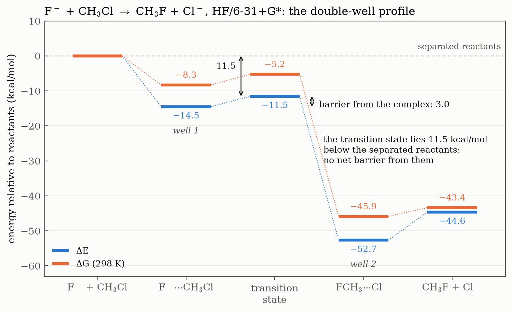

# Ex. 2 — Ion-dipole complexes

[← Session 04](../) · [Bash guide](../../../docs/bash-for-gaussian.md)

## Task

Optimise the two ion-dipole complexes of the SN2 reaction at the HF/6-31+G\* level, F⁻···CH₃Cl on the reactant side and FCH₃···Cl⁻ on the product side. Confirm that they are minima, compare them with the separated species of [Ex. 1](../ex1-reactants-and-products/), and compute their complexation energies.

## Approach

### Three questions before writing any input

**Charge and multiplicity.** The charge adds up: −1 + 0 = −1. The multiplicity depends on whether any electron is left unpaired: F⁻ (10 electrons, like neon) and CH₃Cl are both closed-shell, and bringing them together unpairs nothing, so S = 0 and 2S + 1 = 1. The line is `-1 1`.

**Where does the ion sit?** Behind the leaving group, on the C₃ axis, which is the direction of attack in an SN2 reaction (Walden inversion). The complex has **C₃ᵥ** symmetry.

**How does the ion enter the Z-matrix?** With a **dummy atom**. A dihedral is the angle between two planes, and through three atoms in a straight line, such as F, C and Cl, pass infinitely many planes: the dihedral is undefined. An angle of exactly 180° also causes numerical trouble in an optimisation. So a dummy `X` sits on the carbon, perpendicular to the axis, and Cl and F are both placed at 90° from it, facing each other. It has no nucleus and no electrons, and it is only a geometric reference, the same trick as in the [Session 01 acetylene](../../01-linux-and-z-matrices/z-matrices/hcch.zmat).

### The Z-matrix

[`f_ch3cl.com`](f_ch3cl.com), where the dummy atom counts in the numbering (C = 1, X = 2, Cl = 3, F = 4, H = 5, 6, 7):

```
C
X 1 1.                 dummy, 1 Å from C: a reference, so a fixed number
Cl 1 rccl 2 90.        Cl-C-X = 90°
F 1 rcf 2 90. 3 180.   F-C-X = 90° and dihedral F-C-X-Cl = 180°: right in
                         front of the Cl, with no 180° angle anywhere
H 1 rch 3 a 2 0.       angle H-C-Cl = a; the dihedral only fixes the orientation
H 1 rch 3 a 5 120.     the other two H, turned by +120° and -120° from the
H 1 rch 3 a 5 -120.      first: equivalent by construction (C3v)

rccl 1.80
rcf 2.60
rch 1.08
a 108.
```

**Starting values come from what is already known.** `rccl` is a little longer than in free CH₃Cl (1.786 Å, from Ex. 1), since the ion stretches the bond. `rcf` is much longer than a C–F bond (1.37 Å), since this is an ion held by a dipole, not a bond. [`ch3f_cl.com`](ch3f_cl.com) is the same skeleton with the roles swapped: `rcf 1.40`, and `rccl 3.20` because Cl⁻ is larger than F⁻.

## Results

Both jobs end with two `Normal termination` lines (`opt` and `freq`) in point group C₃ᵥ. That alone does not make them minima: a saddle point also terminates normally. The frequencies do: **all 12 are real in both complexes** (6 real atoms, 3 × 6 − 6; the dummy atom does not vibrate). Unlike planar glycine in [Session 03, Ex. 8](../../03-geometries-and-conformers/ex8-glycine-conformers/), this imposed symmetry hid no saddle point.

| | F⁻···CH₃Cl | FCH₃···Cl⁻ |
|---|---|---|
| E (hartree) | −598.535868 | −598.596697 |
| E + ZPE (hartree) | −598.494856 | −598.553901 |
| H, 298 K (hartree) | −598.488751 | −598.547782 |
| G, 298 K (hartree) | −598.522055 | −598.581975 |
| r(C–Cl) (Å) | 1.864 | 3.423 |
| r(C–F) (Å) | 2.586 | 1.399 |
| r(C–H) (Å) | 1.070 | 1.077 |

Data: [`results.txt`](results.txt), written by [`extract.sh`](extract.sh).

**Complexation energy**, each complex against its separated fragments from Ex. 1 (worked out by hand: two subtractions do not need a script):

ΔE = [E(complex) − E(ion) − E(molecule)] × 627.5

| | ΔE (kcal/mol) |
|---|---|
| F⁻···CH₃Cl, from F⁻ + CH₃Cl | **−14.51** |
| FCH₃···Cl⁻, from Cl⁻ + CH₃F | **−8.04** |

**Reading the frequencies.** Three zones appear in both spectra:

| Zone (cm⁻¹) | F⁻···CH₃Cl | FCH₃···Cl⁻ | Motion |
|---|---|---|---|
| below 200 | 104, 104, 162 | 86, 86, 88 | The ion moving against the molecule: no bond, a very soft spring |
| C–X stretch | **560** | **1057** | C–Cl and C–F |
| 1000–1700 | | | H bends |
| above 3000 | | | C–H stretches |

The repeated values are **degenerate modes**: in C₃ᵥ, a motion perpendicular to the axis can happen in two equivalent directions with the same energy. Free CH₃Cl has its C–Cl stretch at **779 cm⁻¹**. Since ν ∝ √(k/μ) and the atoms are the same, μ does not change: what drops is k. The bond is weaker.

## Conclusions

1. **The C–X bonds get longer.** The anion donates electron density into the σ\*(C–X) orbital, so the bond is weakened: C–Cl by +0.078 Å and C–F by +0.027 Å. The C–Cl stretching frequency drops from 779 to 560 cm⁻¹ (−28 %). The C–Cl bond changes about 3 times more because F⁻ is a better donor (it gets closer) and C–Cl is a better acceptor (a weaker bond, with a lower σ\* orbital). For the same reason, Cl⁻ is a better leaving group.
2. **F⁻ gets closer** (2.59 vs 3.42 Å): it has the same charge as Cl⁻ but it is smaller, so it has a higher charge density.
3. **Complexation energy:** −14.51 vs −8.04 kcal/mol. F⁻ is closer to the carbon, so the ion-dipole interaction, which goes as q·μ/r², is stronger and the complex is more stabilised.

**The chemistry behind them.** Partly filling an antibonding orbital lowers the bond order, (bonding − antibonding electrons)/2, so the bond weakens without breaking. Filling it completely would break it, and that is the reaction itself: the complex is its first step. The large lobe of σ\*(C–X) sits behind the carbon, exactly where the ion arrives. As for why C–F is the stronger bond, size matters more than electronegativity: F is in the same period as C, so the overlap is better.



The scheme puts both ideas in one picture. On the left, the lone pair of the ion donates into the empty antibonding level, and σ\*(C–Cl) lies lower than σ\*(C–F), which is why C–Cl is the better acceptor. On the right, the large lobe of σ\* faces the incoming ion, so the attack comes from behind and ends in Walden inversion, while the node between C and Cl is why electrons in this orbital weaken the bond.

This is the same n → σ\* donation as the anomeric effect in [fluoromethanol](../../03-geometries-and-conformers/ex7-fluoromethanol-rotation/), where it only tilts a conformational preference. Here it goes all the way: the ion ends up forming a new bond and the old one breaks.

## Beyond the exercise

**The other measurements agree.** The conclusions rest on bond lengths and one frequency, but the outputs hold more evidence, collected in [`comparison.txt`](comparison.txt):

| | CH₃Cl | F⁻···CH₃Cl | CH₃F | FCH₃···Cl⁻ |
|---|---|---|---|---|
| C–X stretch (cm⁻¹) | 779 | 560 (−28 %) | 1155 | 1057 (−8 %) |
| H–C–X angle (°) | 108.43 | 107.05 | 108.49 | 108.35 |
| Mulliken charge on the ion | – | −0.952 | – | −0.985 |

- **The C–F frequency confirms the trend:** −8 % against −28 %, the same ratio of about 3 as the bond lengths.
- **Charge really moves.** F⁻ has given away about 0.05 e, and Cl⁻ about 0.015 e, again a ratio of about 3. Mulliken charges are not reliable in absolute terms, least of all with diffuse functions, but the comparison between two similar systems is meaningful, and it is the donation that conclusion 1 describes.
- **The umbrella starts to close.** In the transition state the CH₃ group has to pass through a planar arrangement, with H–C–X = 90°. The H–C–Cl angle has already dropped by 1.4° in F⁻···CH₃Cl, and H–C–F by only 0.1° in the other complex. The structure of the reactant complex already leans towards the reaction.

**The profile takes shape.** With Ex. 1 and these two complexes, four points of the reaction are known:



The product side lies far below the reactant side, and each side has its own well. Between them is the transition state, which is what the next exercises have to find.

**ΔG tells a different story from ΔE.** Against separated fragments, the complexes are much less bound in free energy: −8.3 kcal/mol for F⁻···CH₃Cl and only −2.5 kcal/mol for FCH₃···Cl⁻. Two particles becoming one lose their independent translation, which costs 5 to 6 kcal/mol at 298 K and 1 atm. In ΔH the change is tiny (−14.4 and −7.8 kcal/mol), so nearly all of it is entropy.

**Two caveats.** The complexation energies include no correction for basis set superposition error, so they are somewhat too negative. And the very soft modes below 200 cm⁻¹ are the ones the harmonic approximation describes worst, and they dominate the vibrational entropy, so the ΔG values are less certain than the ΔE ones.

## How it went

- **The first Z-matrix** had 4 H and no Cl, a hydrogen in second position (the slip of Ex. 1 again; here the axis is set by `X`), no `opt=z-matrix freq` in the route line, and no block of variables.
- **The first run failed** with `Convergence failure -- run terminated` in the first SCF step. The clue was the energy, −596.86 hartree, almost 2 hartree above the sum of the fragments (about −598.5): that points at a badly built geometry, not at the SCF. `cat f_ch3cl.com` showed `rch 108.`, the value of the angle typed into the C–H distance, which put the three hydrogens 108 Å away from the carbon. When a job fails, look at the input first; only if it is right does it make sense to try something like `scf=xqc`.
- **The second complex** had three slips of its own: `rcck` for `rccl` (a variable that does not exist), `a 180.` (all three H on the axis, in the same point), and invented distances.
- **The rule that came out of it:** before launching, go through each variable and ask what that number means in the molecule. Both serious failures of the day were numbers that did not fit what they represented.
- **The extraction script was written from scratch,** and the table of what went wrong along the way is now in the [Bash guide](../../../docs/bash-for-gaussian.md#2-pulling-one-number-out-of-a-log): generic patterns such as `"Energy"`, `head -3` to pick a line, the archive at the end of the log, and field 6 being the gradient instead of the distance. Each line was tested alone in the terminal before going into the script, and the final version worked the first time.

## Scripts

[`extract.sh`](extract.sh) reads E, E + ZPE, H, G and the three bond lengths of each output. Pattern: [pulling one number out of a log](../../../docs/bash-for-gaussian.md#2-pulling-one-number-out-of-a-log).

## Files

| File | What it is |
|---|---|
| [`f_ch3cl.com`](f_ch3cl.com), [`ch3f_cl.com`](ch3f_cl.com) | `opt freq` of each complex, with a dummy atom and C₃ᵥ symmetry built in |
| [`extract.sh`](extract.sh) | Writes the energies and bond lengths of both complexes to `results.txt` |
| [`results.txt`](results.txt) | Output of `extract.sh` |
| [`comparison.txt`](comparison.txt) | C–X stretch, H–C–X angle and ion charge, free and in the complex, copied from the outputs |

The energy profile, from the results of Ex. 1 and Ex. 2, and the orbital scheme, a drawing with no data behind it, are built by [`plot_figures.py`](../plot_figures.py).
