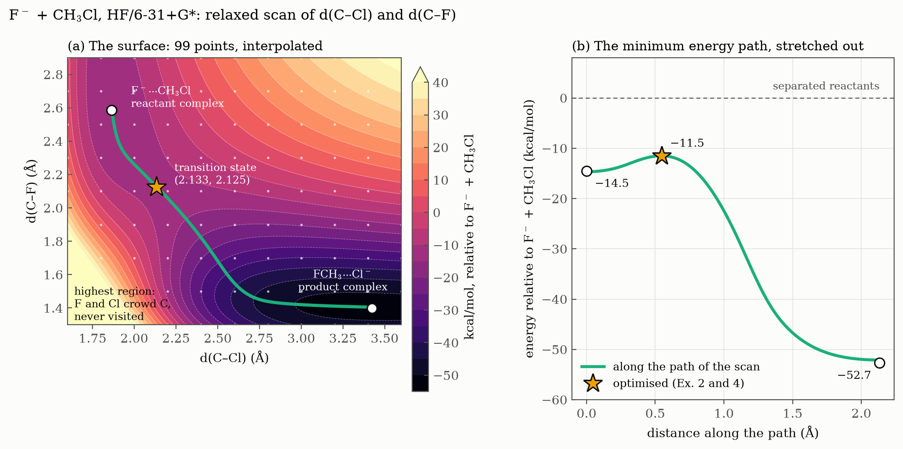

# Ex. 3 — The potential energy surface

[← Session 04](../) · [Bash guide](../../../docs/bash-for-gaussian.md)

## Task

Map the energy of F⁻ + CH₃Cl → CH₃F + Cl⁻ as a function of the two bonds that change, d(C–F) and d(C–Cl), with a relaxed two-dimensional scan at the HF/6-31+G\* level. Find the two valleys, the path between them and the pass that the transition state of [Ex. 4](../ex4-transition-state/) will be started from.



## Approach

### The input

[`sep.com`](sep.com), given by the exercise and typed in by hand (copying from the PDF brings in odd spaces):

```
#HF/6-31+G* opt=z-matrix

SEP

-1 1
C
F 1 r1
H 1 r2 2 a2
H 1 r3 2 a3 3 z3
H 1 r4 2 a4 3 z4
X 1 1.0 2 90. 3 0.
Cl 1 r5 6 a5 2 z5

r1 1.3 S 8 0.2
r5 3.6 S 10 -0.2
...
```

The numbering is C = 1, F = 2, H = 3, 4, 5, X = 6, Cl = 7.

- **The dummy atom** does the same job as in [Ex. 2](../ex2-ion-dipole-complexes/): `X` at 90° from F, and Cl at 90° from `X` with a dihedral of 180° from F, so Cl sits opposite F with no angle of 180° in the Z-matrix.
- **No symmetry imposed.** Each H has its own distance and angle, and `a5` is a variable. Along the reaction the CH₃ group turns inside out (Walden inversion) and the geometry changes a lot: forcing C₃ᵥ would decide the path in advance. More variables give the molecule the freedom to find the best one.

### What the scan does

| | Start | Steps | End | Points |
|---|---|---|---|---|
| `r1 1.3 S 8 0.2`, d(C–F) | 1.3 Å | 8 × 0.2 | 2.9 Å | **9** |
| `r5 3.6 S 10 -0.2`, d(C–Cl) | 3.6 Å | 10 × (−0.2) | 1.6 Å | **11** |

- **Points are steps + 1:** the starting value counts.
- **It starts at the products,** with C–F bonded and Cl far away, and moves towards the reactants.
- **It is a grid:** every value of r1 with every value of r5, 9 × 11 = **99 optimisations**.
- **It is a relaxed scan:** at each point r1 and r5 are held and `opt` optimises everything else, as in the [dichloroethane scan of Session 03](../../03-geometries-and-conformers/ex5-dichloroethane-scan/), now with two coordinates.

The job ran in the background, and the number of points done was followed with `grep -c "Stationary point found" sep.log`, since every point ends with that line. It took about 15 minutes and ends with a single `Normal termination`: there is no `freq`.

## Results

### Getting the numbers out

The scan summary at the end of the log has two traps, so it is not used:

1. **The energies are glued together:** `-598.58982-598.59118-598.56580...`. Gaussian gives each number a fixed width of 10 characters, `-598.58982` fills it, and no room is left for a space. For `awk` that is one field.
2. **The points come in zigzag.** Points 1 to 9 have r5 = 3.6 and r1 rising, points 10 to 18 have r5 = 3.4 and r1 *falling*, and so on. Gaussian goes over the grid the way a lawn is mown, so that each point starts from the optimised geometry of its neighbour.

The values come from the log itself instead, with one `awk` that works like a notebook: every `SCF Done` overwrites the energy, the optimised r1 is noted when its line appears, and r5, the last thing printed for each point, triggers the output:

```bash
awk '/SCF Done/ {e=$5} /! *r1 .* -DE\/DX/ {r1=$3} /! *r5 .* -DE\/DX/ {print $3, r1, e}' sep.log > scan_raw.txt
```

The commands were run by hand in the terminal and are collected in [`extract.sh`](extract.sh), commented step by step. It writes [`scan_raw.txt`](scan_raw.txt) (d(C–Cl), d(C–F), E in hartree) and [`sep.dat`](sep.dat), the same grid in kcal/mol above its lowest point, sorted, with a blank line after each row for gnuplot. The first map was drawn in the VM with gnuplot ([`sep.gnu`](sep.gnu), adapted from the script given with the course). The figure above is drawn from `scan_raw.txt` by [`plot_figures.py`](../plot_figures.py).

**Validation.** The values match the reference data given with the exercise (210.117 against 210.122 kcal/mol at the highest corner, 143.712 against 143.712 at the next point), and `wc -l` gives 99 points.

### Reading the map

The figure uses the zero of the whole session, the separated reactants F⁻ + CH₃Cl, so it can be read against the [double-well profile](../ex4-transition-state/#the-double-well-profile).

- **Two valleys,** one for each ion-dipole complex of Ex. 2: F⁻···CH₃Cl at short C–Cl and long C–F (top left), and FCH₃···Cl⁻ at long C–Cl and short C–F (bottom right). The product valley is much deeper.
- **The minimum energy path** joins the valleys along the bottom: the curve that keeps the energy as low as possible, not the most direct line between them. Following it exactly, with mass-weighted coordinates, is the IRC of Ex. 5. In the figure it is traced by walking downhill from the pass on an interpolation of the grid.
- **The pass is the transition state:** the highest point of the path, and also the lowest point of the ridge that separates the valleys. On the grid it is near (2.2, 2.1) Å.
- **The highest point of the map is not the transition state.** It is the corner where C–Cl = 1.6 Å and C–F = 1.3 Å: F and Cl pressed onto the carbon at the same time, 160 kcal/mol above the reactants. The reaction never goes there. A first guess at the transition state, (2.2, 2.5) Å, lay on the slope at about 42 kcal/mol above the lowest grid point, not on the pass.

**The interpolated surface finds the stationary points almost exactly:**

| | From the scan (interpolated) | Optimised (Ex. 2 and 4) |
|---|---|---|
| F⁻···CH₃Cl: d(C–Cl), d(C–F) (Å) | 1.866, 2.582 | 1.864, 2.586 |
| Its energy (kcal/mol) | −14.7 | −14.51 |
| Transition state: d(C–Cl), d(C–F) (Å) | 2.132, 2.128 | 2.133, 2.125 |
| Its energy (kcal/mol) | −11.5 | −11.52 |
| FCH₃···Cl⁻: d(C–Cl), d(C–F) (Å) | 3.407, 1.405 | 3.423, 1.399 |
| Its energy (kcal/mol) | −52.1 | −52.68 |

The raw grid is coarser: its lowest point, (3.4, 1.5) Å, lies 3.06 kcal/mol above the optimised product complex, because C–F = 1.40 Å falls between two grid lines.

## Conclusions

1. **The scan is validated.** The relative energies reproduce the reference data provided with the exercise (for example 210.12 kcal/mol above the lowest grid point at d(C–Cl) = 1.6 Å, d(C–F) = 1.3 Å), and the two valleys of the surface fall where the ion-dipole complexes of Ex. 2 were optimised independently.
2. **The two valleys are the ion-dipole complexes.** The reactant complex F⁻···CH₃Cl lies at about (1.86, 2.59) Å and the product complex FCH₃···Cl⁻ at about (3.41, 1.40) Å, as [d(C–Cl), d(C–F)]. The product valley is much deeper: the reaction is strongly favoured energetically.
3. **The transition state is the highest point of the reaction path, not of the surface.** The minimum energy path connects the two valleys through a saddle point at about (2.13, 2.13) Å, confirmed by the optimisation of Ex. 4 (2.133, 2.125 Å). The highest region of the map, where both halogens are close to the carbon at the same time, is never visited by the reaction.
4. **A scan only gives the shape of the surface.** The grid has a step of 0.2 Å, so it does not include the exact minima: the lowest grid point (3.4, 1.5 Å) lies about 3 kcal/mol above the optimised product complex (C–F = 1.40 Å). Exact stationary points must be obtained by optimisation.

## Beyond the exercise

**The whole path lies below the reactants.** Along the minimum energy path the energy never rises above −11.5 kcal/mol, the transition state. Panel (b) shows the double well that [Ex. 4](../ex4-transition-state/#the-double-well-profile) builds from optimised points, here drawn from the scan alone: two wells, a small hump between them, and nothing anywhere near the dashed line of the separated reactants.

**The path bends.** Near the reactant valley it runs almost parallel to the C–F axis: F⁻ comes in while C–Cl barely changes. Near the product valley it runs parallel to the C–Cl axis: Cl⁻ leaves once C–F is formed. Only around the pass do both bonds change at once. The reaction is not a single line from one corner to the other, which is why the path has to be found rather than assumed.

**An interpolation, not a calculation.** Between the 99 points, the map is a bicubic spline. It locates the pass within 0.004 Å and 0.1 kcal/mol of the optimised transition state, and the minima within 0.02 Å and 0.6 kcal/mol. The path in the figure follows the steepest descent in the two distances, which is close to, but not the same as, the IRC.

## How it went

- **`sed -n '49567.49610p'`** gave `unknown command: '.'`: the range takes a comma. `less +49567 sep.log` opens the file at that line, which is easier for a table of 280 lines.
- **`grep -E "SCF Done |Stationary point found"`** missed the `SCF Done:` lines: inside a pattern, spaces count.
- **Three wrong turns before the notebook `awk`:** `{print $5}` on `SCF Done` prints every step, not only the last one; `{print $5}` on `Stationary point found` prints field 5 of a line that has none; and `e=$('{print $5}')` mixes two languages, since `$( )` belongs to Bash and in `awk` it is just `e=$5`. In Bash `$m` is the value of `m`; in `awk`, `$5` is field 5 and variables have no `$`.
- **`grep -c "! *r1" sep.log` gave 100, not 99.** The extra line is the initial table, `! r1 1.3 Scan !`. Requiring `-DE/DX` after the value leaves exactly the 99 optimised ones, with `.*` for the number in between and the slash escaped as `DE\/DX`, because `awk` patterns are written between slashes.
- **The force on a frozen variable is not zero.** In the first point, r1 = 1.3 Å has −DE/DX = 0.0817: the molecule wants to stretch C–F towards its equilibrium (1.371 Å in [Ex. 1](../ex1-reactants-and-products/)) but is held. Only the free variables must have zero force.
- **A sign:** the first relative energies were around −750 000 kcal/mol, from `$3-598.59...`. The lowest energy is negative, so subtracting it is a sum.
- **`prev = $1` has to go last** in the `awk` that inserts the blank lines; noted first, each line is compared with itself.
- **gnuplot**, from the course script: `set terminal pngcairo` and `set output` to draw into a PNG, the new ranges, `splot 'sep.dat' u 1:2:3`, axis labels, and no `pause -1`. The colour key covered the y axis, which the figure here avoids.
- **On tools:** cclib, a Python library, reads Gaussian logs directly. It was not used, because the course assesses knowing where each number is and how to get it out, and cclib cannot say which number is the right one either.

## Files

| File | What it is |
|---|---|
| [`sep.com`](sep.com) | The relaxed 9 × 11 scan of d(C–F) and d(C–Cl) |
| [`extract.sh`](extract.sh) | The extraction commands, run by hand, collected and commented |
| [`scan_raw.txt`](scan_raw.txt) | d(C–Cl), d(C–F), E (hartree) of the 99 points, in the order of the log |
| [`sep.dat`](sep.dat) | The same grid in kcal/mol above its lowest point, sorted, for gnuplot |
| [`sep.gnu`](sep.gnu) | The gnuplot script used in the VM |
