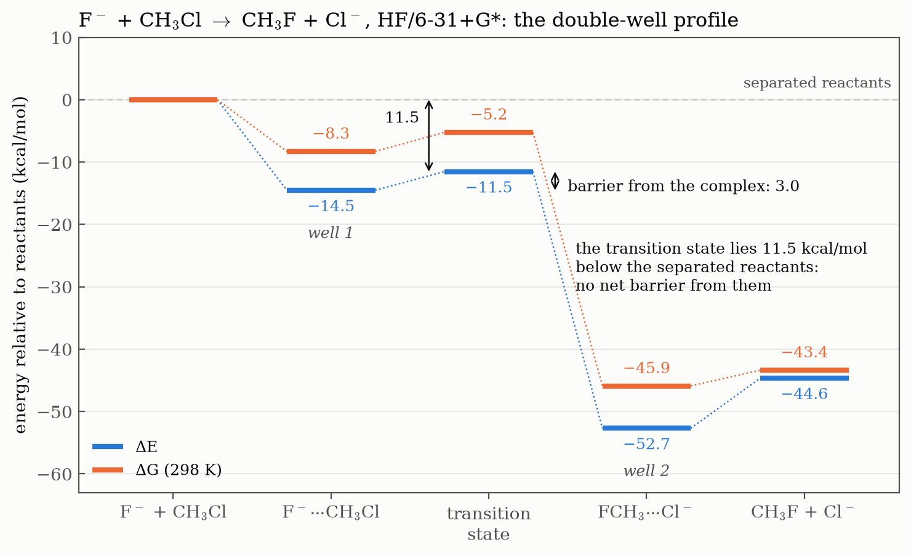
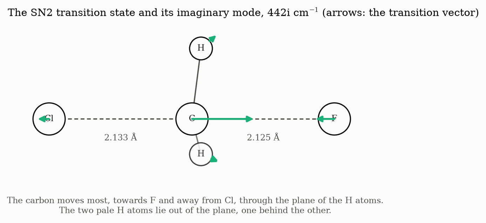

# Ex. 4 — The transition state and the double well

[← Session 04](../) · [Bash guide](../../../docs/bash-for-gaussian.md)

## Task

Locate the transition state of F⁻ + CH₃Cl → CH₃F + Cl⁻ at the HF/6-31+G\* level, starting from the pass of the [potential energy surface](../ex3-potential-energy-surface/), confirm it with its frequencies, and build the complete energy profile of the reaction.



## Approach

### The starting point comes from the scan

The highest point of the minimum energy path on the grid of Ex. 3 is at C–Cl = 2.2 Å and C–F = 2.1 Å, and the interpolated map puts the pass at about (2.13, 2.13) Å. The method itself had already been tried on three atoms in [Ex. 8](../ex8-hcn-isomerization/).

### Three changes to the scan input

[`ts_sn2.com`](ts_sn2.com) starts as a copy of `sep.com`.

**1. The route line** of the HCN transition state, with the basis set of this reaction (the `+` is there for the anions):

```
#HF/6-31+G* opt=(ts,calcfc,noeigentest,z-matrix) freq
```

**2. r1 and r5 become ordinary variables.** The first instinct was "now it is the other way round: everything fixed and ranges on r1 and r5". It is neither:

| Calculation | r1 and r5 | Everything else |
|---|---|---|
| Scan (Ex. 3) | Held at each point, stepping through a range (`S`) | Optimised |
| Transition state search | **Optimised** | **Optimised** |

`S 8 0.2` meant "do not touch r1; set it to 1.3, 1.5, ...". In the search, Gaussian moves every variable, and r1 and r5 only need starting values: `r1 2.1`, `r5 2.2`.

**3. The angles of the H atoms, the most delicate change.** In `sep.com` they are 110°, the CH₃F of the products. Along the reaction H–C–F goes from about 73° in the reactant complex (the umbrella points towards F⁻) to 108° in the product complex. Halfway through the Walden inversion the CH₃ group is planar, with H–C–F = 90°. The first guess was 75°, almost the reactants; the input uses **90°**. A transition state search depends much more on its starting point than a search for a minimum: if the geometry does not look like the transition state, the optimiser gets lost.

```
r1 2.1
r5 2.2
a2 90.
a3 90.
a4 90.
a5 90.
```

## Results

Two `Normal termination` lines. **Exactly one imaginary frequency, 442i cm⁻¹** (printed as −442.09), out of 12 (6 real atoms, 3 × 6 − 6; the dummy atom does not vibrate). It is a first-order saddle point.

| | Start | Map (Ex. 3) | Transition state |
|---|---|---|---|
| d(C–F) (Å) | 2.1 | ≈ 2.13 | **2.125** |
| d(C–Cl) (Å) | 2.2 | ≈ 2.13 | **2.133** |
| H–C–F (°) | 90 | – | **82.7** |
| `a5`, Cl–C–X (°) | 90 | – | **90.0** |

| | Hartree |
|---|---|
| E | −598.531104 |
| E + ZPE | −598.490330 |
| H, 298 K | −598.484993 |
| G, 298 K | −598.517174 |

Data: [`results.txt`](results.txt), [`frequencies.txt`](frequencies.txt) and [`transition_vector.txt`](transition_vector.txt), written by [`extract.sh`](extract.sh), which collects the `grep` commands that were run by hand.

- **`a5` = 90°:** F, C and Cl are collinear, the attack from behind.
- **C–F ≈ C–Cl:** both halogens are half bonded.
- **H–C–F = 82.7°:** the umbrella is not planar yet.
- **No symmetry was imposed,** and the three C–H bonds still come out equal within 0.0002 Å and the three angles within 0.002°: C₃ᵥ in all but name. Gaussian labels it C₁, because its tolerance for symmetry is tighter than that.

### The transition vector



Animated in GaussView, the imaginary mode is the SN2 itself: F approaches the carbon, Cl moves away, and the umbrella of H atoms turns inside out. The displacements in the log say who does the moving: the carbon (0.92), much more than F (0.28), Cl (0.17) or any H (0.13). It shuttles from Cl towards F through the plane of the three H atoms, and that passage is the Walden inversion.

**442i is much lower than the 1227i of HCN.** Here the reduced mass of the mode is 12.6 amu, since heavy atoms move, against 1.17 amu for the lone H of HCN, and ν ∝ √(k/μ).

### The double-well profile

With the transition state, every stationary point of the reaction is known. Relative to the separated reactants:

| Point | ΔE (kcal/mol) | ΔG, 298 K (kcal/mol) |
|---|---|---|
| F⁻ + CH₃Cl | 0 | 0 |
| F⁻···CH₃Cl, well 1 | −14.51 | −8.29 |
| **Transition state** | **−11.52** | **−5.22** |
| FCH₃···Cl⁻, well 2 | −52.68 | −45.89 |
| CH₃F + Cl⁻ | −44.64 | −43.37 |

| Barrier | ΔE‡ (kcal/mol) | ΔG‡ (kcal/mol) |
|---|---|---|
| From the complex F⁻···CH₃Cl | **2.99** | **3.06** |
| From the separated F⁻ + CH₃Cl | **−11.52** | **−5.22** |

This is the **double well** of SN2 reactions in the gas phase: two wells, the ion-dipole complexes, separated by a small barrier that **does not reach the level of the separated reactants**.

**The negative barrier is not a mistake.** The first reaction was "how can a ΔG‡ be negative?". A barrier is a difference between two states, and a transition state only has to lie above the two wells it connects, not above every point of the profile. Measured from the complex it is a perfectly ordinary +3 kcal/mol. Measured from the separated reactants, the transition state is 11.5 kcal/mol *below* the starting point: once F⁻ meets CH₃Cl, the energy released by forming the complex is more than enough to cross the barrier. In the gas phase there is no net barrier, and the reaction is almost as fast as the collisions.

**ΔG raises the transition state, but not above zero.** Relative to the separated reactants the transition state is at −11.52 kcal/mol in E but at −5.22 in G. Two particles become one, three translations and three rotations turn into soft vibrations, and the entropy drops: −TΔS = ΔG − ΔH = −5.22 − (−12.03) = **+6.8 kcal/mol** at 298 K. Entropy charges a toll for bringing the molecules together, the same as for the complexes of Ex. 2.

## Conclusions

1. **The transition state was located and characterised.** It has exactly one imaginary frequency (442i cm⁻¹), so it is a first-order saddle point. Its normal mode is the SN2 itself: F approaches the carbon, Cl leaves, and the CH₃ umbrella inverts (Walden inversion). Mathematically, the existence of this saddle point between the two minima is guaranteed by the mountain pass theorem, and the number of imaginary frequencies is its Morse index.
2. **The geometry is collinear and reactant-like (Hammond).** F–C–Cl is linear (`a5` = 90° to the dummy atom), and both C–X distances are almost equal (C–F 2.125 Å, C–Cl 2.133 Å), matching the saddle point of the scan of Ex. 3. The H–C–F angle is 82.7°, closer to the reactant complex (73°) than to the product complex (108°): the umbrella has not yet reached planarity. The transition state is also much closer in energy to the reactant complex (3.0 kcal/mol) than to the product complex (41.2 kcal/mol), as expected for a strongly exothermic reaction.
3. **Double-well profile.** Relative to the separated reactants (F⁻ + CH₃Cl = 0), the reactant complex lies at −14.51 kcal/mol, the transition state at −11.52 kcal/mol, the product complex at −52.68 kcal/mol and the separated products at −44.64 kcal/mol (ΔE). On the way from the reactants the only barrier starts at the reactant complex, and the transition state lies below the separated reactants, so in the gas phase there is no net barrier.
4. **Kinetics and thermodynamics.** The reaction is strongly spontaneous, ΔG = −43.37 kcal/mol. The absence of a net barrier makes it very fast in the gas phase. These are two separate conclusions, thermodynamics and kinetics.
5. **Entropy raises the free energy of the transition state.** Relative to the separated reactants, the transition state lies at −11.52 kcal/mol in E but only at −5.22 kcal/mol in G. Two particles become one, so the entropy decreases, and −TΔS ≈ +6.8 kcal/mol at 298 K.

## Beyond the exercise

**The charges agree with Hammond.** At the transition state the Mulliken charge is −0.87 on F and −0.54 on Cl. The negative charge has not been shared equally: most of it is still on the incoming F, as in the reactants. Mulliken charges are rough, but the asymmetry is large.

**In solution the double well disappears.** The wells exist because a bare ion is held by the dipole of the molecule, and in the gas phase nothing else competes for it. In a polar solvent the free ion is already surrounded by solvent molecules, which stabilise it far more than one molecule of CH₃Cl can, so the complexes are no longer deep wells and the net barrier comes back. Gas-phase SN2 reactions are fast for the same reason that they look so different from the textbook ones.

**The mathematics behind it, briefly.** Three results from analysis sit behind this session:

- **The mountain pass theorem** (Ambrosetti and Rabinowitz, 1973): for a smooth function with two separate minima (and a technical condition that rules out escaping to infinity), take every path from one to the other and, on each path, its highest point. The lowest of those highest points is a critical point that is not a minimum. That is exactly the definition of the transition state used here: the highest point of the best path.
- **Morse theory** classifies critical points by their index, the number of directions in which the function curves downwards, which is the number of negative eigenvalues of the Hessian. Mass-weighting does not change that number, so the index is the number of imaginary frequencies: 0 for a minimum, 1 for a transition state (and for [planar glycine](../../03-geometries-and-conformers/ex8-glycine-conformers/) in Session 03, whose single imaginary mode led down to the true minimum), 2 for a second-order saddle point.
- **Brouwer's fixed-point theorem** belongs to a different step, the SCF: orbitals give a field, the field gives new orbitals, and the cycle stops when they no longer change, at a fixed point. Brouwer guarantees that a continuous map of a closed ball into itself has a fixed point, but not that iterating will reach it, which is why an SCF can still fail to converge.

## How it went

- **The starting geometry was read off the scan** with `grep "^2.2 " sep.dat` and the rows around it, following the path to its highest point.
- **r1 and r5 were first going to be held,** with ranges, the reverse of what a search needs (table above).
- **The first guess for the H angles was 75°,** the reactant side; 90° matches the planar CH₃ of the middle of the inversion, and the search converged from there.
- **The energies were found by trial,** typing the part of the label that was remembered, `grep "of electronic" *.log`, looking at what matched, then narrowing the pattern and checking the field. `*.log` works because there is only one log in the folder; with two, `grep` would put the file name in front of each line and shift the fields.
- **The negative ΔG‡ looked like an error,** and the question "without a net barrier, then it is spontaneous?" was the same mix-up as in Ex. 8: the barrier says how fast, ΔG of reaction says which way.

## Files

| File | What it is |
|---|---|
| [`ts_sn2.com`](ts_sn2.com) | Transition state search from the pass of the scan, `opt=ts` and `freq` |
| [`extract.sh`](extract.sh) | Writes the three data files below |
| [`results.txt`](results.txt) | E, E + ZPE, H, G and the geometry of the transition state |
| [`frequencies.txt`](frequencies.txt) | The 12 frequencies; negative means imaginary |
| [`transition_vector.txt`](transition_vector.txt) | Geometry of the transition state and displacements of its imaginary mode |

The profile and the transition vector are drawn by [`plot_figures.py`](../plot_figures.py).
