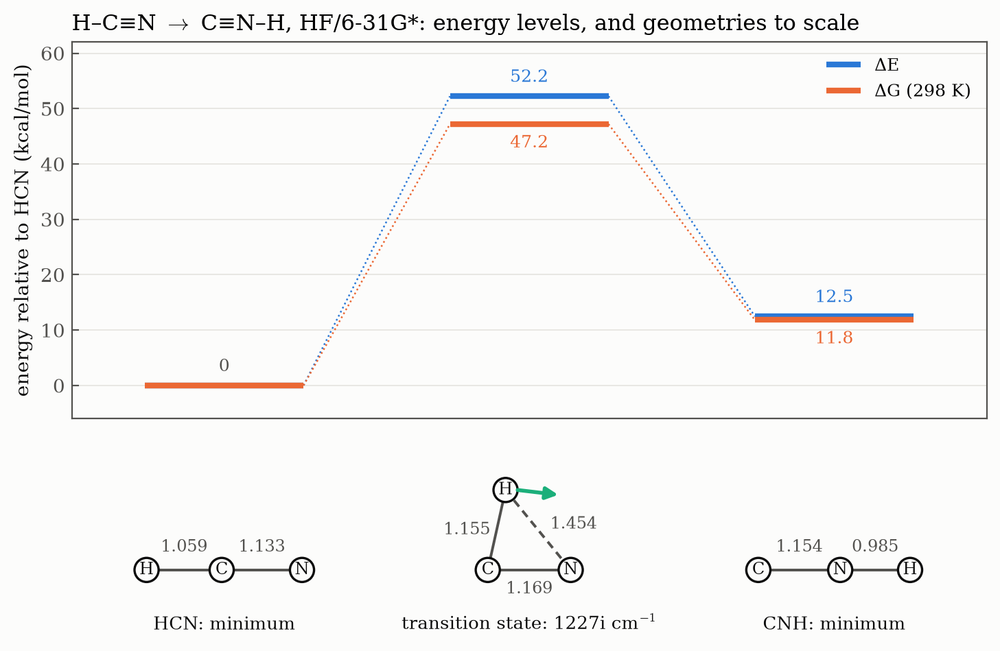

# Ex. 8 — HCN to CNH: a first transition state

[← Session 04](../) · [Bash guide](../../../docs/bash-for-gaussian.md)

## Task

Study the isomerisation H–C≡N → C≡N–H at the HF/6-31G\* level: optimise both isomers, locate the transition state, confirm it with its frequencies, and compute the reaction energy and the barrier.

This exercise was done out of order, while the long scan of Ex. 3 was running. Ex. 3 to 6 form a chain, each one starting from the previous one, but this reaction stands alone and teaches the same method with only three atoms. CNH is usually written HNC; the name here follows the order of the atoms.



## Approach

### The two minima

**Basis set and charge.** Everything is neutral and closed-shell (`0 1`), so the diffuse functions of the SN2 anions are not needed: 6-31G\*.

**A dummy atom, for a different reason.** With three atoms there is no dihedral at all: a distance needs 2 atoms, an angle 3 and a dihedral 4. What remains is the other problem from [Ex. 2](../ex2-ion-dipole-complexes/): an angle of exactly 180° causes numerical trouble. So `X` sits on the central atom, as a fixed reference, and the other two atoms go at 90° from it, facing each other. It carries no variables: with no nucleus and no electrons, no force says where it should be.

[`hcn.com`](hcn.com):

```
C
X 1 1.0
H 1 rch 2 90.
N 1 rcn 2 90. 3 180.

rch 1.07
rcn 1.15
```

In [`cnh.com`](cnh.com) the central atom is N. Only the two distances are variables, because linearity fixes the angles. That also means this Z-matrix cannot bend, so the optimisation alone says nothing about whether the linear shape is a minimum: the frequencies do.

**Starting distances.** Bond order only compares bonds between the same two atoms (C≡N < C=N < C–N). Across different atoms, size weighs more, and H is the smallest atom there is: a single N–H bond (about 1.00 Å) is shorter than a C≡N triple bond (about 1.15 Å).

### The transition state

A transition state is the point of highest energy on the path between two minima. If the minima are two valleys, it is the mountain pass: a maximum along the reaction, and a minimum in every other direction. That is a **first-order saddle point**, recognised by having **exactly one imaginary frequency**. Its normal mode, the transition vector, shows the reaction itself.

**The estimate.** The H sits above the C≡N bond and the molecule is a triangle, so no dummy atom is needed: nothing is at 180° any more. Three variables, as 3N − 6 says: two sides and the angle between them.

[`ts_hcn.com`](ts_hcn.com):

```
#HF/6-31G* opt=(ts,calcfc,noeigentest,z-matrix) freq

HCN transition state

0 1
C
H 1 rch
N 1 rcn 2 a1

rch 1.20
rcn 1.18
a1 70.0
```

`rch` is longer than in HCN because the bond is half broken, and `rcn` barely changes. The angle H–C–N has to travel from 180° in HCN to 0° in CNH, and for an H roughly equidistant from C and N the triangle is nearly equilateral, hence 70°.

| Option | What it does |
|---|---|
| `ts` | Looks for a saddle point: climbs along one direction and descends along all the others |
| `calcfc` | Computes the Hessian at the first step, since the search needs to know from the start which direction has negative curvature |
| `noeigentest` | Does not stop if, at some step, the Hessian does not have exactly one negative curvature |
| `z-matrix` | Optimises in the coordinates of the Z-matrix |
| `freq` | Essential: without it nothing proves that this is a transition state |

## Results

All three jobs end with two `Normal termination` lines. HCN and CNH are linear (C∞ᵥ) and the transition state is planar (Cₛ).

| | HCN | Transition state | CNH |
|---|---|---|---|
| E (hartree) | −92.875197 | −92.791953 | −92.855328 |
| E + ZPE (hartree) | −92.857209 | −92.780340 | −92.838276 |
| H, 298 K (hartree) | −92.853791 | −92.776563 | −92.834580 |
| G, 298 K (hartree) | −92.876524 | −92.801315 | −92.857696 |
| r(C–N) (Å) | 1.133 | 1.169 | 1.154 |
| r(C–H) (Å) | 1.059 | 1.155 | – |
| r(N–H) (Å) | – | 1.454 | 0.985 |
| H–C–N (°) | 180 | 77.5 | – |

Data: [`results.txt`](results.txt), written by [`extract.sh`](extract.sh). The N–H distance of the transition state is not a variable: it comes from the distance matrix of the log, and the law of cosines gives the same value.

Differences, multiplied by 627.5 (worked out by hand):

| kcal/mol | ΔE | ΔH | ΔG |
|---|---|---|---|
| Reaction, CNH − HCN | **+12.47** | +12.06 | **+11.81** |
| Barrier from HCN | **52.24** | 48.46 | **47.19** |
| Barrier from CNH | 39.77 | 36.41 | 35.38 |

**The frequencies decide what each structure is.** A linear molecule has 3N − 5 vibrations, not 3N − 6, because turning around its own axis moves no nucleus: 4 here, one of them doubly degenerate. The transition state is not linear, so it has 3.

| Mode (cm⁻¹) | HCN | CNH | Transition state |
|---|---|---|---|
| Bend (twice) | 889 | 541 | |
| C≡N stretch | 2438 | 2309 | 2238 |
| X–H stretch | 3681 | 4094 | 2860 |
| Imaginary | | | **1227i** |

Data: [`frequencies.txt`](frequencies.txt). Both isomers have only real frequencies, so the bends confirm that the linear geometries, imposed by the Z-matrix, are true minima. The transition state has exactly one imaginary frequency, which Gaussian prints as −1227.

**The transition vector.** Animated in GaussView, the imaginary mode moves the H from C towards N. The numbers say the same ([`transition_vector.txt`](transition_vector.txt)): the H has a displacement of 0.99, almost parallel to the C–N bond, and the reduced mass of the mode is 1.17 amu, so it is nearly the H alone.

**The energy goes up.** In `hcn.log` and `cnh.log` each `SCF Done` is lower than the one before. In `ts_hcn.log` it rises, from −92.7937 to −92.7920 hartree: the search starts on the side of the pass and climbs to its top.

## Conclusions

1. **HCN is more stable than CNH.** CNH lies 12.47 kcal/mol above HCN (ΔE), and the reaction free energy is ΔG = +11.81 kcal/mol. The reaction is not spontaneous: the equilibrium is strongly shifted towards HCN.
2. **The transition state was located and characterised.** It has exactly one imaginary frequency (1227i cm⁻¹), so it is a first-order saddle point. Its normal mode is the migration of the H atom from C to N, which connects HCN with CNH.
3. **Transition state geometry.** The molecule is bent: the H atom bridges the C≡N bond, with an H–C–N angle of 77.5°. The C≡N distance (1.169 Å) changes little compared with HCN (+0.037 Å), so nearly all the motion is the H atom. The H atom is still much closer to C (1.155 Å) than to N (1.454 Å).
4. **The barrier is high.** ΔE‡ = 52.24 kcal/mol and ΔG‡ = 47.19 kcal/mol, so the reaction is very slow at room temperature. Kinetics and thermodynamics give two separate conclusions: the barrier says that the reaction is slow, and the reaction free energy says that it is unfavourable.

The rate constant, from transition state theory and ΔG‡, is still to be done.

## Beyond the exercise

**Why ΔG‡ is 5 kcal/mol below ΔE‡.** Almost all of it is zero-point energy. HCN holds half a quantum in each of its 4 modes, but the transition state only in 3 real ones, since the imaginary mode is not a vibration: the two bends at 889 cm⁻¹ are gone. The ZPE falls from 11.29 to 7.29 kcal/mol, which takes 4.0 kcal/mol off the barrier. The other 1.3 kcal/mol is entropy: ΔS‡ = +4.25 cal/(mol·K), and the rotational term alone gives +4.54, because a bent molecule has a third rotation and a linear one does not.

**CNH is a real molecule, kept by its barrier.** Going back to HCN costs 39.77 kcal/mol, far more than the 12.47 that separate them. A species can be unstable and still persist if its way out is high enough. This is why HNC can be detected in cold interstellar clouds.

**The geometry does not follow the simple rule.** The Hammond postulate places the transition state closer to the higher species, CNH. By the distances it is the other way round: C–H is only 0.096 Å longer than in HCN, while N–H is 0.469 Å longer than in CNH, and the foot of the H on the C–N axis lies just 21 % of the way from C to N. The C≡N bond is also longer than in either isomer. The postulate is a guide for a barrier close to the reaction energy, and here the barrier is more than four times larger.

**Against experiment and better theory.** HF is expected to shorten the C≡N bond and to raise frequencies, and it does:

| HCN | HF/6-31G\* | Experiment | Error |
|---|---|---|---|
| r(C–H) (Å) | 1.059 | 1.064 | −0.005 |
| r(C≡N) (Å) | 1.133 | 1.156 | −0.023 |
| Bend (cm⁻¹) | 889 | 712 | +25 % |
| C≡N stretch (cm⁻¹) | 2438 | 2089 | +17 % |
| C–H stretch (cm⁻¹) | 3681 | 3312 | +11 % |

Experimental values from [NIST CCCBDB](https://cccbdb.nist.gov/exp2x.asp?casno=74908&charge=0). The frequencies are fundamentals, so anharmonicity is part of the gap. The usual "about 10 % too high" only holds for the C–H stretch here.

A high-level calculation (Makhnev et al., *J. Phys. Chem. A* **2018**, 122, 1326, [doi:10.1021/acsjpca.7b10483](https://doi.org/10.1021/acsjpca.7b10483)) gives a barrier of 16 809 cm⁻¹ (48.1 kcal/mol) and an isomerisation energy of 5313 cm⁻¹ (15.2 kcal/mol). HF puts the reaction energy about 3 kcal/mol too low. Its barrier is 52.2 kcal/mol, or 48.2 with ZPE, so it is between 0 and 4 kcal/mol too high depending on the reference, and part of that closeness may be luck.

**What is still unproven.** One imaginary frequency with the right motion is strong evidence, but only an IRC, which follows the path down from the saddle point on both sides, shows the connection formally. That is Ex. 5 for the SN2 reaction.

## How it went

- **The first `hcn.com`** had the `X` after the H, a variable distance and angle on the dummy atom, and 6 variables with no values. The first run also died in `l101` with a `?` below `X 1 1`: Gaussian wanted a real number, `1.`, and the blank line at the end was missing. `l101` reads the input, so dying there in a fraction of a second means a problem of writing, not of chemistry.
- **The first `cnh.com`** started from `rnc 1.07` and `rnh 1.20`, on the idea that a triple bond must be shorter than a C–H bond. The criterion fails, as explained above.
- **The first transition state input** had 4 variables, one angle too many, and the first instinct for the angle was close to 180°, which is HCN itself.
- **It then failed with two typos** in the route line, `noeingestest` and `x-matrix`. Link `l1` reads that line, and a `'` below the text marks where it stops understanding. Reading the error took less time than worrying about it.
- **The optimisation itself converged in 4 steps.** The estimate was close, which matters more here than for a minimum: a search for a saddle point gets lost much more easily.
- **Kinetics and thermodynamics got mixed up:** "the barrier is high and, with a positive ΔG, it will not be spontaneous either". The barrier is always positive, even in spontaneous reactions. It says how fast, and ΔG says which way.
- **The extraction script was written without help,** with two slips, both repeated from earlier sessions: `for m in *.log: do` with `:` instead of `;`, and the `tail -1` on the free energy instead of on `SCF Done`. The version here also collects E + ZPE, H, the geometry and the frequencies. Pattern: [pulling one number out of a log](../../../docs/bash-for-gaussian.md#2-pulling-one-number-out-of-a-log).

## Files

| File | What it is |
|---|---|
| [`hcn.com`](hcn.com), [`cnh.com`](cnh.com) | `opt freq` of each isomer, with a dummy atom |
| [`ts_hcn.com`](ts_hcn.com) | Transition state search, `opt=ts` and `freq` |
| [`extract.sh`](extract.sh) | Writes the three data files below |
| [`results.txt`](results.txt) | Energies and geometry of the three species |
| [`frequencies.txt`](frequencies.txt) | All the frequencies; negative means imaginary |
| [`transition_vector.txt`](transition_vector.txt) | Geometry of the transition state and displacements of its imaginary mode |

The figure is built by [`plot_figures.py`](../plot_figures.py).
