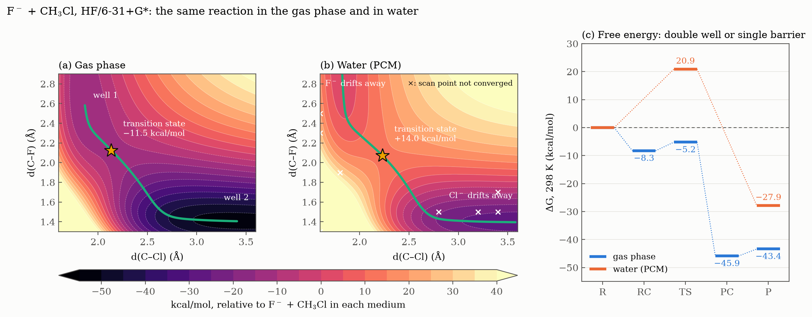

# Extra — The same reaction in water (PCM)

[← Session 04](../) · [Report](../report/) · [Bash guide](../../../docs/bash-for-gaussian.md)

## The question

In the gas phase, F⁻ + CH₃Cl follows a [double well](../ex4-transition-state/#the-double-well-profile) whose transition state lies 11.5 kcal/mol *below* the separated reactants. In water the same reaction is known to be slow. The hypothesis: water stabilises an ion more the more concentrated its charge is, so it should stabilise F⁻ much more than the transition state, where the charge is shared between F and Cl. The complexes should disappear and the transition state should rise above the reactants: the double well should turn into a single barrier.

This extension goes beyond the exercises of the session, and it is the subject of the [session report](../report/).



## Approach

Every calculation of Ex. 1 to 4 was repeated with the same input and one keyword more:

```
#HF/6-31+G* opt=z-matrix freq scrf=(pcm,solvent=water)
```

**PCM**, the polarisable continuum model, places the molecule in a cavity inside a continuous dielectric with the permittivity of water. The charge of the solute polarises the dielectric, and the dielectric acts back on the solute. It has no water molecules, so it describes the bulk electrostatics of solvation and nothing else: no hydrogen bonds.

The seven species ([`f_anion.com`](f_anion.com), [`cl_anion.com`](cl_anion.com), [`ch3cl.com`](ch3cl.com), [`ch3f.com`](ch3f.com), [`f_ch3cl.com`](f_ch3cl.com), [`ch3f_cl.com`](ch3f_cl.com), [`ts_sn2.com`](ts_sn2.com)) were re-optimised, and the relaxed scan of Ex. 3 was repeated ([`sep_pcm.com`](sep_pcm.com)).

## Results

Data: [`results.txt`](results.txt), [`sep_pcm_raw.txt`](sep_pcm_raw.txt) and [`sep_pcm.dat`](sep_pcm.dat), written by [`extract.sh`](extract.sh), which extends the extraction loop written for the exercise to all seven species and adds the scan commands of Ex. 3.

### The complexes do not survive

- **F⁻···CH₃Cl** never converged: the optimisation ran out of steps (`Number of steps exceeded, NStep= 20`, then `Error termination` in `l9999`) with F⁻ already 4.50 Å from the carbon and still moving away.
- **FCH₃···Cl⁻** converged, but with Cl⁻ 5.07 Å away, and with two tiny imaginary frequencies (10.6i and 4.9i cm⁻¹): not a minimum, only a flat region where the energy hardly changes.

In the gas phase each ion is held by the dipole of the molecule, and that attraction is all there is. In water the dielectric screens it, and the ion is better off surrounded by solvent. On the water map, panel (b), the two closed wells of the gas phase open into valleys that keep descending as the ion leaves.

### The transition state rises

The transition state is still there: one imaginary frequency, **547i cm⁻¹**, higher than the 442i of the gas phase, so the barrier is not only higher but also narrower.

| Relative to F⁻ + CH₃Cl (kcal/mol) | Gas ΔE | Gas ΔG | Water ΔE | Water ΔG |
|---|---|---|---|---|
| F⁻ + CH₃Cl | 0.00 | 0.00 | 0.00 | 0.00 |
| F⁻···CH₃Cl | −14.51 | −8.29 | – | – |
| Transition state | −11.52 | −5.22 | **+14.03** | **+20.86** |
| FCH₃···Cl⁻ | −52.68 | −45.89 | – | – |
| CH₃F + Cl⁻ | −44.64 | −43.37 | −29.13 | −27.88 |

**Why: the solvation energies.** E(water) − E(gas), for each species optimised in each medium:

| | F⁻ | Cl⁻ | CH₃Cl | Transition state |
|---|---|---|---|---|
| Solvation (kcal/mol) | **−86.2** | −70.5 | −2.5 | −63.2 |

The smaller the ion, the larger its solvation, as the Born model says (∝ −q²/r). In the transition state the charge is spread over F and Cl, so it is solvated less than F⁻ alone. The reactants are stabilised by 86.2 + 2.5 − 63.2 = **25.5 kcal/mol** more than the transition state, and that turns −11.5 into +14.0. The same reason, F⁻ better solvated than Cl⁻, makes the reaction less exergonic in water.

**The transition state moves towards the products:** d(C–F) = 2.071 Å, d(C–Cl) = 2.231 Å and H–C–F = 86.0°, against 2.125 Å, 2.133 Å and 82.7° in the gas phase. In water the reaction is less exergonic, and the transition state is later, as Hammond's postulate predicts.

### Rate constants

From transition state theory, k = (k_BT/h) · (RT/P°)^(n−1) · exp(−ΔG‡/RT), with n the molecularity of the step:

| | Step | ΔG‡ (kcal/mol) | k, 298 K |
|---|---|---|---|
| Gas phase | F⁻···CH₃Cl → TS, unimolecular | 3.06 | 3.5 × 10¹⁰ s⁻¹ |
| Water | F⁻ + CH₃Cl → TS, bimolecular | 20.86 | 7.8 × 10⁻² M⁻¹ s⁻¹ |

In the gas phase, once the complex has formed, it crosses the barrier in about 30 ps (1/k). In water the barrier is the whole story, and the reaction is slow at room temperature.

## Conclusions

1. **Water changes the profile completely.** The ion-dipole complexes disappear, and a barrier of 20.9 kcal/mol in ΔG appears where the gas phase had none. The double well becomes a single barrier, as the hypothesis predicted.
2. **The reason is differential solvation.** The solvent stabilises F⁻ (−86.2 kcal/mol), whose charge is concentrated, much more than the transition state (−63.2 kcal/mol), where it is shared between F and Cl.
3. **The mechanism and the rate change with it:** a unimolecular step from the complex, with k = 3.5 × 10¹⁰ s⁻¹, in the gas phase; a bimolecular reaction between separated reactants, with k = 7.8 × 10⁻² M⁻¹ s⁻¹, in water.
4. **The transition state follows Hammond's postulate in both media:** early in the gas phase (H–C–F = 82.7°) and later in water (86.0°), where the reaction is less exergonic.

## Caveats

- **PCM is a dielectric, not water.** It has no hydrogen bonds, which are especially strong for F⁻, so the real solvation of F⁻ and the real barrier should be even larger. Hartree–Fock also neglects electron correlation. The results are qualitative.
- **Eight points of the water scan did not converge** within the step limit ([`scan_stopped.txt`](scan_stopped.txt), crosses in panel (b)). Their geometries were nearly converged: the largest energy change Gaussian predicted for the next step was 0.27 kcal/mol, far below the contour spacing of the map.
- **Standard states.** Gaussian gives G at 1 atm. For the bimolecular step in water, the factor RT/P° = 24.5 L/mol in the rate constant is exactly the conversion to the usual 1 M standard state, so k comes out in M⁻¹ s⁻¹.

## Files

| File | What it is |
|---|---|
| `*.com` | The seven species and the scan of Ex. 1 to 4, with `scrf=(pcm,solvent=water)` |
| [`extract.sh`](extract.sh) | Writes the four data files below |
| [`results.txt`](results.txt) | E, H, G and the lowest frequency of each species in water |
| [`sep_pcm_raw.txt`](sep_pcm_raw.txt), [`sep_pcm.dat`](sep_pcm.dat) | The water scan, raw and as a grid for gnuplot |
| [`scan_stopped.txt`](scan_stopped.txt) | The scan points that ran out of optimisation steps |

The figure is drawn by [`plot_figures.py`](../plot_figures.py).
