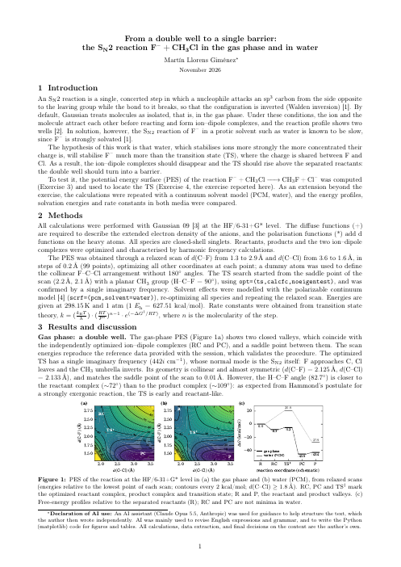
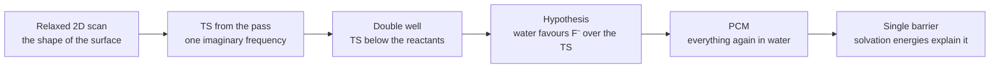
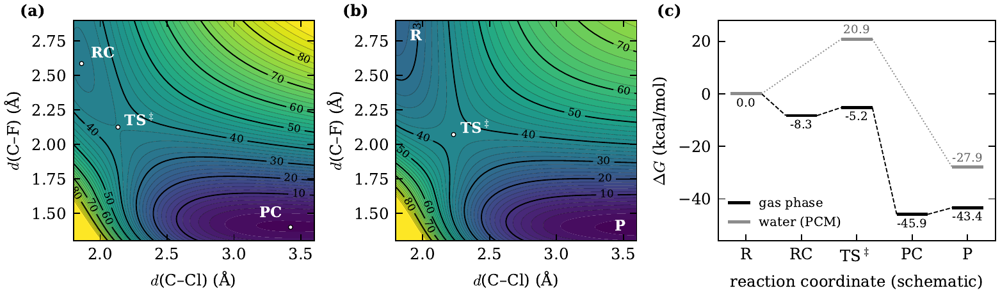

# Case study — from a double well to a single barrier

[← Session 04](../) · [Ex. 3 — surface](../ex3-potential-energy-surface/) · [Ex. 4 — transition state](../ex4-transition-state/) · [Extra — water](../extra-water-pcm/)

<table>
<tr>
<td width="190"></td>
<td>

### Report: *From a double well to a single barrier*
**The SN2 reaction F⁻ + CH₃Cl in the gas phase and in water**

Two exercises and one extension, told as a single study: a potential energy surface shows where the reaction goes, the transition state optimised from its pass reveals a double well with no net barrier, and a continuum model of water tests whether the solvent turns it into the slow reaction known from the lab.

**[Read the report (PDF, 2 pages)](report.pdf)**

</td>
</tr>
</table>

## The question

An SN2 reaction is a single, concerted step: the nucleophile attacks the carbon from the side opposite the leaving group while the bond to it breaks, and the configuration is inverted. In the gas phase, the ion and the molecule attract each other before reacting and form ion-dipole complexes, so the profile shows two wells. In water, the SN2 reaction of F⁻ is known to be slow, because F⁻ is strongly solvated. Does a calculation reproduce that change, and why does it happen?

## The path, step by step

## Results

*Figure 1 of the report: the surface in the gas phase (a) and in water (b), relative to the lowest point of each scan, and the free-energy profiles (c), relative to the separated reactants.*

| ΔG, 298 K (kcal/mol) | Gas phase | Water (PCM) |
|---|---|---|
| F⁻···CH₃Cl | −8.29 | does not exist |
| Transition state | −5.22 | **+20.86** |
| CH₃F + Cl⁻ | −43.37 | −27.88 |
| Imaginary frequency | 442i cm⁻¹ | 547i cm⁻¹ |
| Rate constant, 298 K | 3.5 × 10¹⁰ s⁻¹ (from the complex) | 7.8 × 10⁻² M⁻¹ s⁻¹ |

## How the work was done

1. **A map before any search** ([Ex. 3](../ex3-potential-energy-surface/)). A relaxed scan of d(C–F) and d(C–Cl), 99 optimisations, located both valleys and the pass. Its energies matched the reference data of the session, and its valleys fell on the complexes optimised independently in [Ex. 2](../ex2-ion-dipole-complexes/).
2. **The transition state from the pass** ([Ex. 4](../ex4-transition-state/)). Started from the highest point of the path with a planar CH₃ group, the search converged to a saddle point 0.01 Å from the one on the map, with a single imaginary frequency whose mode is the Walden inversion.
3. **The double well, and a hypothesis.** The transition state lies 11.5 kcal/mol below the separated reactants. That can only change if something stabilises the reactants more than the transition state: a solvent that prefers concentrated charge.
4. **Everything again in water** ([extra](../extra-water-pcm/)). The same seven species and the same scan with PCM. The complexes drift apart, the transition state rises to +20.9 kcal/mol, and the solvation energies (F⁻ −86.2, transition state −63.2 kcal/mol) account for the change.

## What the report adds to the exercise READMEs

- **The comparison as a single argument,** from hypothesis to test, with the rate constants that turn two profiles into "fast" and "slow".
- **Hammond's postulate in both media:** the transition state is early in the gas phase and moves towards the products in water, where the reaction is less exergonic.
- **The limits of the model:** PCM has no hydrogen bonds, which matter most for F⁻, and HF has no electron correlation, so the results are qualitative.

## Files

| File | What it is |
|---|---|
| [`report.pdf`](report.pdf) | The report, 2 pages |
| [`figure1_pes.py`](figure1_pes.py) | Draws Figure 1. Usage: `python figure1_pes.py ../ex3-potential-energy-surface/sep.dat ../extra-water-pcm/sep_pcm.dat figure1.pdf` |
| [`figure1.pdf`](figure1.pdf), [`figure1.png`](figure1.png) | Figure 1, as in the report and as an image for this page |
| [`preview.png`](preview.png) | First page of the report |

The data behind every number are in the exercise folders: [`ex1`](../ex1-reactants-and-products/results.txt), [`ex2`](../ex2-ion-dipole-complexes/results.txt), [`ex4`](../ex4-transition-state/results.txt) and [`extra-water-pcm`](../extra-water-pcm/results.txt).
