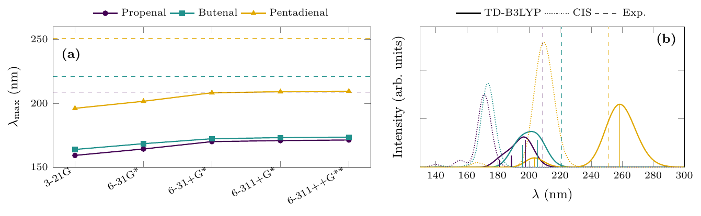
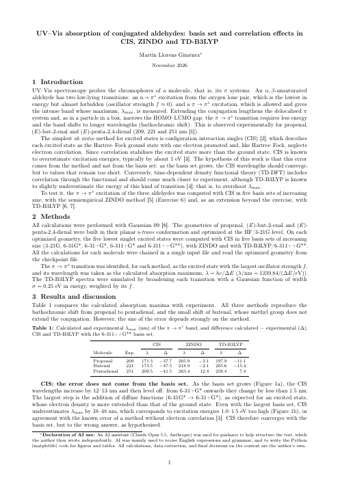

# Sessions 05–06 — Semiempirical Methods, Post-HF and Excited States

The two sessions were taught as one block. Until now every calculation described the ground state; here the molecule absorbs light. Excited states need their own methods, and three of them meet on the same problem: CIS, the simplest *ab initio* one, built on Hartree–Fock; ZINDO, semiempirical, with parameters fitted to spectra; and TD-DFT, which brings in electron correlation through a functional.



<table>
<tr>
<td width="190"><a href="report/"></a></td>
<td>

### Case study and report: *UV–Vis absorption of conjugated aldehydes*

The π → π\* band of three aldehydes with CIS in five basis sets, ZINDO and TD-B3LYP. CIS converges with the basis set to wavelengths 40 nm short: the error is the missing correlation, which TD-B3LYP cuts to 7–15 nm.

**[Case study: how the work was done](report/)** · **[Report (PDF, 2 pages)](report/report.pdf)**

</td>
</tr>
</table>

## Contents

| Exercise | Question | Level of theory |
|---|---|---|
| [Ex. 6 — UV–Vis spectra of three conjugated aldehydes](ex6-uv-vis-aldehydes/) | Is the error of CIS the basis set or the method, and how do ZINDO and TD-B3LYP compare? | CIS (3-21G → 6-311++G\*\*), ZINDO, TD-B3LYP/6-311++G\*\* |
| [Case study and report](report/) | Ex. 6 and the TD-B3LYP extension as one study | |

The other exercises of these sessions are not in the repository.

---

## Ex. 6 — UV–Vis spectra of three conjugated aldehydes

| λ_max (nm) | Exp. | CIS | ZINDO | TD-B3LYP |
|---|---|---|---|---|
| Propenal | 209 | 171.3 | 205.9 | 197.9 |
| Butenal | 221 | 173.5 | 218.9 | 205.6 |
| Pentadienal | 251 | 209.5 | 263.4 | 258.5 |

- **More basis functions do not fix CIS.** It converges from 6-31+G\* on, 1.0–1.5 eV too high in energy: the error is the method.
- **Correlation does most of the work.** TD-B3LYP is 7–15 nm off, but overestimates the effect of conjugation.
- **ZINDO is right for empirical reasons.** Its parameters were fitted to spectra like these.
- **One input per molecule:** eight jobs chained with `--Link1--` read the same geometry from the checkpoint, and one `awk` program picks the brightest state of each.
- **Pending:** the pentadienal geometry was never optimised (the first job has no `opt`), so its numbers need a rerun. [Details](ex6-uv-vis-aldehydes/#the-pentadienal-geometry).

[Ex. 6 README](ex6-uv-vis-aldehydes/).

---

## Reproducing everything

On a machine with Gaussian 09 (`g09` in the `PATH`):

```bash
cd ex6-uv-vis-aldehydes && ../run.sh && ./extract.sh && cd ..
```

[`run.sh`](run.sh) is the same launcher as in the previous sessions. Gaussian output and checkpoint files are not stored.
