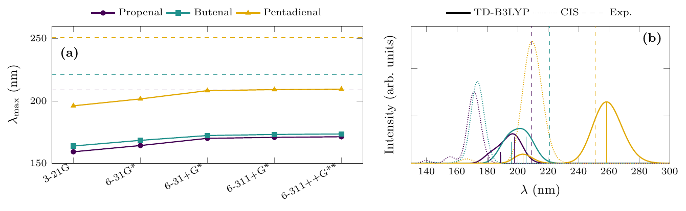

# Ex. 6 — UV–Vis spectra of three conjugated aldehydes

[← Sessions 05–06](../) · [Report](../report/) · [Bash guide](../../../docs/bash-for-gaussian.md)

## Task

Compute the π → π\* absorption maximum of propenal, (E)-but-2-enal and (E)-penta-2,4-dienal with CIS in five basis sets of increasing size, with the semiempirical method ZINDO and, as an extension, with TD-B3LYP, and compare with the experimental maxima: 209, 221 and 251 nm (course handout).

## Approach

### One input per molecule, eight jobs in a chain

Each input ([`propenal.com`](propenal.com), [`butenal.com`](butenal.com), [`pentadienal.com`](pentadienal.com)) holds eight jobs separated by `--Link1--`. The first one builds the geometry; the other seven read it from the checkpoint file with `geom=checkpoint`, so all methods see exactly the same molecule:

```
%chk=propenal.chk
#hf/3-21g opt geom=connectivity          the geometry, from the GaussView coordinates
--Link1--
%chk=propenal.chk
#rcis=(nstates=5)/3-21g geom=checkpoint  CIS: 3-21G, 6-31G*, 6-31+G*, 6-311+G*, 6-311++G**
...
#rzindo=(nstates=5) geom=checkpoint      ZINDO
#td=(nstates=5) b3lyp/6-311++g** geom=checkpoint   TD-B3LYP
```

`nstates=5` asks for the five lowest singlet excited states. Each log ends with eight `Normal termination` lines, one per job.

### Which state is the π → π\* one

Each excited state comes with its energy, its wavelength and its **oscillator strength f**, the probability of the transition. The lowest state is the n → π\* excitation of the oxygen lone pair, almost forbidden (f ≈ 0.0002 at TD-B3LYP). The π → π\* transition is the bright one, so for each method the state with the largest f is taken. In TD-B3LYP it is the second state for all three molecules.

### Reading 21 jobs at once

[`extract.sh`](extract.sh) reads every chained job with one `awk` program: each route line is noted, and every excited state that follows is filed under it, keeping only the brightest. It writes [`uv.dat`](uv.dat): molecule, method, λ (nm), E (eV) and f.

## Results

| λ_max (nm), 6-311++G\*\* for CIS and TD | Exp. | CIS | ZINDO | TD-B3LYP |
|---|---|---|---|---|
| Propenal | 209 | 171.3 | 205.9 | 197.9 |
| Butenal | 221 | 173.5 | 218.9 | 205.6 |
| Pentadienal\* | 251 | 209.5 | 263.4 | 258.5 |

| CIS λ (nm) | 3-21G | 6-31G\* | 6-31+G\* | 6-311+G\* | 6-311++G\*\* |
|---|---|---|---|---|---|
| Propenal | 159.2 | 164.2 | 170.0 | 170.8 | 171.3 |
| Butenal | 163.9 | 168.4 | 172.3 | 173.1 | 173.5 |
| Pentadienal\* | 196.1 | 201.6 | 208.3 | 209.1 | 209.5 |

\*See [the pentadienal geometry](#the-pentadienal-geometry) below.



*Figure 1 of the report: (a) the CIS wavelength against the basis set, with the experimental maxima dashed; (b) spectra simulated with Gaussian functions of width 0.25 eV, TD-B3LYP (solid) and CIS (dotted).*

## Conclusions

From the [report](../report/), checked against the logs:

1. **CIS underestimates λ_max by 38–48 nm**, that is, excitation energies 1.0–1.5 eV too high. A larger basis set does not fix it: from 6-31+G\* onwards the wavelengths change by less than 1.5 nm, converging to values far from experiment. The error comes from the missing electron correlation, not from the basis set.
2. **TD-B3LYP, with correlation, cuts the error to 7–15 nm** (0.1–0.4 eV). Its error, however, depends on the length of the π system: it falls short for propenal and butenal and overshoots for pentadienal, overestimating the effect of conjugation.
3. **ZINDO gives the closest values for the two shorter aldehydes**, as expected from a method parametrised against experimental spectra. All methods reproduce the red shift caused by conjugation.

Two details, against the text of the report: the CIS wavelengths grow by 10–13 nm across the basis sets (butenal by 9.7 nm, not 12–13), and the largest single step is the diffuse functions (6-31G\* → 6-31+G\*) for propenal and pentadienal, but 3-21G → 6-31G\* for butenal (4.5 nm against 3.9).

## The pentadienal geometry

**The first job of [`pentadienal.com`](pentadienal.com) has no `opt`:**

```
# hf/3-21g geom=connectivity
```

So it is a single point, and the seven excited-state calculations of pentadienal read the geometry as it came out of GaussView, not one optimised at HF/3-21G. The log shows it: no `Stationary point found`, and idealised builder values in the distance matrix.

| Bond | Pentadienal, as built | Propenal, optimised HF/3-21G |
|---|---|---|
| C=C (Å) | 1.355 | 1.317 |
| C–C (Å) | 1.540 | 1.474 |
| C–H (Å) | 1.070 | 1.072–1.088 |

The single bonds of the chain are 0.07 Å too long, a geometry with more bond alternation and less conjugation than the real one. Less conjugation means a higher π → π\* energy, so the pentadienal wavelengths are probably too *short*, for every method. After a proper optimisation they should move to longer wavelengths: the overshoot of TD-B3LYP and ZINDO would then grow, and the error of CIS shrink a little. The qualitative conclusions should hold, but the pentadienal numbers, and the red shift of 61 nm, need the job rerun with `opt`.

## How it went

- **Three molecules, 21 excited-state calculations, one chained input each.** `--Link1--` and `geom=checkpoint` keep the geometry identical across methods and save writing it 24 times.
- **The bright state, not the lowest.** Taking the first excited state would have given the n → π\* transition, invisible in the spectrum. The script chooses by f.

## Files

| File | What it is |
|---|---|
| [`propenal.com`](propenal.com), [`butenal.com`](butenal.com), [`pentadienal.com`](pentadienal.com) | Geometry, CIS in five basis sets, ZINDO and TD-B3LYP, chained with `--Link1--` |
| [`extract.sh`](extract.sh) | Writes `uv.dat`, the brightest excited state of every job |
| [`uv.dat`](uv.dat) | Molecule, method, λ (nm), E (eV) and f |
