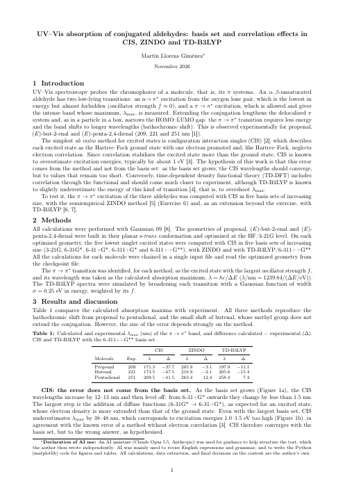
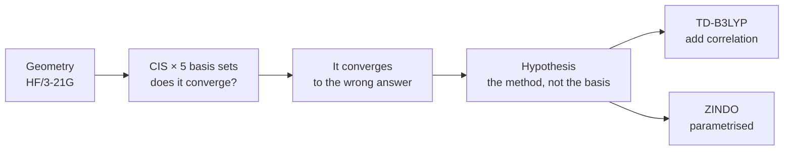
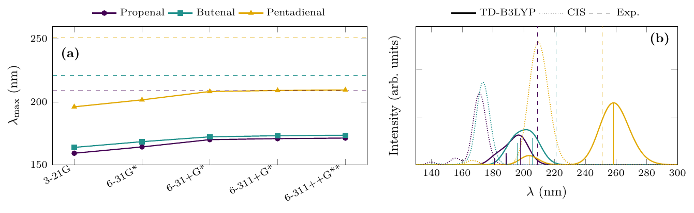

# Case study — UV–Vis absorption of conjugated aldehydes

[← Sessions 05–06](../) · [Ex. 6 — UV–Vis](../ex6-uv-vis-aldehydes/)

<table>
<tr>
<td width="190"><a href="report.pdf"></a></td>
<td>

### Report: *UV–Vis absorption of conjugated aldehydes*
**Basis set and correlation effects in CIS, ZINDO and TD-B3LYP**

One exercise and one extension, told as a single study: CIS is pushed through five basis sets to see whether its error is the basis or the method, ZINDO shows what parametrisation buys, and TD-B3LYP tests what electron correlation adds.

**[Read the report (PDF, 2 pages)](report.pdf)**

</td>
</tr>
</table>

## The question

An α,β-unsaturated aldehyde absorbs through a π → π\* transition, and extending the conjugation shifts the band to longer wavelengths, as a particle in a longer box. CIS, the simplest *ab initio* method for excited states, is known to put these bands about 1 eV too high. Is that error the basis set or the method? And how close do a semiempirical method and a DFT method get?

## The path, step by step



## Results



| λ_max (nm) | Exp. | CIS/6-311++G\*\* | ZINDO | TD-B3LYP/6-311++G\*\* |
|---|---|---|---|---|
| Propenal | 209 | 171.3 | 205.9 | 197.9 |
| Butenal | 221 | 173.5 | 218.9 | 205.6 |
| Pentadienal | 251 | 209.5 | 263.4 | 258.5 |

- **CIS converges, to the wrong answer:** from 6-31+G\* on, more basis functions change λ by less than 1.5 nm, and it stays 38–48 nm short.
- **TD-B3LYP brings the error down to 7–15 nm,** but its sign depends on the length of the chain: short for the two smaller aldehydes, long for pentadienal.
- **ZINDO is closest for propenal and butenal,** for empirical reasons: its parameters were fitted to spectra.

The data, the script and a check of every number are in the [Ex. 6 README](../ex6-uv-vis-aldehydes/).

## A caveat found after submission

When the numbers were checked against the logs for this repository, the first job of the pentadienal input turned out to have no `opt`: its excited states were computed at the geometry built by GaussView, with C–C single bonds of 1.540 Å instead of about 1.47 Å. Its wavelengths are probably too short, and its numbers need a rerun; the details are in the [exercise README](../ex6-uv-vis-aldehydes/#the-pentadienal-geometry). The report is kept as it was submitted.

## Inside the LaTeX source

The full source of the report is in [`source/`](source/): [`report.tex`](source/report.tex), [`bibliografia.bib`](source/bibliografia.bib) and Figure 1. The comments in the `.tex` are in Spanish, as they were written, and the preamble is the same as in the Session 03 and 04 reports.

**Figure 1 is drawn entirely in `pgfplots`** ([`figure_uv.tex`](source/figure_uv.tex)), with no data file and no Python. Overleaf did not render it inside the report, so it is a `standalone` document, compiled on its own to [`figure_uv.pdf`](source/figure_uv.pdf), which the report includes with `\includegraphics`.

- **Panel (a)** uses symbolic x coordinates, one per basis set, and draws the experimental maxima as dashed lines at `rel axis cs` heights computed from the y range: (209 − 150)/(260 − 150) = 0.536 for propenal.
- **Panel (b)** simulates each spectrum inside `pgfplots` itself: every transition becomes a Gaussian in energy, `f·exp(−((1239.84/λ − E)/0.25)²)`, all of a molecule's states summed in a single `\addplot` expression, and the individual transitions are drawn as `ycomb` bars of height f. The broadening is done in energy, where the band is symmetric, and plotted in wavelength.
- **The table** uses `siunitx` `S` columns aligned on the decimal point, with `table-format=-2.1` for the differences, which can be negative.

### Building it

```bash
cd source
pdflatex figure_uv.tex
pdflatex report && bibtex report && pdflatex report && pdflatex report
```

The bibliography was not sent with the source, so [`bibliografia.bib`](source/bibliografia.bib) was rebuilt from the reference list of the PDF; it compiles to the same two pages and the same eight references.

## Files

| File | What it is |
|---|---|
| [`report.pdf`](report.pdf) | The report, 2 pages |
| [`preview.png`](preview.png) | First page of the report |
| [`figure_uv.png`](figure_uv.png) | Figure 1 as an image for this page |
| [`source/report.tex`](source/report.tex) | LaTeX source of the report |
| [`source/bibliografia.bib`](source/bibliografia.bib) | Bibliography, rebuilt from the PDF |
| [`source/figure_uv.tex`](source/figure_uv.tex), [`source/figure_uv.pdf`](source/figure_uv.pdf) | Figure 1: the `pgfplots` source and the figure as the report includes it |
