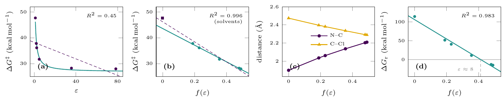
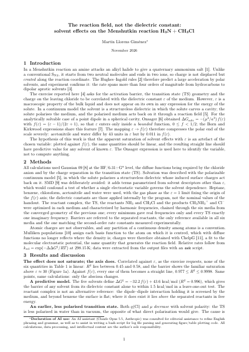

# Session 07 — Solvent Effects

Until now every calculation described an isolated molecule, in the gas phase. Real chemistry happens in a solvent. This session adds one with implicit (continuum) models, PCM and SMD, which replace the solvent with a dielectric around a cavity, and asks how much it changes an equilibrium and a reaction.



<table>
<tr>
<td width="190"><a href="report/"></a></td>
<td>

### Case study and report: *the reaction field, not the dielectric constant*

The Menshutkin reaction H₃N + CH₃Cl in six media. Correlated with ε, as the exercise asks, nothing is linear; against the Onsager function f(ε) = (ε − 1)/(2ε + 1), where ε actually enters the theory, every quantity is a straight line, and the line predicts new solvents within 1.5 kcal/mol.

**[Case study: how the work was done](report/)** · **[Report (PDF, 2 pages)](report/report.pdf)** · **[Extended version (PDF, 12 pages)](report/extended/informe_extendido.pdf)**

</td>
</tr>
</table>

## Contents

Each exercise folder has its own README with the task and the reasoning behind each step. The Bash patterns are explained in the **[Bash for Gaussian guide](../../docs/bash-for-gaussian.md)**.

| Exercise | Question | Level of theory |
|---|---|---|
| [Ex. 4 — 1,2-Dichloroethane in water](ex4-dichloroethane-in-water/) | Does a polar solvent shift the trans–gauche equilibrium? | HF/6-31G\*, SMD (water) |
| [Ex. 6 — The SN2 reaction in water](ex6-sn2-in-water/) | How high is the barrier from the reactant complex in water? | HF/6-31+G\*, PCM (water) |
| [Ex. 8 — The Menshutkin reaction in six media](ex8-menshutkin/) | How do the transition state and the barrier depend on the solvent? | HF/6-31+G\*, PCM (five solvents and gas) |
| [Case study and report](report/) | Ex. 8 as one study, with a 12-page extended version | |

The other exercises of the session will be added as they are done.

---

## Ex. 4 — 1,2-Dichloroethane in water

| Gauche − trans, 298 K | Gas phase | Water (SMD) |
|---|---|---|
| ΔG (kcal/mol) | 1.85 | 0.23 |
| K = 2 exp(−ΔG/RT) | 0.088 | 1.37 |
| Gauche (%) | 8.1 | **57.7** |

- **Water turns the equilibrium around.** Gauche, the only conformer with a dipole moment, is stabilised more, and becomes the majority. The prediction of the [Session 03 report](../../03-geometries-and-conformers/report/), confirmed.
- **A small change in ΔG, a large one in K:** 1.6 kcal/mol is enough, because K is exponential.
- **The factor 2 of the two gauche conformers decides the conclusion:** without it, gauche would still be the minority in water (41 %).

[Ex. 4 README](ex4-dichloroethane-in-water/).

---

## Ex. 6 — The SN2 reaction in water

| Barrier from the reactant complex | ΔE‡ (kcal/mol) | ΔG‡ (kcal/mol) |
|---|---|---|
| Gas phase | 2.99 | 3.06 |
| Water (PCM) | 14.11 | 16.68 |

- **There is no complex in water:** F⁻ drifts to 4.63 Å, in a flat region with a tiny imaginary frequency.
- **Results differ between students for two reasons:** the symmetry number, when Gaussian takes a C₃ᵥ structure as C₁, and the flat region, where the optimiser stops early and the harmonic G is unreliable.

[Ex. 6 README](ex6-sn2-in-water/).

---

## Ex. 8 — The Menshutkin reaction in six media

| R² of a straight line | d(N–C) | d(C–Cl) | q(Cl) | μ | ΔG‡ | ΔG_r |
|---|---|---|---|---|---|---|
| against ε | 0.510 | 0.527 | 0.576 | 0.549 | 0.447 | 0.464 |
| against f(ε) | 0.995 | 0.998 | 0.999 | 1.000 | 0.977 | 0.983 |

- **The effect does not saturate; the axis does.** ε never appears alone in the theory of a continuum model, only inside f(ε), which compresses the polar end: acetonitrile and water differ by 43 in ε and by 0.011 in f(ε).
- **A predictive line:** ΔG‡ = −32.2 f(ε) + 43.6 kcal/mol, within 1.5 kcal/mol for a solvent left out of the fit.
- **A transition state less polarised in water than in vacuum.** The solvent swings the reaction free energy by 129 kcal/mol, and Hammond's postulate moves the transition state earlier (Leffler α = 0.15).
- **One variable, five correlations.** In a continuum model f(ε) is the only knob, so the correlations are not independent: only their slopes inform.
- **PCM on purpose, not SMD:** a model with several solvent variables could not test whether one is enough.

[Ex. 8 README](ex8-menshutkin/).

---

## The symmetry number

Both exercises ran into the same detail of thermochemistry. The rotational partition function is divided by the symmetry number σ, and a wrong σ shifts G by RT ln σ: 0.41 kcal/mol for σ = 2, 0.65 for σ = 3. Gaussian sets σ from the point group it detects, and a Z-matrix that does not impose the symmetry leaves a geometry that is only *almost* symmetric, which Gaussian may take as C₁.

```bash
grep "Rotational symmetry number" *.log
grep "Full point group" *.log | tail -2
```

When the error is the same in both structures, it cancels in ΔG (the two conformers of Ex. 4). When only one of them is detected correctly, it does not (the SN2 transition state of Ex. 6, and of [Session 04](../../04-sn2-reaction/ex4-transition-state/#a-symmetry-number-gaussian-missed)).

---

## Reproducing everything

On a machine with Gaussian 09 (`g09` in the `PATH`):

```bash
cd ex4-dichloroethane-in-water && ../run.sh && cd ..
cd ex6-sn2-in-water && ../run.sh && ./extract.sh && cd ..
cd ex8-menshutkin && ./extract.sh && python analyze.py && cd ..   # inputs rebuilt from inputs.md
```

[`run.sh`](run.sh) is the same launcher as in the previous sessions. Gaussian output files are not stored.
