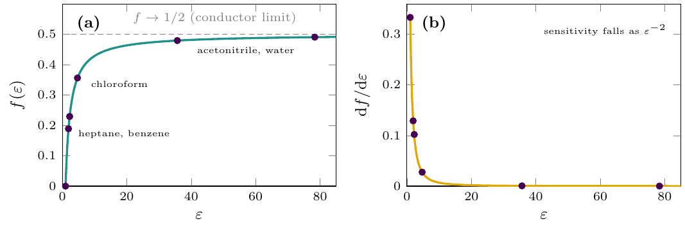
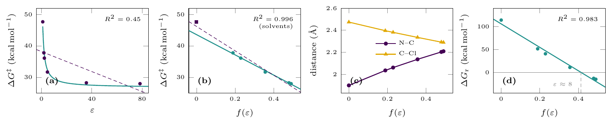
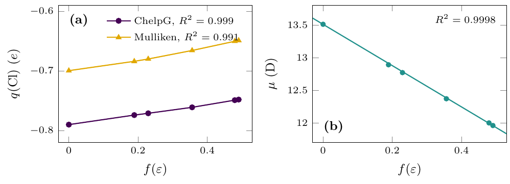
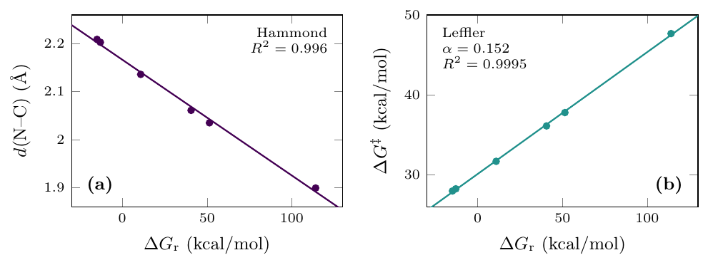

# Ex. 8 — The Menshutkin reaction in six media

[← Session 07](../) · [Report](../report/) · [Bash guide](../../../docs/bash-for-gaussian.md)

## Task

H₃N + CH₃Cl → CH₃NH₃⁺ + Cl⁻ at the HF/6-31+G\* level with PCM, in heptane, benzene, chloroform, acetonitrile and water. Compute the reactant complex and the transition state in each solvent, and correlate the N–C and C–Cl distances, the charge on chlorine at the transition state and the free-energy barrier with the dielectric constant ε.

## The idea: where does ε appear?

ε is a macroscopic property of the bulk liquid, defined by the capacitance of a condenser filled with it. It does not appear on its own in any expression for the energy of a solute. What a continuum model computes is the **reaction field**, and in the two cases that can be solved by hand, ε always enters through a bounded function:

- ion in a sphere (Born): ΔG ∝ −(q²/2a)(1 − 1/ε)
- dipole in a sphere (Onsager): ΔG ∝ −(μ²/a³) f(ε), with **f(ε) = (ε − 1)/(2ε + 1)**

ε runs from 1 to about 80; f(ε) only from 0 to 0.5, and it compresses the polar end:

| Medium | ε (used by Gaussian) | f(ε) |
|---|---|---|
| Gas | 1 | 0 |
| Heptane | 1.9113 | 0.189 |
| Benzene | 2.2706 | 0.229 |
| Chloroform | 4.7113 | 0.356 |
| Acetonitrile | 35.688 | 0.479 |
| Water | 78.3553 | 0.490 |

Acetonitrile and water differ by 43 units of ε and by 0.011 of f(ε): to a continuum model they are almost the same solvent. **The hypothesis:** every computed quantity should look saturated against ε and be a straight line against f(ε). This table was written before any job was launched.

## Approach

Three decisions came before the first calculation:

1. **Include the gas phase.** It is ε = 1, so f(ε) = 0 exactly: the origin of the axis. Without it the five solvents sit between 0.19 and 0.49, and the intercept of any fit is poorly determined.
2. **Also compute NH₃, CH₃Cl, CH₃NH₃⁺ and Cl⁻ on their own** in all six media. The exercise measures the barrier from the reactant complex, but the experiment is second order. Ten trivial extra jobs, and the decision that saved the work later on.
3. **PCM, not SMD.** SMD adds a term parametrised with solvent descriptors other than ε (refractive index, hydrogen-bond acidity and basicity, surface tension). It is usually more accurate, but a model with several solvent variables built in cannot test whether one is enough. The less accurate model is the one that makes the hypothesis falsifiable.

Each species is one input with the six media chained by `--Link1--`, each job starting from the geometry of the previous one, and the order of each chain was chosen on purpose. The Z-matrix, the route lines and the order are in [`inputs.md`](inputs.md). Charges are ChelpG (`pop=chelpg`), fitted to the electrostatic potential, the same quantity that generates the reaction field; Mulliken charges, which assign each basis function to its centre, are unreliable with diffuse functions.

[`extract.sh`](extract.sh) reads the 33 converged jobs into [`jobs.dat`](jobs.dat), one record per job, and [`analyze.py`](analyze.py) computes the barriers, the fits, the cross-validation and the comparison with experiment, writing [`results.dat`](results.dat). Both were rerun here: the four logs available reproduce `jobs.dat` exactly, and `analyze.py` reproduces every number below.

## Results

| Medium | d(N–C) (Å) | d(C–Cl) (Å) | q(Cl) | μ (D) | ν‡ (cm⁻¹) | ΔG‡ (kcal/mol) | ΔG_r (kcal/mol) |
|---|---|---|---|---|---|---|---|
| Gas | 1.899 | 2.474 | −0.790 | 13.51 | 559i | 47.67 | +114.09 |
| Heptane | 2.035 | 2.396 | −0.774 | 12.89 | 574i | 37.78 | +51.43 |
| Benzene | 2.061 | 2.381 | −0.771 | 12.77 | 572i | 36.11 | +40.59 |
| Chloroform | 2.136 | 2.335 | −0.761 | 12.37 | 564i | 31.68 | +10.85 |
| Acetonitrile | 2.203 | 2.292 | −0.749 | 12.00 | 554i | 28.24 | −12.97 |
| Water | 2.209 | 2.289 | −0.748 | 11.96 | 554i | 27.97 | −14.93 |

Barriers and reaction free energies are measured from the separated reactants, NH₃ + CH₃Cl, in the same medium. Each transition state has exactly one imaginary frequency.

| R² of a straight line | d(N–C) | d(C–Cl) | q(Cl) | μ | ΔG‡ | ΔG_r |
|---|---|---|---|---|---|---|
| against ε | 0.510 | 0.527 | 0.576 | 0.549 | 0.447 | 0.464 |
| against f(ε) | 0.995 | 0.998 | 0.999 | **1.000** | 0.977 | 0.983 |

*(a) The barrier against ε: a straight line fails, R² = 0.45; the curve is the model of (b) mapped back onto this axis. (b) The same barriers against f(ε). (c) The transition state distances and (d) the reaction free energy against f(ε).*

**Not one quantity correlates with ε; all of them are straight lines against f(ε).** The points and the calculations are the same; only the axis changes.

### A predictive model

The five solvents give **ΔG‡ = −32.2 f(ε) + 43.6 kcal/mol** (R² = 0.996). Each solvent left out of the fit is predicted within 1.5 kcal/mol; the gas phase is predicted 4.1 kcal/mol too low, because the linearity assumes a constant dipole and the dipole of the transition state changes most between the gas phase and the first solvent. The line is for interpolating between solvents, not for extrapolating to vacuum.

### An earlier, less polarised transition state

Two quantities move the opposite way to intuition: as the medium becomes more polar, the charge on chlorine becomes *less* negative and the dipole of the transition state *falls*. A reaction field polarises the solute, so the direct effect should be the reverse. The geometry wins:

- In the gas phase the products are two ions in vacuum, and the reaction is endergonic by **+114 kcal/mol**. In water it is exergonic, −15 kcal/mol: a swing of **129 kcal/mol**, and the reaction turns spontaneous above ε ≈ 8.
- Hammond's postulate then moves the transition state earlier as the solvent becomes more polar: N–C lengthens from 1.899 to 2.209 Å and C–Cl shortens from 2.474 to 2.289 Å. An earlier transition state has transferred less charge.
- Measured: d(N–C) against ΔG_r gives R² = 0.996, and ΔG‡ against ΔG_r gives R² = 0.9995 with slope **α = 0.152**, the Leffler coefficient of an early transition state.

### One variable, five correlations

In a continuum model the only solvent property is ε, and it enters only through f(ε). Every converged property of the solute is a function of that single variable, so if each is linear in it, each is linear in all the others. **The Hammond and Leffler correlations are not independent evidence**: they follow from the common dependence. What carries physical content is the slopes, not the existence of the correlations.

The conclusion does not depend on the charge scheme either: Mulliken charges differ from ChelpG by about 0.09 e, but give R² = 0.62 against ε and 0.99 against f(ε).

### The reactant complex is screened out of existence

| Medium | ΔE complexation (kcal/mol) | ΔG complexation (kcal/mol) |
|---|---|---|
| Gas | −1.56 | +3.24 |
| Heptane | −0.88 | +3.99 |
| Benzene | −0.73 | +4.21 |

The complex is held by a dipole-dipole interaction, which the dielectric screens. In chloroform the optimisation ran out of steps while N–C drifted past 7 Å and the energy changed by less than 0.001 kcal/mol over the last cycles: there was no minimum to find. The ion-dipole complexes of the [Session 04 SN2](../../04-sn2-reaction/extra-water-pcm/) survived up to ε = 78; this one does not survive ε = 4.7. Even where it exists, it lies *above* the separated reactants in free energy, because the entropy of bringing two molecules together outweighs one or two kcal/mol of binding.

### Against experiment

The calculation puts the barrier 9.5 kcal/mol lower in acetonitrile than in heptane. Published relative rates of Menshutkin reactions (Reichardt and Welton), converted with ΔΔG‡ = RT ln k_rel, give about 5.6 kcal/mol from hexane to acetonitrile: the right direction and order of magnitude, overestimated by nearly a factor of two. The experimental reactions use tertiary amines and alkyl iodides, HF has no correlation, and PCM has no hydrogen bonds.

## Conclusions

1. **Correlated against ε, as requested, none of the six quantities is linear** (0.45 ≤ R² ≤ 0.58). Against f(ε) = (ε − 1)/(2ε + 1), all of them are (0.977 ≤ R² ≤ 0.9998). The apparent saturation of solvent effects is a property of the axis, not of the chemistry.
2. **The line predicts the barrier of a solvent left out of the fit within 1.5 kcal/mol,** but should not be extrapolated to the gas phase.
3. **The correlations the exercise asks for are one correlation,** and only their slopes carry independent information.
4. **The slopes are chemically sensible.** The solvent swings the reaction free energy by 129 kcal/mol, turns the reaction exergonic above ε ≈ 8, and moves the transition state earlier (Leffler α = 0.15), which leaves it less polarised in water than in vacuum.
5. **The reactant complex does not survive above ε ≈ 2.3,** and is above the separated reactants in free energy even where it exists.
6. **Against experiment the direction and order of magnitude are right,** and the size is overestimated, as expected from HF and a continuum without hydrogen bonds.

## Beyond the report: the symmetry numbers

The pending check of the [process notes](../report/#what-is-left), done here on the logs:

| | Point group detected | σ | Should be |
|---|---|---|---|
| CH₃Cl | C₃ᵥ | 3 | 3 |
| NH₃ | Cₛ | **1** | 3 |
| Transition state | C₁ | **1** | 3 |
| Complex | C₁ | 1 | 3 |

The expectation was that the error would not cancel in the bimolecular barrier, and it does, by luck: G(TS) and G(NH₃) are both too low by RT ln 3 = 0.65 kcal/mol, and ΔG‡ = G(TS) − G(NH₃) − G(CH₃Cl) loses both errors. ΔG_r depends on how CH₃NH₃⁺ was detected, which needs its log. Either way the offset is the same in every medium, so slopes and R² are untouched: the conclusions do not depend on it.

## How it went

- **`l9999` is not a segmentation fault.** The complex died in chloroform with `Error termination via Lnk1e in l9999.exe`, first read as a crash. It is the end of the optimisation link: `Number of steps exceeded, NStep= 100`. The decisive clue was the energy along the trajectory, flat to the sixth decimal: the failure *was* the measurement of the screening.
- **The same message, a different cause.** CH₃NH₃⁺ died in benzene with `NStep= 38`. Here the problem was numerical: plain `opt`, with an estimated Hessian, on the flatter surface of PCM. Relaunched with `opt=(calcfc,maxcycles=200)`, the remaining four media converged. Flat surface or badly initialised optimiser: the error message is the same, and the energy along the trajectory tells them apart.
- **Two Bash slips:** `logs_S7.tar.gz` written and `logs_s7.tar.gz` checked (Linux is case sensitive), and a `grep -c "Erorr termination"` that found nothing because of the typo.
- **The cation and chloride block was not in the plan.** It was added once it was clear that the Hammond argument needed the number of the endothermicity to be more than a plausible story.

## Files

| File | What it is |
|---|---|
| [`inputs.md`](inputs.md) | The Z-matrix, the route lines and the order of the chains |
| [`extract.sh`](extract.sh) | Writes `jobs.dat`, one record per converged job |
| [`jobs.dat`](jobs.dat) | Species, solvent, ε, E, G, distances, ChelpG charge on Cl, dipole, imaginary frequency |
| [`analyze.py`](analyze.py) | Barriers, fits, cross-validation, Hammond and Leffler, experiment; writes `results.dat` |
| [`results.dat`](results.dat) | The main table, one row per medium |

The figures are drawn in `pgfplots`; their sources are in [`report/extended/`](../report/extended/).
