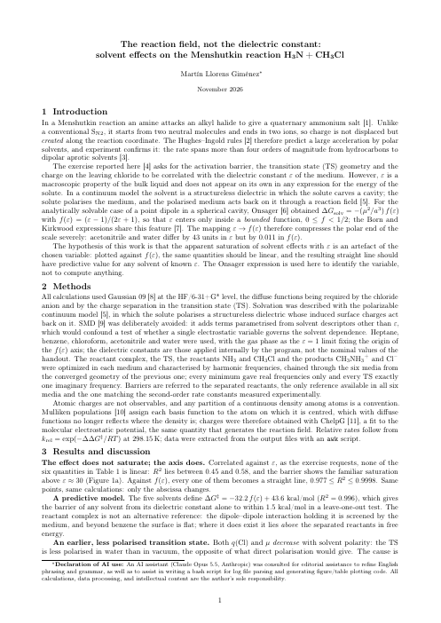
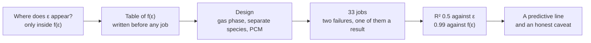
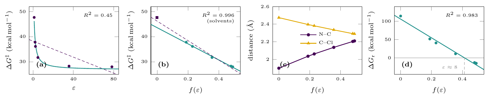

# Case study — the reaction field, not the dielectric constant

[← Session 07](../) · [Ex. 8 — the Menshutkin reaction](../ex8-menshutkin/)

<table>
<tr>
<td width="190"><a href="report.pdf"></a></td>
<td>

### Report: *The reaction field, not the dielectric constant*
**Solvent effects on the Menshutkin reaction H₃N + CH₃Cl**

The exercise asks for correlations with the dielectric constant. None appears. Against the Onsager function f(ε), which is where ε actually enters the theory of the method, every quantity becomes a straight line, and the line predicts new solvents.

**[Read the report (PDF, 2 pages)](report.pdf)** · **[Extended version (PDF, 12 pages)](extended/informe_extendido.pdf)**

</td>
</tr>
</table>

## The question

The handout asked for something concrete: compute the reactant complex and the transition state in five solvents and correlate the N–C and C–Cl distances, the charge on chlorine and the barrier with ε. The first question was not *how* to compute it but *what to add*, as the earlier reports had done. Four ideas came out of twenty minutes of brainstorming:

| Idea | Verdict |
|---|---|
| Compare with experimental data | Possible, but weak as the main point: absolute barriers of different systems say little |
| Contrast with the SN2 of the [Session 04 report](../../04-sn2-reaction/report/) | Strong and free: the two large rows of the Hughes–Ingold table, both with own data |
| "Optimise the reaction medium" | Discarded: PCM only knows ε, it cannot answer that |
| Repeat with a correlated method (MP2) | Discarded: it answered no question of the argument |

The fifth became the whole report, and it came from one question: **where does ε appear in the equations?**

## The path, step by step



## Results



| R² of a straight line | d(N–C) | d(C–Cl) | q(Cl) | μ | ΔG‡ | ΔG_r |
|---|---|---|---|---|---|---|
| against ε | 0.510 | 0.527 | 0.576 | 0.549 | 0.447 | 0.464 |
| against f(ε) | 0.995 | 0.998 | 0.999 | 1.000 | 0.977 | 0.983 |

ΔG‡ = −32.2 f(ε) + 43.6 kcal/mol predicts a solvent left out of the fit within 1.5 kcal/mol. The full table and the discussion are in the [Ex. 8 README](../ex8-menshutkin/).

## How the work was done

### Decisions taken before launching anything

- **The gas phase is the origin of the axis,** f(ε) = 0 exactly, and it costs nothing.
- **The separate reactants and products in all six media,** ten trivial jobs on a reward-to-risk basis. Two hours later they saved the report, when the reactant complex turned out not to exist in polar media and the barrier could be measured from the separated reactants without a single new job.
- **PCM rather than SMD,** the best-argued decision of the work: the more accurate model would have made the hypothesis untestable.
- **The order of each chain:** start where the starting geometry is most reliable and end where convergence is least certain. The transition state runs from water down to the gas phase; everything else, up from the gas phase.

### What failed, and why it was good that it did

The reactant complex died in chloroform. It was first read as a segmentation fault; it was the optimisation link, out of steps, on a surface flat to 0.001 kcal/mol while N–C drifted past 7 Å. The failure *was* the result: the dielectric had screened the dipole-dipole attraction away. The cation then failed in benzene with the same message for a numerical reason, an estimated Hessian on the flatter PCM surface, and converged with `opt=calcfc`. Telling the two apart needed the energy along the trajectory, not the final geometry.

### The result nobody expected

The charge on chlorine and the dipole of the transition state *decrease* as the solvent becomes more polar. The explanation needed numbers that were not in the plan, the reaction free energy in each medium, so CH₃NH₃⁺ and Cl⁻ were added: a swing of 129 kcal/mol, Hammond's postulate measured (R² = 0.996), and a Leffler α of 0.15.

### The epistemological point

With so many high R² values, the right suspicion appeared: is this circular? Not trivially, since f(ε) is an input and the distances and dipoles are results. But in a continuum model f(ε) is the only knob there is, so every converged property is a function of it, and the correlations are one correlation seen from five angles. Only the slopes carry information.

### Two pages

The material was enough for twelve; the rubric allows two. In the order the cuts were made:

1. **The figure, from two rows of panels to one.** Four panels in a row take less height than three, because at fixed page width more panels make a wider, shorter figure: from about 7 cm to 3.2 cm.
2. **The Onsager equation, from displayed to inline.**
3. **Merged blocks:** the reactant complex became two sentences, and the comparison with experiment moved into the conclusions.
4. **The bibliography in two columns, then three,** without article titles and with initials for first names.
5. **LaTeX float parameters.** By default `\topfraction` is 0.7, so a float taller than 70 % of the page cannot go at the top, and LaTeX pushed the table and the figure to the next page, leaving blank space. Raising it to 0.92 and lowering `\textfraction` to 0.05 recovered several lines.

What was never cut: the case for PCM over SMD, the argument for ChelpG charges, and the paragraph "one variable, five correlations". Those three are what make the report.

## What is left

- Propagate the uncertainty of the fits to their slopes (six points, two parameters).
- Repeat with a correlated method (MP2 or B3LYP) and see whether the *slope* changes, not only the absolute values.
- Add one or two explicit water molecules to the chloride and see how much of the factor of two against experiment hydrogen bonds explain.
- Check the symmetry numbers: done in the [Ex. 8 README](../ex8-menshutkin/#beyond-the-report-the-symmetry-numbers). The error cancels in ΔG‡ by luck, and does not touch any slope.

## Inside the source

- [`source/`](source/) holds the submitted report: [`report.tex`](source/report.tex), the bibliography, and Figure 1 ([`figura_s7.tex`](source/figura_s7.tex), four `pgfplots` panels in one row). The two-page tricks are visible in it: the table with `\setlength{	abcolsep}{4pt}` and `siunitx` columns, and the bibliography inside a `multicols` environment at `ootnotesize`.
- [`extended/`](extended/) holds the complete source of the 12-page version: [`informe_extendido.tex`](extended/informe_extendido.tex), its [`preamble.tex`](extended/preamble.tex), the bibliography and the four figures with their `pgfplots` sources. It adds the derivations, the leave-one-out table, the charge and dipole panels, the Hammond and Leffler plots, the failed calculations and the extraction script.

```bash
cd source
pdflatex figura_s7.tex
pdflatex report && bibtex report && pdflatex report && pdflatex report
cd ../extended
for f in fig*.tex; do pdflatex "$f"; done
pdflatex informe_extendido && bibtex informe_extendido && pdflatex informe_extendido && pdflatex informe_extendido
```

## Files

| File | What it is |
|---|---|
| [`report.pdf`](report.pdf) | The submitted report, 2 pages |
| [`preview.png`](preview.png), [`figure.png`](figure.png) | First page and Figure 1, as images for this page |
| [`source/report.tex`](source/report.tex) | LaTeX source of the submitted report |
| [`source/figura_s7.tex`](source/figura_s7.tex), [`source/figura_s7.pdf`](source/figura_s7.pdf) | Figure 1 of the report |
| [`source/bibliografia.bib`](source/bibliografia.bib) | Bibliography (the same file in both versions) |
| [`extended/`](extended/) | The extended version: PDF, LaTeX source, preamble, bibliography and four figures |
