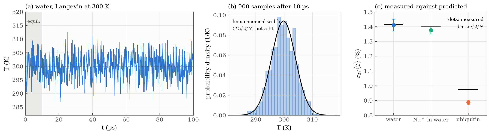
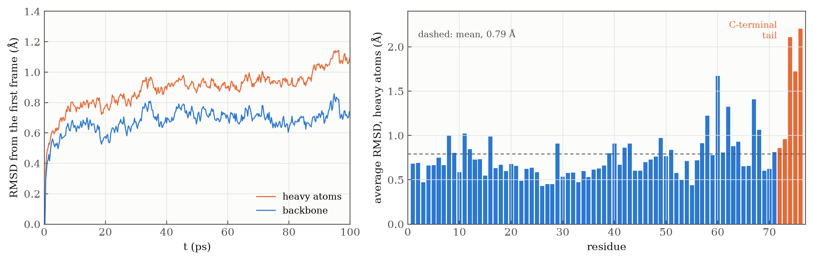

# Session 08 — Molecular Dynamics

Until Session 07, every calculation was one structure: a minimum, a transition state, a solvent reduced to a continuum. With explicit solvent there is no single structure. There are countless arrangements of the solvent molecules with similar energies, and what matters is an average over them. Molecular dynamics generates those arrangements by integrating Newton's equations, here with **NAMD**, and the trajectories are visualised and analysed with **VMD**.



The three simulations were run beforehand and are provided by the course: liquid water, a sodium ion in water, and the protein ubiquitin in water, 100 ps each at 300 K. This session is therefore about analysis, not setup. It is also the first one without Gaussian.

## Contents

| Exercise | Question | System |
|---|---|---|
| [Ex. 1 — Liquid water](ex1-water/) | Are the temperature fluctuations the canonical ones? How well does TIP3P reproduce the structure of water? | 1111 TIP3P waters, AMBER |
| [Ex. 2 — A sodium ion in water](ex2-sodium-in-water/) | How many waters does Na⁺ hold, and how are they oriented? | Na⁺ + 1136 waters, AMBER |
| [Ex. 3 — Ubiquitin in a water box](ex3-ubiquitin/) | Is the fold stable, and which residues move most? | 76 residues + 1940 waters, CHARMM |

Exercises 2 and 3 are done in class on Wednesday 18 November. Their data come from the course trajectories, analysed in advance.

## The common setup

| Setting | Value | Why |
|---|---|---|
| Periodic box | about 32 Å (water), 39 × 41 × 43 Å (protein) | No surface: a drop would be mostly interface |
| Non-bonded | cutoff 12 Å, switched from 10 Å, pair list 13.5–14 Å | Pairs grow as N²; the switch removes the jump in force at the cutoff; the extra 1.5–2 Å lets the list be rebuilt only every few steps |
| Long-range electrostatics | none, plain cutoff | No PME. Acceptable for pure water, rough around an ion |
| Integrator | Verlet, 1 fs, 100 000 steps | 1 fs is set by the fastest vibration, the O–H stretch (period about 9 fs). No bonds are frozen |
| Ensemble | NVT, Langevin thermostat, γ = 10 ps⁻¹, 300 K | Friction plus a random force sized by the fluctuation-dissipation theorem |
| Output | energies every 100 steps, coordinates every 250 | 1001 energy lines and 400 frames per run |

The NAMD inputs are course material and are not reproduced here; every setting the analysis depends on is in the exercise READMEs.

## Ex. 1 — Liquid water

| | This run | Reference |
|---|---|---|
| σ_T / ⟨T⟩ | 0.01411 ± 0.0004 | √(2/N) = 0.01414, canonical |
| C_V from σ_E² / (k_B T²) | 114 ± 10 J mol⁻¹ K⁻¹ | 75.3 (experiment) |
| g_OO first maximum | 2.73 Å, g = 3.04 | 2.80 Å, g = 2.57 (X-ray) |
| Neighbours in the first shell | 4.50 | 4.3 ± 0.2 (X-ray) |
| Self-diffusion D | 1.22 × 10⁻⁵ cm²/s | 5.06 (TIP3P, no friction); 2.30 (experiment) |

- **The temperature fluctuates by exactly the canonical amount**, which depends only on the number of degrees of freedom. The fluctuations are not noise: they are the test that the thermostat samples the right ensemble.
- **The energy fluctuation is a heat capacity**, 50 % too large. Two thirds of the excess come from a water model that was meant to be rigid and runs here as three classical springs.
- **TIP3P has the hydrogen bond but not the tetrahedral network:** a first shell 0.07 Å too close and too high, and no second peak at 4.5 Å.
- **Diffusion is four times slower than TIP3P in the literature.** The strong Langevin coupling is the first suspect: a thermostat can be right for static averages and wrong for dynamics.

[Ex. 1 README](ex1-water/).

---

## Ex. 2 — A sodium ion in water

| | This run | Experiment (X-ray) |
|---|---|---|
| Na–O distance | 2.38 Å | 2.384 ± 0.003 Å |
| Oxygens in the first shell | 5.8 | 5.5 ± 0.3 |

- **A sharp first shell of about six waters**, with g dropping to 0.15 after it, much more ordered than the first shell of pure water.
- **Oxygens in, hydrogens out:** the Na–H peak sits 0.7 Å further, where the geometry of a water pointing its dipole away from the ion puts it (3.06 Å calculated, 3.08 Å measured).

[Ex. 2 README](ex2-sodium-in-water/).

---

## Ex. 3 — Ubiquitin in a water box

- **The fold is stable:** the backbone stays within 0.6–0.8 Å of the starting structure after the first 5 ps.
- **The C-terminal tail moves most**, Arg74–Gly76 at about 2 Å, three times the average residue, followed by a surface loop around Asn60.
- **An open question:** the temperature of this run fluctuates 9 % less than the canonical prediction, six standard errors away, while both water runs agree with it.



[Ex. 3 README](ex3-ubiquitin/).

---

## Limits of classical molecular dynamics

Three limits underlie every result above, and two of them show in the numbers:

- **Classical nuclei:** no zero-point energy and no tunnelling. They show in the heat capacity, where the O–H vibrations take k_BT each instead of nothing.
- **Fixed charges:** the electron cloud of a molecule does not respond to its surroundings. Polarisable force fields (AMOEBA, Drude) add that response. The missing second shell of TIP3P is a force-field limit.
- **No bond breaking:** bonds are springs. Reactions need ab initio MD, QM/MM or reactive force fields.

## Reproducing

The trajectories (16–34 MB each) and the logs are not in the repository; the energy tables and every quantity derived from the trajectories are.

```bash
./extract.sh path/to/dinamica_aguas.log ex1-water        # energies.dat and statistics.txt
python analyze.py path/to/course_files                    # g(r), MSD and RMSD data files
python plot_figures.py                                    # figures/, from the data files only
```

[`extract.sh`](extract.sh) is the `grep`/`awk` of the class notes. [`analyze.py`](analyze.py) reads the DCD trajectories with a short reader written for this session, [`dcd.py`](dcd.py), and needs only numpy. It repeats the VMD calculations of the exercises, as an independent check, and adds the diffusion coefficient. [`plot_figures.py`](plot_figures.py) builds the figures from the data files alone.
