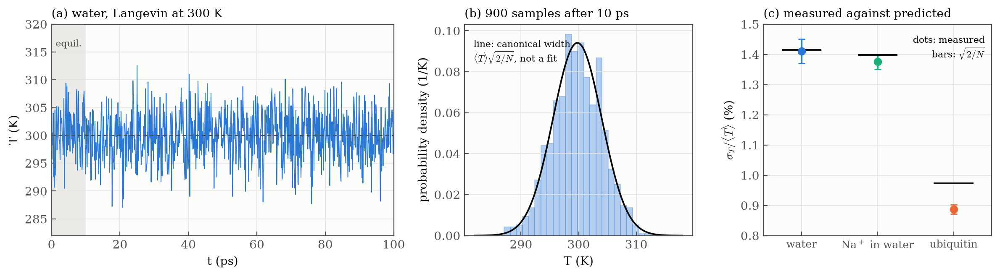
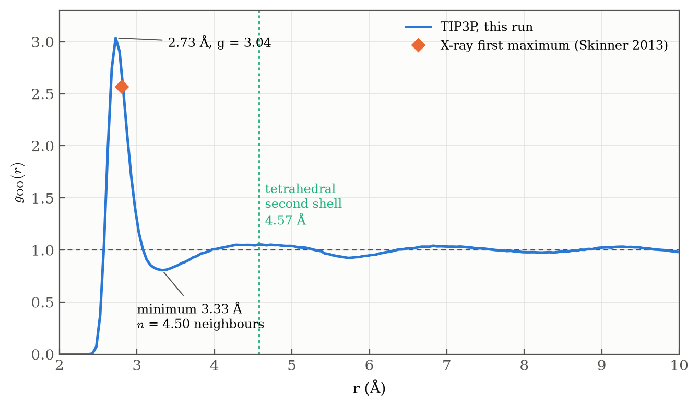
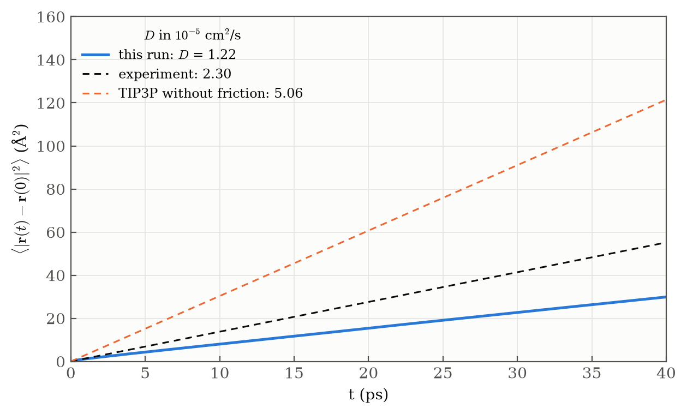

# Ex. 1 — Liquid water

[← Session 08](../) · [Bash guide](../../../docs/bash-for-gaussian.md)

## Task

1111 TIP3P water molecules in a periodic box, 100 ps of Langevin dynamics at 300 K with NAMD. Plot the total energy and the temperature against time, and compute their averages and standard deviations. In VMD, compute the oxygen-oxygen radial distribution function g_OO(r) and compare it with the experimental one.

## The system and the input

The simulation was run beforehand. The course provides the topology, the starting coordinates and velocities, the NAMD input and the outputs. The input is course material and is not reproduced here; these are the settings that matter for the analysis:

| Setting | Value | What it means |
|---|---|---|
| Force field | AMBER, TIP3P water | `aguas.prmtop`, built with leap |
| Box | 32.22 × 32.36 × 32.22 Å, periodic | 0.989 g/cm³, as NAMD prints at startup (TIP3P at 1 atm: 0.993; real water: 0.997) |
| Non-bonded | cutoff 12 Å, switching from 10 Å, pair list 13.5 Å | Below half the box, as the minimum image convention requires. No PME: electrostatics are simply cut |
| Integrator | Verlet, 1 fs, 100 000 steps | 100 ps |
| Thermostat | Langevin, γ = 10 ps⁻¹, 300 K | NVT, canonical ensemble |
| Output | energies every 100 steps, coordinates every 250 | 1001 energy lines, 400 frames |

VMD shows 401 frames when the final `.coor` is loaded first and the `.dcd` on top of it, as in the class recording: the `.dcd` itself holds 400, from step 250 to step 100 000.

### The water is a triangle of springs

The startup lines of the log say what the model really is:

```
Warning: Found 1111 H-H bonds.
Info: 3333 BONDS
Info: 0 ANGLES
```

The AMBER TIP3P has no angle term. Each molecule has three bonds instead: two O–H at 0.9572 Å and one H–H at 1.5136 Å, all with a force constant of 553 kcal/mol/Ų. TIP3P was built as a **rigid** model. The H–H "bond" exists so that SHAKE can hold the triangle fixed, which is what `rigidBonds water` does. This input has no `rigidBonds`, so the constraint skeleton becomes three stiff springs. That is why the timestep has to be 1 fs, and why each molecule carries three classical vibrations that real water, at 300 K, does not excite (see the heat capacity below).

## Approach

The energy columns are taken from the log with [`../extract.sh`](../extract.sh) (`grep "^ENERGY:"` and `awk`, the method of the class notes), which writes [`energies.dat`](energies.dat) and [`statistics.txt`](statistics.txt). The first 10 ps are treated as equilibration and left out of every average.

The radial distribution function is computed in class with VMD: *Extensions → Analysis → Radial Pair Distribution Function g(r)*, selections `name O` and `name O`, Δr = 0.1 Å, r_max = 10 Å, **Use PBC** on. [`../analyze.py`](../analyze.py) repeats the calculation from the trajectory as an independent check, with Δr = 0.05 Å, and also counts the neighbours directly: [`g_OO.dat`](g_OO.dat), with columns r, g(r) and n(r). The same script gives the mean square displacement in [`msd_O.dat`](msd_O.dat), which the exercise does not ask for.

## Results

### Energy and temperature

| Production, 10–100 ps | Mean | Standard deviation |
|---|---|---|
| Total energy (kcal/mol) | −8424.90 | 73.66 |
| Temperature (K) | 299.79 | 4.23 |



**The temperature fluctuates by exactly the canonical amount.** In the canonical ensemble the kinetic energy is a sum of N independent squared Gaussian velocity components, and its relative width is fixed by N alone:

σ_T / ⟨T⟩ = √(2 / N)

N is printed by NAMD at startup: 9999 degrees of freedom, 3 per atom. The 3 of the centre of mass are not removed, because with a Langevin thermostat the total momentum is not conserved; the class notes write 3N − 3 = 9996, and the difference does not show in the fourth significant figure.

| | σ_T / ⟨T⟩ |
|---|---|
| Measured, 900 samples | 0.01411 ± 0.0004 |
| √(2/9999) | 0.01414 |

The uncertainty comes from splitting the production run into 9 blocks. The agreement within 0.2 % is better than that uncertainty, so part of it is luck, but the test is real: panel (b) shows the measured distribution against a Gaussian whose width was predicted, not fitted. A wrong thermostat would fail it. Plain velocity rescaling gives σ_T = 0, and Berendsen gives a width that depends on its coupling time. Langevin passes, because the fluctuation-dissipation theorem ties its random force to its friction.

**The total energy is not conserved, and it should not be.** With Langevin the system exchanges energy with a bath at every step. The 73.66 kcal/mol is not integration error: it is the physical energy fluctuation of a canonical system, and it measures a thermodynamic property,

C_V = σ_E² / (k_B T²) = 114 ± 10 J mol⁻¹ K⁻¹ per mole of water

with the uncertainty from six blocks. Real liquid water has 75.3 J mol⁻¹ K⁻¹ at constant pressure (NIST), and C_V differs from C_P by about 1 % for water. Most of the excess has a simple cause: the three springs of each molecule are classical oscillators, and each takes R = 8.3 J mol⁻¹ K⁻¹ by equipartition, 25 J mol⁻¹ K⁻¹ in total. The real O–H stretch (about 3600 cm⁻¹, 17 k_BT at 300 K) is in its quantum ground state and takes none. Removing them leaves 89 ± 10 J mol⁻¹ K⁻¹: classical nuclei explain two thirds of the error, and the force field the rest. Fixing the geometry with `rigidBonds` would remove those three modes from the simulation.

### Reading the log

Four details of the NAMD log that are easy to misread:

- **TEMPAVG is not a running average.** It is the mean temperature over the steps since the previous energy line, the last 100 steps, which is why it fluctuates almost as much as TEMP. NAMD gives no cumulative averages of T or E: they are computed from [`energies.dat`](energies.dat).
- **TOTAL and TOTAL3** are both the total energy. TOTAL3 uses an estimate of the kinetic energy with less high-frequency noise, meant for spotting a drift in NVE. With a thermostat, TOTAL is the one to use.
- **A negative total energy means nothing by itself.** The zero of a force field is arbitrary; here the electrostatics dominate, −11 401 kcal/mol of potential energy against 2 979 of kinetic energy.
- **The pressure is not controlled in NVT:** −870 ± 1466 bar over the run, with a standard deviation larger than the mean. NAMD computes it from the virial theorem. A negative mean says that, at this density and with this cutoff, the liquid pulls inwards; a barostat (NPT) would let the volume adjust.

### Radial distribution function



| | This run (TIP3P) | Experiment |
|---|---|---|
| First maximum | 2.73 Å, g = 3.04 | 2.80 Å, g = 2.57 (X-ray, Skinner 2013) |
| First minimum | 3.33 Å, g = 0.81 | 3.30 Å (Skinner 2014) |
| Neighbours up to the first minimum | 4.50 | 4.3 ± 0.2 (Skinner 2014) |
| Second maximum | none, a flat shoulder of g ≈ 1.05 | near 4.5 Å (the experimental curve of the handout) |

- **g(r) is not a probability.** It is the ratio between the density at distance r from an oxygen and the average density, which is why it reaches 3. What counts neighbours is the integral, n(R) = 4πρ ∫₀^R g(r) r² dr: the factor r² weights each shell by its volume.
- **Zero below 2.4 Å:** the repulsive wall of the Lennard-Jones potential.
- **First peak: the hydrogen bond.** TIP3P puts it 0.07 Å too close and 18 % too high: a first shell that is too tight and too ordered, with 4.5 neighbours where tetrahedral water has 4.3.
- **No second peak.** In a simple liquid of spheres, the second shell would sit at about twice the first, 5.6 Å. In water it sits at 4.5 Å, because two neighbours of the same oxygen are two vertices of a tetrahedron, separated by 2.80 × √(8/3) = 4.57 Å. TIP3P shows only a shoulder there. The model has hydrogen bonds but almost no tetrahedral network beyond the first shell, a limit of the force field and not of the sampling: 400 frames resolve the first peak to the third decimal.
- **Check at long range:** n(10 Å) = 137.9 molecules. With g = 1 the count would be (4/3)π·10³·ρ = 138.4. The integral reaches the bulk density, so the normalisation is right.

### Diffusion: what the thermostat does to transport



From the Einstein relation, ⟨|r(t) − r(0)|²⟩ = 6Dt, fitted between 5 and 40 ps:

| | D (10⁻⁵ cm²/s) |
|---|---|
| This run | 1.22 |
| TIP3P, NVT without friction (Mahoney and Jorgensen 2001) | 5.06 |
| Experiment, 25 °C | 2.30 |

TIP3P without a thermostat diffuses more than twice as fast as real water (5.06 against 2.30). Here the same model diffuses half as fast as real water, four times slower than its reference. This setup differs from the reference simulation in three ways, and each one is a candidate:

- **Langevin friction.** γ = 10 ps⁻¹ randomises each velocity in 1/γ = 0.1 ps. Thermostats that randomise velocities are known to damp diffusion and viscosity at strong coupling, while thermostats that only rescale them do not (Basconi and Shirts 2013).
- **The flexible triangle** described above, instead of a rigid molecule.
- **The plain 12 Å cutoff**, instead of a long-range treatment of electrostatics.

A rough estimate does not settle it. Adding the friction mγ to the friction of the liquid, kT/D, would only bring D from 5.06 to about 3.7. Separating the three causes would take a rerun with γ = 1 ps⁻¹, or a production run in NVE after equilibration.

The lesson is the one in the class notes: **γ = 10 ps⁻¹ samples the canonical ensemble well and gets the dynamics wrong.** Temperature, energy and g(r) are static averages and do not depend on how fast the system moves through its configurations. Diffusion does.

## Conclusions

- The temperature fluctuations are the canonical ones: σ_T/⟨T⟩ = 0.01411 ± 0.0004 against √(2/N) = 0.01414. The fluctuations are not noise, they are thermodynamics.
- The fluctuation of the total energy gives C_V = 114 ± 10 J mol⁻¹ K⁻¹, against 75 for real water. Two thirds of the excess are the three classical vibrations of a water that was meant to be rigid.
- TIP3P gets the hydrogen-bond distance within 0.07 Å, but its first shell is too high, and it has no second, tetrahedral shell.
- Diffusion comes out four times slower than for the same model in the literature. The strong Langevin coupling is the first suspect: static and dynamic properties need different settings.

## References

- L. B. Skinner et al., *J. Chem. Phys.* **138**, 074506 (2013). [doi:10.1063/1.4790861](https://doi.org/10.1063/1.4790861)
- L. B. Skinner, C. J. Benmore, J. C. Neuefeind, J. B. Parise, *J. Chem. Phys.* **141**, 214507 (2014). [doi:10.1063/1.4902412](https://doi.org/10.1063/1.4902412)
- M. W. Mahoney, W. L. Jorgensen, *J. Chem. Phys.* **114**, 363 (2001). [doi:10.1063/1.1329346](https://doi.org/10.1063/1.1329346)
- J. Basconi, M. R. Shirts, *J. Chem. Theory Comput.* (2013). [doi:10.1021/ct400137r](https://doi.org/10.1021/ct400137r)
