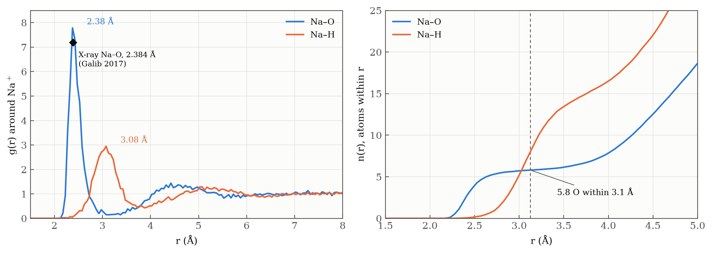

# Ex. 2 — A sodium ion in water

[← Session 08](../) · [Bash guide](../../../docs/bash-for-gaussian.md)

## Task

One Na⁺ ion in 1136 TIP3P water molecules, 100 ps of Langevin dynamics at 300 K. Compute the Na–O and Na–H radial distribution functions and the coordination number of the ion.

Done in class on 18 November, in VMD; the class session is summarised [below](#in-vmd), after the analysis of the trajectory.

## The system and the input

The same setup as [Ex. 1](../ex1-water/), with three differences:

| Setting | Ex. 1 (water) | Ex. 2 (Na⁺ in water) |
|---|---|---|
| Atoms | 3333 | 3409: one Na⁺ and 1136 waters |
| Starting velocities | read from a file | `temperature 300`: drawn from the Maxwell–Boltzmann distribution at 300 K, so the run starts at 304.8 K |
| Wrapping | `wrapAll` | `wrapWater`, with the box centred away from the origin |

The water is again the triangle of three springs of Ex. 1, with no angle term. The net charge is +1 and the electrostatics are cut at 12 Å, with no PME. A plain cutoff is a rougher approximation around an ion than in pure water: the ion polarises the water well beyond 12 Å.

## Approach

[`../extract.sh`](../extract.sh) takes the energy table and the averages ([`energies.dat`](energies.dat), [`statistics.txt`](statistics.txt)). In VMD the radial distribution functions use the selections `name 'Na+'` against `name O`, and `name 'Na+'` against `name H1 or name H2`, with **Use PBC** (details [below](#in-vmd)). [`../analyze.py`](../analyze.py) computes the same functions from the trajectory, in [`g_NaO.dat`](g_NaO.dat) and [`g_NaH.dat`](g_NaH.dat), with columns r, g(r) and n(r).

There is only one ion, so each frame gives one reference instead of 1111. The curves are noisier than g_OO, and the 400 frames are what makes them usable.

## Results

| | This run | Experiment (Galib et al. 2017) |
|---|---|---|
| Na–O first maximum | 2.38 Å, g = 7.8 | 2.384 ± 0.003 Å (X-ray), 2.37 ± 0.02 Å (EXAFS) |
| Na–O first minimum | 3.13 Å, g = 0.15 | |
| Oxygens in the first shell | 5.8 | 5.5 ± 0.3 (X-ray) |
| Na–H first maximum | 3.08 Å | |

- **A first shell much better defined than in pure water.** The Na–O peak reaches g = 7.8, against 3.0 for O–O, and the minimum after it falls to 0.15: almost no water sits between the first and the second shell. The ion holds about six waters, the number of an octahedron, and the X-ray value of 5.5 ± 0.3 lies between five and six.
- **The distance is right.** 2.38 Å against 2.384 Å from X-ray diffraction. Older experiments gave about 2.44 Å; the X-ray and EXAFS measurements of Galib et al. moved the value to where these classical parameters already put it.
- **The hydrogens point away from the ion.** The Na–H peak lies 0.7 Å beyond the Na–O peak, so each water turns its oxygen, the negative end of its dipole, towards the cation. The geometry can be checked: if the H–O–H bisector points straight at the ion, each hydrogen sits at √(2.38² + 0.957² + 2 · 2.38 · 0.957 · cos 52.26°) = 3.06 Å, against 3.08 Å measured.
- **Counting hydrogens needs care.** Up to the Na–H minimum at 3.88 Å there are 15.7 hydrogens, more than 2 × 5.8 = 11.6. That minimum is shallow (g = 0.43), and the hydrogens of the second shell start before the first shell ends. The oxygens, with their deep minimum, are the reliable count.

### Temperature

σ_T/⟨T⟩ = 0.01375 ± 0.0002, against √(2/10227) = 0.01398: the canonical width again, within about one standard error. See [Ex. 1](../ex1-water/#energy-and-temperature) for what this test means.

## In VMD

What was done by hand in class, on the same trajectory:

- **Loading.** The final `.coor` is loaded as a PDB file, then the `.dcd` into the same molecule, once: 401 frames. Loading the `.dcd` twice gives 801, and the molecule has to be deleted and loaded again. Frame 0 is the `.coor`, the *last* structure of the run, so analyses start at frame 1. [`analyze.py`](../analyze.py) reads only the 400 frames of the `.dcd`.
- **Selecting the ion:** `name 'Na+'`, `resname 'Na+'` or `index 0`. The quotes are needed because `+` is a special character, and a keyword is needed in front: `'Na+'` alone does not parse. The ion has no bonds, so the *Lines* style does not show it; *VDW* or *CPK* does.
- **Radial distribution functions:** *Extensions → Analysis → Radial Pair Distribution Function*, frames 1 to −1, **Use PBC**, **Display int(g(r))**, **Save to File**. The saved files have three columns: r, g(r) and its integral, the running coordination number.
- **One frame against the average.** `within 2.8 of name 'Na+'` selects 5 oxygens and no hydrogen in frame 0. Averaged over the 400 frames the first shell holds 5.8: the coordination number fluctuates, because waters come and go.
- **The first shell is exchanged.** Distances between the ion and single oxygens, followed with *Labels → Bonds → Graph*, show waters that start about 8 Å away and end in the first shell at about 2.5 Å: within 100 ps the first shell trades molecules with the solvent. The five distance traces were saved in class; they are not in the repository yet.
- **The open question of the class,** how far the hydrogens sit if each water points its dipole away from the ion, is answered in the results above: 3.06 Å from the geometry, 3.08 Å from g_NaH.

## Conclusions

- Na⁺ holds a first shell of 5.8 water molecules at 2.38 Å, in agreement with X-ray diffraction (5.5 ± 0.3 at 2.384 Å).
- Each water of that shell points its oxygen at the ion, as the 0.7 Å between the Na–O and Na–H peaks shows.
- The shell is much sharper than the first shell of pure water: the ion orders its surroundings more than a water molecule does.

## Reference

- M. Galib, M. D. Baer, L. B. Skinner, C. J. Mundy, T. Huthwelker, G. K. Schenter, C. J. Benmore, N. Govind, J. L. Fulton, *J. Chem. Phys.* **146**, 084504 (2017). [doi:10.1063/1.4975608](https://doi.org/10.1063/1.4975608)
