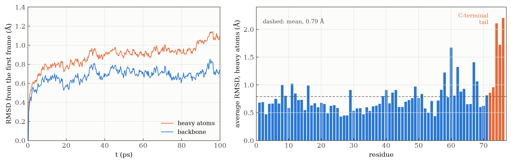

# Ex. 3 — Ubiquitin in a water box

[← Session 08](../) · [Bash guide](../../../docs/bash-for-gaussian.md)

## Task

Ubiquitin, a protein of 76 residues, in a box of water, 100 ps of Langevin dynamics at 300 K with the CHARMM force field. Compute the RMSD of the protein against time and the average RMSD of each residue, and find the most mobile regions.

The exercise is done in class on Wednesday. The data here come from the trajectory provided by the course, analysed in advance; the VMD session will be added when it is done.

## The system and the input

The system is the one of the NAMD tutorial (`ubq_wb.psf`): 7051 atoms, 1231 of the protein and 1940 water molecules, in a box of 38.7 × 40.5 × 43.3 Å.

| Setting | Value |
|---|---|
| Force field | CHARMM22 with the CMAP backbone correction (the 74 cross terms in the log), CHARMM TIP3P water (`par_all27_prot_lipid.inp`) |
| Non-bonded | cutoff 12 Å, switching from 10 Å, pair list 14 Å, no PME |
| 1-4 interactions | not scaled (`1-4scaling 1.0`, the CHARMM convention; AMBER scales them by 1/1.2) |
| Integrator | 1 fs, no `rigidBonds` |
| Thermostat | Langevin, γ = 10 ps⁻¹, 300 K |

The water here is flexible in the usual way, with an O–H spring and an H–O–H angle term. The CHARMM file does have an HT–HT bond, but with a force constant of zero: it exists only for SHAKE.

The log was written by an input named `ubq_wb_eq_OK.namd`, started from restart files (`1_restart_.coor`, `1_restart_.vel`), while the course provides `ubq_md.namd`, `initial.coor` and `initial.vel`. Every parameter printed in the log matches `ubq_md.namd`; only the file names differ.

**The run starts cold.** The first energy line reads 211 K, and the thermostat brings the system to 300 K within 0.3 ps. As in the other exercises, the first 10 ps are left out of the averages.

## Approach

The course provides `residue_rmsd.tcl`, a VMD script from the NAMD tutorial. For every frame, it fits the whole protein onto frame 0, computes the RMSD of the heavy atoms of each residue, and averages it over the trajectory. [`../analyze.py`](../analyze.py) repeats that calculation and adds the RMSD of the whole backbone against time, fitted on the backbone itself, the usual measure of whether the fold is stable: [`rmsd_time.dat`](rmsd_time.dat) and [`rmsd_residue.dat`](rmsd_residue.dat). The reference is the first frame of the `.dcd`, at 0.25 ps, as in the Tcl script.

## Results

- **The fold holds.** The backbone RMSD rises to 0.6 Å in the first 5 ps and then stays between 0.6 and 0.8 Å for the rest of the run. 100 ps is far too short to unfold a protein, but long enough to see that nothing in the starting structure was strained.
- **The heavy atoms keep drifting.** Their RMSD goes from 0.8 Å to 1.1 Å over the run, with no plateau. The side chains keep moving after the backbone has settled: at 88 ps the heavy atoms jump by 0.1 Å and the backbone by half as much.
- **The C-terminal tail is the most mobile part.** Arg74, Gly75 and Gly76 average 2.1, 1.7 and 2.2 Å, three times the mean of 0.79 Å. These are the last residues of the chain, held by no secondary structure. The tail is also where ubiquitin works: Gly76 is the residue that bonds to the lysine of a target protein.
- **Then a loop around residue 60.** Asn60 (1.67 Å), Leu67 (1.41 Å), Gln62 (1.32 Å) and Asp58 (1.22 Å) are the next most mobile residues, all on the surface.

### An open question: the temperature fluctuates too little

In water and in the sodium solution, σ_T/⟨T⟩ matches the canonical √(2/N) within one standard error (see [Ex. 1](../ex1-water/#energy-and-temperature)). Here it does not:

| | σ_T / ⟨T⟩ |
|---|---|
| Measured, 10–100 ps | 0.00887 ± 0.00015 |
| √(2/21153) | 0.00972 |

The measured value is 9 % low, about six standard errors. Three explanations can be ruled out with the data at hand:

- **Not equilibration:** all nine 10-ps blocks are low, from 0.0079 to 0.0094.
- **Not correlation between samples:** the autocorrelation of T after one sample (0.1 ps) is 0.12, so the 900 samples are nearly independent, and the block error is honest.
- **Not the number of degrees of freedom:** KINETIC/TEMP in the log gives back 21153 = 3 × 7051.

What is left differs between the runs: a protein with its stiff bonds and angles, a different force field, and a different NAMD build (2.9b3 with CUDA, against 2.9 and 2.8b3 on CPUs). The cause is not settled yet; it is a question to bring to class.

## Conclusions

- The backbone of ubiquitin stays within 0.8 Å of its starting structure: the fold is stable on this time scale.
- The most mobile region is the C-terminal tail, Arg74–Gly76, followed by the surface loop around Asn60.
- Unlike the two water runs, the temperature fluctuates 9 % less than the canonical prediction, a discrepancy still to be explained.
