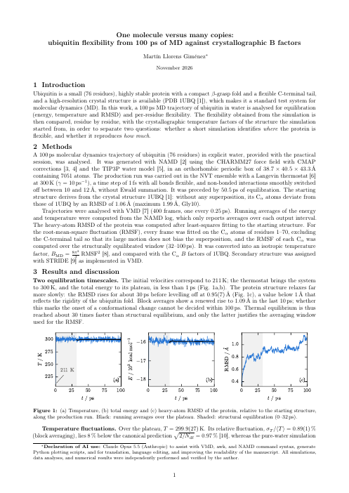
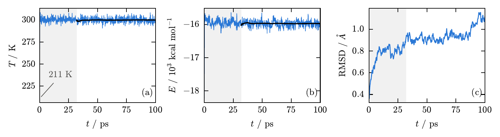
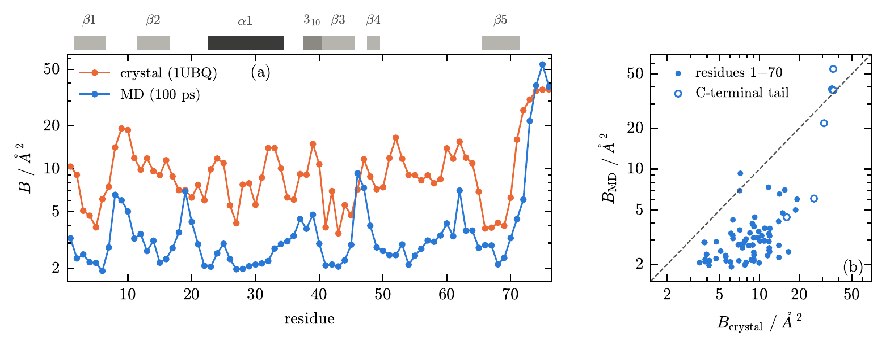

# Case study — one molecule against many copies

[← Session 08](../) · [Ex. 3 — ubiquitin](../ex3-ubiquitin/)

<table>
<tr>
<td width="190"><a href="report.pdf"></a></td>
<td>

### Report: *One molecule versus many copies*
**Ubiquitin flexibility from 100 ps of MD against crystallographic B factors**

The ubiquitin trajectory of Ex. 3, analysed for equilibration and per-residue flexibility, and then set against the crystal it started from. A short simulation finds *where* the protein is flexible only in part, and not *how much*; and a correlation coefficient of 0.82 over the whole chain turns out to be set by six residues.

**[Read the report (PDF, 2 pages)](report.pdf)**

</td>
</tr>
</table>

## The question

A crystal structure reports, for every atom, a temperature factor B: how far it is smeared around its mean position, averaged over the millions of copies of the molecule in the crystal. A molecular dynamics run follows one copy in solution, and its fluctuations can be turned into the same quantity. Do 100 ps of MD tell where ubiquitin is flexible, and how much?

## The path, step by step


## Results



*Figure 1 of the report: (a) temperature, (b) total energy and (c) heavy-atom RMSD of the protein, relative to the starting structure. Black: running averages over the plateau. Shaded: structural equilibration, 0–32 ps.*

| | Value |
|---|---|
| Thermal equilibration (T and E on their plateau) | < 1 ps |
| Structural equilibration (RMSD on its plateau) | about 30 ps |
| RMSD on the plateau | 0.95 ± 0.07 Å |
| σ_T/⟨T⟩ against √(2/N) | 0.89 % against 0.97 % (water: 1.41 % against 1.41 %) |
| ⟨B_cryst⟩/⟨B_MD⟩, residues 1–70 | 2.8 |
| Pearson r, all 76 residues / residues 1–70 | 0.82 / 0.39 |
| Spearman ρ, residues 1–70 | 0.43 |



*Figure 2 of the report: (a) C<sub>α</sub> temperature factors of the crystal (1UBQ) and from the MD RMSF, on a logarithmic scale, where a constant scale factor becomes a vertical shift; the bar marks the secondary structure. (b) B<sub>MD</sub> against B<sub>cryst</sub>; dashed, equality; open symbols, the C-terminal tail.*

- **Two equilibration times.** The temperature and the energy settle within 1 ps, the structure within about 30 ps. Only the second decides where a structural average may start.
- **The tail agrees, the core does not.** The C-terminal tail is the most flexible region in both, with B of 30–50 Ų, and at residues 74–75 the simulation even exceeds the crystal, plausibly because the crystal lattice holds the tail. In the core, B<sub>MD</sub> is 2.8 times smaller: 70 ps sample fast local motions, while a crystal B also holds static disorder and lattice vibrations.
- **One number can hide this.** Over the 76 residues r = 0.82, but six tail residues set it; without them, r = 0.39.
- **The temperature fluctuates 8 % less than the canonical prediction,** while the water run of Ex. 1 matches it: the open question of [Ex. 3](../ex3-ubiquitin/#an-open-question-the-temperature-fluctuates-too-little), now in the report.

## How the work was done

- **The equilibration first, because it sets the window.** The temperature looked equilibrated within a picosecond; the RMSD said otherwise. Averaging the RMSF from 0 ps would have mixed the relaxation of the structure into its fluctuations, so the RMSF is taken over 32–100 ps.
- **The fit excludes the tail.** Each frame is superimposed on the C<sub>α</sub> atoms of residues 1–70 before the fluctuations are measured. Fitting on the whole chain would let the large motion of the tail tilt the superposition and inflate the fluctuations of the core.
- **From RMSF to B.** For isotropic motion, B = (8π²/3) RMSF², which puts both quantities in the units of the crystal.
- **A logarithmic axis.** If the simulation reproduced the shape of the profile but not its size, the two curves would be parallel on a log scale, shifted by a constant. They are not, which is the second half of the answer.
- **Two correlations, and why.** The Pearson coefficient over all residues is dominated by the few largest values. Computing it again without the tail, and adding the rank correlation, is what showed that the agreement over the core is weak.
- **Running averages from the log.** NAMD prints TEMPAVG, which is the average over the last 100 steps, not over the run; the running averages of Figure 1 are computed in Python with a cumulative sum.

## Checked against the trajectory

For this repository the numbers of the report were checked independently, from the trajectory, with the reader of [`analyze.py`](../analyze.py):

- **The RMSF is reproduced** to within 0.01 Å for every residue, with the same fit and window.
- **The RMSD of the text is reproduced exactly.** Against `initial.coor`, the plateau is 0.949 ± 0.068 Å and the last 10 ps average 1.085 Å: the 0.95(7) and 1.09 Å of the report.
- **The 211 K of the first step** is the kinetic energy of velocities taken from an equilibration run with `rigidBonds all`, spread over the 21 153 degrees of freedom of this one: [Ex. 3](../ex3-ubiquitin/#the-system-and-the-input) explains it.
- **Not checked here:** the C<sub>α</sub> RMSD of 1.06 Å between the starting structure and 1UBQ, which needs the coordinates of 1UBQ.

## Known slips in the submitted version

The PDF and its source are kept as they were submitted.

| In the report | From the data |
|---|---|
| Crystal maxima "such as 34–35 or 52" missing from the simulation | The maxima in that region are 32–33 (B = 14.0 Ų) and 39 (15.0 Ų); 34–35 have 10.1 and 6.3. Neither appears in the simulation, so the point stands |
| σ_T/⟨T⟩ = 0.89(1) % "over the plateau" | 0.90(1) % over 32–100 ps; 0.89 % is the value over 10–100 ps |
| RMSD plateau 0.95(7) Å, against Figure 1c | Figure 1c plots the series exported from VMD, which runs 0.02 Å lower (plateau 0.92(6) Å, last 10 ps 1.05 Å) and lacks frame 1. The text values come from the full trajectory, as above |
| Reference 1: "refined at 1.8 å resolution" | `unsrt` lowercases titles; the `.bib` needs `{{\AA}}` to keep the capital |

None of them changes a conclusion.

## Inside the source

The full source is in [`source/`](source/): [`report.tex`](source/report.tex), [`bibliografia.bib`](source/bibliografia.bib), the four data files and [`plot_ubq.py`](source/plot_ubq.py), which draws both figures from them. The comments are in Spanish, as they were written.

- **Running averages in one line:** `np.cumsum(x) / np.arange(1, len(x) + 1)`, the mean of every value seen up to each point.
- **Secondary structure as a bar above the axis.** Each residue becomes a rectangle placed with `get_xaxis_transform()`: x in data units, so it lines up with the residue, and y in axis units, so it sits above the plot whatever the scale.
- **Log axes with plain numbers.** `FixedLocator` and `ScalarFormatter` print 2, 5, 10, 20, 50 instead of powers of ten.

`plot_ubq.py` reproduces Figure 1 and every number of Figure 2. The labels of each secondary-structure element in the submitted Figure 2 (β1 to β5, α1) come from a later version of the script, not yet in the repository.

### Building it

```bash
cd source
python plot_ubq.py
pdflatex report && bibtex report && pdflatex report && pdflatex report
```

## Files

| File | What it is |
|---|---|
| [`report.pdf`](report.pdf) | The report, 2 pages |
| [`preview.png`](preview.png), [`figure1.png`](figure1.png), [`figure2.png`](figure2.png) | First page and the two figures, as images for this page |
| [`source/report.tex`](source/report.tex), [`source/bibliografia.bib`](source/bibliografia.bib) | LaTeX source and bibliography |
| [`source/plot_ubq.py`](source/plot_ubq.py) | Draws both figures and prints the numbers of the text |
| [`source/ubq_ET.dat`](source/ubq_ET.dat) | Step, total energy and temperature, from the NAMD log |
| [`source/ubq_rmsd.dat`](source/ubq_rmsd.dat) | Heavy-atom RMSD per frame, from the VMD RMSD Trajectory Tool |
| [`source/ubq_rmsf_ca.dat`](source/ubq_rmsf_ca.dat) | Residue, name, secondary structure and C<sub>α</sub> RMSF, from VMD |
| [`source/1ubq_bfac_ca.dat`](source/1ubq_bfac_ca.dat) | C<sub>α</sub> B factors of PDB 1UBQ |
| [`source/fig1_ubq_tiempo.pdf`](source/fig1_ubq_tiempo.pdf), [`source/fig2_ubq_bfactors.pdf`](source/fig2_ubq_bfactors.pdf) | The figures as the report includes them |

**Reference.** S. Vijay-Kumar, C. E. Bugg and W. J. Cook, *Structure of ubiquitin refined at 1.8 Å resolution*, J. Mol. Biol. **1987**, 194, 531–544.
